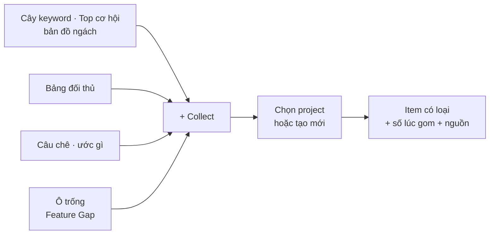

# Phase 21 · Collect niche vào Project

> Thấy gì đáng giữ ở **bất cứ chỗ nào** — keyword, ngách, đối thủ, câu chê, ô trống tính năng — bấm 1 lần là vào
> project, kèm số liệu lúc đó và nguồn. Gom nhanh, không mất dấu.

Xong 2026-10-26 · 5 loại item · gom ở 6 chỗ + phím C · 100 keyword / 239 ms, gom lại 0 dòng trùng · migration chung 0019 không mất dòng

**Hiện có (Phase 8).** Nút **+ Collect** (popover) ở kết quả Research / Explore gom niche hoặc long-tail vào một project,
copy được danh sách. Mới gom được keyword / niche, từng cái một, không ghi số lúc gom.

**Cần xong trước:** [Phase 8](phase-8-project-data.md) (project + `.niche.json`) · [Phase 18](phase-18-competitor-complaints.md) (lời chê để gom)

## Chạy thế nào

## Làm gì

| | |
|---|---|
| :material-shape: **5 loại item** | keyword · niche · đối thủ · lời chê / ước gì · khoảng trống tính năng. Mỗi loại có icon + cột riêng trong project |
| :material-gesture-tap: **Collect ở mọi chỗ** | cây keyword, bảng Top cơ hội, bản đồ ngách, bảng đối thủ, khối Đối thủ bị chê gì, ô Feature Gap "không ai có" |
| :material-checkbox-multiple-marked: **Gom hàng loạt** | tick nhiều dòng → Collect 1 lần (VD 20 long-tail từ cây keyword) |
| :material-folder-plus: **Chọn project nhanh** | popover nhớ project dùng gần nhất, gõ tên để tìm, tạo project mới ngay trong popover |
| :material-camera: **Chụp số lúc gom** | item tự lưu điểm cơ hội, số đối thủ, rating, giá… và lượt Research / Explore gốc + ngày — mở lại thấy vì sao đã gom |
| :material-note-edit: **Ghi chú 1 dòng** | ô ghi chú tuỳ chọn ngay lúc gom ("long-tail cho bản Mac") |
| :material-content-duplicate: **Không trùng** | cùng item cùng project → báo "đã có" + cập nhật số mới, không thêm dòng |
| :material-undo: **Hoàn tác** | thanh báo "Đã thêm 20 vào Project X · Hoàn tác" |
| :material-keyboard: **Phím tắt** | đang chọn dòng trong bảng → bấm `C` mở Collect (gom nhanh khi lướt bảng dài) |

**Luật**

- Item giữ khoá ULID + nguồn gốc, đi theo gói `.niche.json` (nhập máy khác không nhân đôi — như Phase 8)
- Số chụp lúc gom không bị ghi đè khi tra lại; số mới nằm ở [Phase 42](phase-42-tracking.md)
- **Một migration chung cho Phase 21 + 22**: thêm luôn cột / bảng Phase 22 cần (thẻ, lưu trữ, bước tiếp, trạng thái +
  lý do + thứ tự item, nhật ký) để DB thật chỉ nâng 1 lần, backup 1 lần, test round-trip `.niche.json` 1 lần. Phase 22
  chỉ làm logic + UI trên schema đã có

**Xong khi**

- Gom được từ đủ 6 chỗ ở trên, mỗi loại hiện đúng cột trong project
- Gom 20 keyword 1 lần < 2 giây; gom lại → 0 dòng trùng
- Xuất / nhập project vẫn đủ item + số chụp (test round-trip)
- DB thật lên schema chung 14 + 15, 0 dòng mất (đếm trước / sau)
- Test xanh, screenshot popover + project đã Read

**Không làm ở phase này**

- Sắp xếp, lọc, gộp project — [Phase 22](phase-22-project-manage.md) (cột cho Phase 22 thêm sẵn ở migration chung, chưa có UI)
- Đồng bộ project lên mạng — [Backlog 04](phase-backlog-04-project-sync.md)

## Kết quả (2026-10-26)

- **Migration chung 21 + 22** (`0019_hoan_thien_web`): bản sao DB thật trước / sau — projects 2 → 2, project_items 8 → 8, runs 32, apps 1.890,
  decisions 2; mọi item có `uid` + khoá; tự backup `niche-before-migrate-19-to-20-….db` trước khi nâng.
- **Gom ở đủ 6 chỗ**: cây keyword + bảng keyword Explore (keyword), Top cơ hội + "Collect N ngách ô Cơ hội" của bản đồ ngách (niche),
  bảng Đối thủ (competitor), cụm lời chê + "ước gì" (complaint), hàng Khoảng trống / Định vị của Feature Gap (gap). Nút ở trang Research
  + bảng keyword vẫn như cũ.
- **Hàng loạt**: "+ Collect N keyword đang hiện" (theo nhóm / ô lọc đang chọn) và "+ Collect N" ở thanh keyword đã tick. Đo trên dev server
  bản sao DB thật: **100 keyword trong 239 ms**; gom lại cùng 100 → "100 đã có — đã cập nhật số mới", 0 dòng thêm.
- **Popover**: project dùng gần nhất lên đầu (ghi "gần nhất"), ô tìm khi > 5 project, tạo project mới + thêm 1 lần, ghi chú 1 dòng.
  **Thanh báo** "Đã thêm N vào X · Hoàn tác". **Phím C** khi rê chuột / đang chọn dòng (bỏ qua khi đang gõ).
- **Số chụp lúc gom** (`snapshot`) giữ nguyên khi gom lại; số mới vào `latest` (trang project hiện dòng "mới: …"). Keyword / niche: điểm v2 mới
  nhất + số Explore; đối thủ: ★, số rating, tiền, lượt cài; lời chê: số review, loại, 3 câu trích; khoảng trống: có / tổng app.
- `.niche.json` mang đủ loại item, số chụp, ghi chú, trạng thái + lý do; gói cũ (không có `kind`) nhập thành keyword. Test round-trip.
- Theo dõi định kỳ, Bàn quyết định, Description, tra lại project chỉ dùng item keyword / niche (`ProjectView.items`); `all` = mọi loại.

Plan code chi tiết: [Phase 21](../superpowers/plans/2026-10-25-niche-radar-phase14-collect.md)
