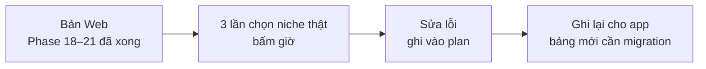

# Phase 22 · Review Version 3

> Dùng Version 3 **chọn niche thật 3 lần** ở bản Web, sửa lỗi gặp phải. Phần gói vào app Mac tách sang
> [Phase 22b · Local App 3.0](../app/phase-22b-local-app-3.md) — làm ở mục App, **sau khi hết phase Web**.

Chưa làm · sau Phase 21

## Chạy thế nào

## Làm gì

| | |
|---|---|
| :material-timer-outline: **3 lần chọn thật** | mỗi lần: so 3 niche → so 4 đối thủ → báo cáo → evidence pack. Bấm giờ, mục tiêu ≤ 30 phút |
| :material-bug-check: **Sửa lỗi** | lỗi gặp khi chọn thật → sửa ở bản Web |
| :material-database-outline: **Ghi cho app** | liệt kê bảng mới (bộ so sánh, lịch sử hỏi, kết quả kiểm trích dẫn) để Phase 22b viết migration |

**Xong khi**

- 3 lần chọn thật xong, ≥ 2 lần ≤ 30 phút, mỗi lần có evidence pack
- So 3 niche + hỏi 1 câu + xuất 1 báo cáo chạy được trên bản Web, test xanh

**Không làm ở phase này**

- Tính năng mới (chỉ soát những gì Phase 18–21 đã xong)
- Gói app Mac → [Phase 22b](../app/phase-22b-local-app-3.md)

