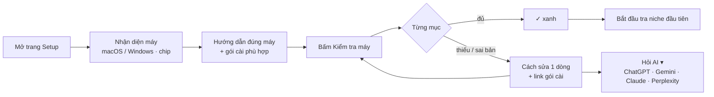

# Phase 24 · Setup ngay trong Web

> Máy người dùng có thể **thiếu đồ cài** (Node, gói dịch, key AI…). Thay vì bắt đọc README, tool có sẵn
> **trang Setup**: hướng dẫn đúng máy đó, **nút Kiểm tra máy** báo cái gì đủ / thiếu, kèm **gói cài phù hợp**.
> Kẹt chỗ nào thì có nút nhỏ **Hỏi AI** — xổ ra ChatGPT · Gemini · Claude · Perplexity, câu hỏi soạn sẵn.

Xong 2026-10-26 · /setup kiểm 12 mục trong 0,7 s · Hỏi AI 4 AI, đã che dữ liệu riêng · trang Setup máy tĩnh

## Chạy thế nào

## Hai lớp — vì máy chưa có Node thì web local chưa chạy được

| | |
|---|---|
| :material-file-document-outline: **Lớp 1 · Trang Setup tĩnh** | nằm trên trang docs / landing — mở được khi máy **chưa cài gì**; tự nhận macOS / Windows, chip Apple / Intel; hiện đúng bộ bước + link gói cài cho máy đó |
| :material-stethoscope: **Lớp 2 · Kiểm tra máy trong tool** | trang `/setup` trong bản Web; server đọc phiên bản thật trên máy và trả từng mục đủ / thiếu |

## Mục kiểm

**Bắt buộc (bản web)**

- **Node.js** — kiểm `node -v` ≥ 20.19 (Vite 8 đòi) · thiếu thì link bộ cài Node LTS đúng máy
- **npm** — kiểm `npm -v` · đi kèm Node
- **Gói dịch native (better-sqlite3)** — mở thử DB SQLite · macOS: `xcode-select --install`, Windows: Build Tools
- **Cổng 3200 / 3201** — cổng còn trống · bận thì đổi `PORT=… API_PORT=…`
- **Mạng tới Google Play / App Store / Trends** — gọi thử 1 lượt nhỏ mỗi nguồn · báo nguồn nào bị chặn, đợi 10–30 phút

**Tuỳ chọn**

- **Key Claude API** — gọi thử 1 câu rẻ nhất · dẫn sang Cài đặt AI (Phase 6)
- **Claude in Chrome** — chỉ hướng dẫn (tool không đọc được trình duyệt) · link cài extension

## Làm gì

| | |
|---|---|
| :material-monitor-cellphone: **Nhận diện máy** | hệ điều hành + chip từ trình duyệt (lớp 1) hoặc server (lớp 2) — không hỏi người dùng |
| :material-package-down: **Gói cài phù hợp** | mỗi mục thiếu có đúng 1 link chính chủ cho máy đó (nodejs.org, developer.apple.com…), không gói lại đồ người khác |
| :material-check-decagram: **Nút Kiểm tra máy** | API `GET /api/setup/check` → danh sách mục `ok / thiếu / sai bản` + 1 dòng cách sửa; bấm lại sau khi cài |
| :material-robot-outline: **Hỏi AI ▾** | nút nhỏ cạnh mỗi mục lỗi; bấm xổ ra ChatGPT · Gemini · Claude · Perplexity, mở tab mới với câu hỏi soạn sẵn (máy, phiên bản, dòng lỗi) |
| :material-content-copy: **Copy câu hỏi** | AI nào không nhận câu hỏi qua link (Gemini) → copy sẵn vào clipboard rồi mở trang |
| :material-shield-lock-outline: **Che dữ liệu riêng** | câu hỏi gửi AI chỉ có OS, phiên bản, dòng lỗi — **bỏ** đường dẫn máy, tên user, key |

## Nút Hỏi AI — trông thế nào

- Nút nhỏ `Hỏi AI ▾` ở cuối dòng lỗi, không che nội dung.
- Bấm → menu dọc 4 dòng, mỗi dòng logo + tên. Bấm lại hoặc bấm ra ngoài thì đóng.
- Câu hỏi mẫu: *"Tôi dùng macOS 15 chip Apple. Cài ShotMatic báo: `<dòng lỗi>`. Node hiện tại 18.20. Sửa thế nào, từng bước?"*
- Dùng chung một component `AskAi` để Phase 45 và các trang lỗi khác gắn lại được.

**Xong khi**

- Máy Mac sạch (chưa Node) mở trang Setup tĩnh → làm theo → chạy được tool, không cần đọc README
- Kiểm tra máy báo đúng 3 tình huống thật: thiếu Node · Node cũ · thiếu Command Line Tools
- Nút Hỏi AI mở đủ 4 AI, câu hỏi không chứa đường dẫn máy / key
- Screenshot trang Setup + menu Hỏi AI đã Read

**Không làm**

- Tự cài hộ (chạy installer, `sudo`) — chỉ hướng dẫn + kiểm
- Gọi API của ChatGPT / Gemini trong tool — chỉ mở trang web của họ
- Linux — khi có người dùng xin

## Kết quả (2026-10-26)

- **Lớp 1 · trang tĩnh** [Setup máy](../setup.md): đoán macOS / Windows + chip Apple / Intel từ trình duyệt, chỉ hiện bước của máy đó
  (đoán không ra → hiện cả hai). Link cài chỉ nodejs.org + developer.apple.com. Thử trên Mac chip Apple: hiện "macOS · chip Apple", ẩn bước Windows.
- **Lớp 2 · `/setup`** (menu Thêm → Setup · kiểm tra máy), API `GET /api/setup/check`: 12 mục chia 3 nhóm Máy · Nguồn dữ liệu · AI (tuỳ chọn),
  mỗi mục đủ / thiếu / sai bản / lỗi / tuỳ chọn + 1 dòng cách sửa + link chính chủ. App Mac bỏ qua mục Node / npm / Command Line Tools của Terminal.
- **Chạy thật trên máy dev** bắt đúng 1 tình huống thật: tool chạy Node 22.19, nhưng `node` trong Terminal là **18.16** → báo "sai bản, cần ≥ 20.19".
  3 tình huống thiếu Node · Node cũ · thiếu Command Line Tools + nguồn bị chặn 429 kiểm bằng test (lệnh giả).
- **Nhanh**: lần đầu viết tuần tự mất **33 s** (kiểm AI còn hỏi thử 1 câu — tốn lượt). Sửa: mọi mục chạy song song, AI chỉ tìm CLI + kiểm đăng nhập
  (không hỏi thử) → **0,7 s**.
- **Hỏi AI ▾** (`AskAi`, dùng lại được): ChatGPT · Claude · Perplexity mở tab với câu soạn sẵn; Gemini copy câu hỏi rồi mở trang. Câu hỏi qua
  `scrub()`: bỏ `/Users/<tên>`, `C:\Users\<tên>`, key (`sk-…`, `AIza…`, `ghp_…`), email. Đóng bằng Esc / bấm ra ngoài.
- Xem 1340 + 375 (375 không cuộn ngang). Test: `tests/setup-check.test.ts` (7).

**Chưa làm được:** thử trên máy Mac sạch thật (user macOS mới, chưa Node) — cần anh tạo user mới hoặc máy khác; ghi ở phiếu soát Phase 26.

Plan code chi tiết: [Phase 24](../superpowers/plans/2026-10-25-niche-radar-phase30-1-setup.md)
