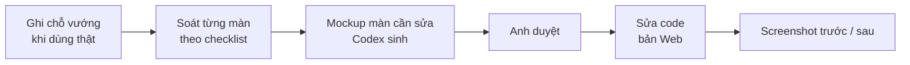

# Phase 25 · UI / UX Improvement

> Làm cho tool **dễ dùng hơn** dựa trên chỗ vướng thật — ít bấm hơn, đọc nhanh hơn, không lạc.

Xong 2026-10-26 · 10 chỗ soát · 4 sửa · 6 không cần sửa / để sau có lý do · 12 màn × 4 cỡ không cuộn ngang

## Cách chạy

## Soát gì

| | |
|---|---|
| :material-map-marker-path: **Luồng chính** | gõ niche → ra quyết định mất mấy bước, chỗ nào phải đoán |
| :material-progress-clock: **Trạng thái** | đang tải · rỗng · lỗi · bị chặn — màn nào thiếu |
| :material-table-eye: **Bảng dày** | keyword, matrix, đối thủ — đọc được ở cửa sổ app nhỏ không |
| :material-theme-light-dark: **Sáng / tối** | đủ tương phản cả hai chế độ |
| :material-keyboard: **Bàn phím + đọc màn hình** | dùng được không cần chuột |
| :material-monitor-cellphone: **Cỡ màn** | 1280 · 1340 · 375 |

**Xong khi**

- Danh sách chỗ vướng có trạng thái từng mục (sửa / bỏ + lý do)
- Mỗi màn sửa có screenshot trước / sau đã Read ở bản Web

**Không làm**

- Thêm tính năng mới (ghi sang Phase 9)
- Đổi hết giao diện vì thích — chỉ sửa chỗ có vướng thật

## Kết quả (2026-10-26)

Soát tự động 12 màn (`/`, Explore, 2 trang Research, 1 Explore, Projects, 1 Project, Cài đặt, Gap hỏi đáp, Hướng dẫn, About, Setup) ở 4 cỡ
375 · 1009 · 1280 · 1340 (đo `scrollWidth` + phần tử tràn), quét nút / ô nhập không có tên đọc màn hình, đo tương phản token màu, đi bàn phím
trang chủ. Dev server + bản sao DB thật.

**Luồng chính:** gõ niche → Enter → trang kết quả có ngay gợi ý BUILD / TEST THÊM / BỎ ở đầu trang (Phase 23) = **2 thao tác, không cuộn**
(trước Phase 23: phải cuộn qua 6 khối tới Sức khoẻ niche hoặc bấm "Chấm sức khoẻ niche").

### Danh sách chỗ vướng

**1 · Header tràn ở cửa sổ 900–1150px** — mặt: cỡ màn. Bằng chứng: ở 1009px mọi trang `scrollWidth` 1049 (nút "Tra niche mới" lòi ra 40px).
→ **Sửa**: khép khoảng cách header / menu ở ≤ 1150px. Sau: 994 = vừa khít (ảnh sau: `design/ui-25/header-after-1009.png` trong repo code).

**2 · Chữ phụ quá nhạt** — mặt: tương phản. `text-zinc-400` (#9f9fa9) chỉ **2,46:1** trên nền, dùng 72 chỗ cho chữ thật ("chưa đo", "chưa có",
"ước lượng từ các lần trước", nút Xoá…). → **Sửa**: đổi sang `zinc-500` (**4,53:1**, đạt AA); dấu "—" chỗ trống cũng vậy. Test
`ui-contrast.test.ts` chặn dùng lại (trừ ký hiệu trang trí `aria-hidden`).

**3 · Bảng nhật ký AI ở Cài đặt tràn 9px trên điện thoại 360px** — mặt: bảng dày. → **Sửa**: bảng cuộn trong khối.

**4 · Kiểm tra máy chờ 33 giây** — mặt: trạng thái. → **Sửa** (ở Phase 24): chạy song song, AI chỉ kiểm đăng nhập → 0,7 s.

**5 · Research 1 keyword và Explore niche trông như nhau** — mặt: luồng chính. → **Để sau**: đã có plan riêng
[Tách Research / Explore](../superpowers/plans/2026-10-26-niche-radar-tach-research-explore.md) chờ anh duyệt; sửa ở đây là làm lén ngoài plan.

**6 · Chế độ tối** — mặt: sáng / tối. App chỉ có giao diện sáng; chế độ sáng đạt AA sau mục 2. → **Bỏ ở phase này**: thêm chế độ tối là tính
năng mới (luật "không thêm tính năng") → ghi [Appendix](../appendix.md).

**7 · Bàn phím** — Tab trang chủ đi đúng thứ tự: Đến nội dung → logo → 6 mục menu → Ngôn ngữ → Tra niche mới → Hướng dẫn → ô tra. Menu Thêm
mở bằng mũi tên, đóng bằng Esc; mọi nút có viền focus cam 3px. → **Không cần sửa**.

**8 · Tên cho đọc màn hình** — 7 màn chính, 4.672 nút / link / ô nhập: **0** cái thiếu tên. → **Không cần sửa**. VoiceOver đọc thật **chưa thử**
(cần người nghe) → phiếu soát Phase 26.

**9 · Cỡ màn 375 / 1280 / 1340** — sau mục 1 + 3: 12 màn × 4 cỡ không màn nào cuộn ngang. → **Không cần sửa**.

**10 · Trạng thái đang tải / lỗi / bị chặn** — đã làm ở Phase 23 (4 mức + lý do thường + chạy lại từng nguồn, có test fixture) và Phase 24.
→ **Không cần sửa thêm**.

Plan code chi tiết: [Phase 25](../superpowers/plans/2026-10-25-niche-radar-phase29-ui-ux.md)
