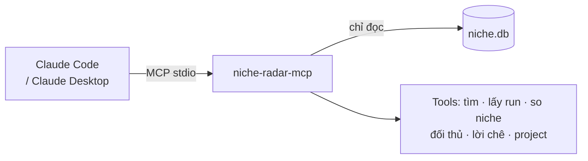

# Phase 27.3 · MCP của app (Claude đọc dữ liệu)

> Một MCP server nhỏ (`niche-radar-mcp`) để **Claude tự đọc DB** của tool: tìm niche đã tra, so nhiều niche, viết báo
> cáo trong `research/*.md` — không phải xuất file rồi dán tay.

Xong đợt 1 · 2026-10-26 — kết quả ở Phase 27 mục 26.3

**Gộp vào [Phase 27](../app/phase-27-ai-cua-ban.md) (2026-10-26)** — làm theo trang đó; trang này giữ để tra chi tiết.

**Hiện có.** Chưa có. Ứng viên "MCP của app" ở [Phase 9](phase-9-small-features.md). Hiện muốn Claude đọc dữ liệu phải
xuất evidence pack / gói LLM ([Phase 15](phase-15-export.md)) rồi dán.

## Chạy thế nào

## Làm gì

| | |
|---|---|
| :material-tools: **Tools chỉ đọc** | `search_niches` · `get_research` · `get_explore` · `list_projects` / `get_project` · `get_competitor` · `get_complaints` · `compare_niches` (dùng cùng logic so sánh khi có) |
| :material-format-quote-close: **Trả kèm nguồn** | mọi kết quả có id lượt tra, ngày, link nguồn — Claude trích lại được |
| :material-database-lock: **Chỉ đọc** | mở SQLite chế độ read-only; không có tool ghi / xoá ở phase này |
| :material-file-document: **Cài 1 lệnh** | `claude mcp add niche-radar -- node mcp/server.js` (hoặc tương đương), ghi ở trang Cách dùng |
| :material-script-text: **Quy trình mẫu** | 3 câu lệnh mẫu: "so 3 niche đã tra tuần này", "viết research/<niche>.md từ dữ liệu", "đối thủ nào bỏ bê trong project X" |

**Luật**

- Không lộ key, đường dẫn máy, ghi chú riêng của anh nếu không được hỏi
- Kết quả giới hạn kích thước (cắt + báo "còn X dòng") để không tràn ngữ cảnh

**Xong khi**

- Claude Code gọi được mọi tool trên DB thật; 3 câu lệnh mẫu ra kết quả đúng số (kiểm tay với UI)
- Test cho từng tool (fixture DB); thử ghi qua MCP → bị chặn

**Không làm ở phase này**

- Tool ghi (tạo project, collect) qua MCP — plan ở [Phase 28.2](phase-28-2-mcp-write.md)
- Hỏi dữ liệu bằng lời ngay trong UI — [Phase 27.4](phase-27-4-ai-cite-ask.md)

Plan code chi tiết: [Phase 27.3](../superpowers/plans/2026-10-25-niche-radar-phase26-mcp.md)
