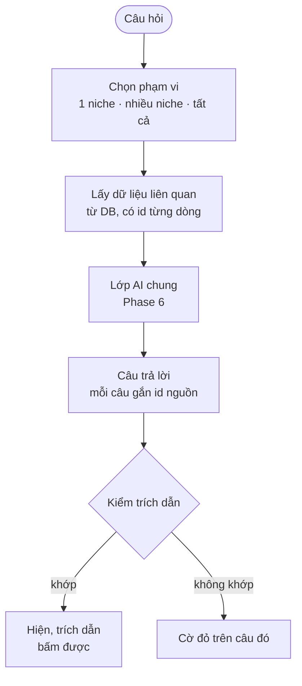

# Phase 27.4 · Hỏi dữ liệu (AI Cite)

> Gõ câu hỏi bằng lời thường. AI trả lời **chỉ từ dữ liệu đã cào**, câu nào cũng có **trích dẫn bấm được**.
> Phase này cũng dựng **lớp kiểm trích dẫn** dùng chung cho Phase 39.

Backlog · làm sau · 2026-10-27

**Đẩy vào Backlog (chốt 2026-10-27):** hỏi dữ liệu bằng lời đã chạy được qua khung chat (Phase 27 mục 26.4) + MCP chỉ đọc
(27.3) — mọi số kèm nguồn. Phần còn lại ở trang này (bài thử 20 câu, lớp kiểm trích dẫn riêng) chỉ là đo lại, không thêm
gì cho người dùng → không làm trước bản bán. Trang giữ lại để tra.

**Gộp vào [Phase 27](../app/phase-27-ai-cua-ban.md) (2026-10-26)** — làm theo trang đó; trang này giữ để tra chi tiết.

## Chạy thế nào

## Làm gì

| | |
|---|---|
| :material-chat-question: **Ô hỏi** | trên màn niche và màn so sánh. Ví dụ sẵn: "niche nào ít đối thủ mà than nhiều?", "app nào bị chê về giá?", "keyword nào lên trong 12 tháng?" |
| :material-database-search: **Lấy dữ liệu** | không đưa cả DB cho AI. Tìm dòng liên quan (keyword, đối thủ, review, chủ đề) rồi gửi kèm **id từng dòng** |
| :material-format-quote-close: **Trích dẫn** | mỗi câu trả lời gắn id nguồn → UI đổi thành link: review, video + mốc giây, listing, ô bảng so sánh |
| :material-shield-check: **Kiểm trích dẫn** | (lớp dùng chung) với mỗi trích dẫn: id có thật không · câu nguyên văn có **đúng chữ** trong nguồn không · con số có **bằng** số trong DB không. Không qua → cờ đỏ |
| :material-history: **Lịch sử hỏi** | lưu câu hỏi + trả lời + kết quả kiểm, xem lại được, không gửi lại cho AI |

## Chọn tuyến AI

Dùng lại tuyến đã chọn ở [Phase 6](phase-6-ai-web.md). Bài thử chuẩn: **20 câu hỏi** trên 3 niche, chấm:

| Đo | Đạt khi |
|---|---|
| Trích dẫn qua kiểm | ≥ 95% |
| Câu không có trích dẫn | 0 |
| Câu "chưa có dữ liệu" khi đúng là thiếu | đủ, không đoán |
| Chi phí mỗi câu hỏi | dưới trần đặt sẵn |

**Luật AI** (thêm vào luật Phase 6)

- Chỉ đọc dữ liệu gửi kèm, không lên web
- Số nào AI viết ra mà không có trong DB → cờ đỏ, dù số đó "nghe hợp lý"
- Tắt AI → ô hỏi ẩn, phần còn lại chạy bình thường

**Xong khi**

- Bài thử 20 câu đạt cả 4 dòng ở bảng trên
- Cố tình sửa 1 câu trích trong DB → câu trả lời cũ bị cờ đỏ khi kiểm lại
- Kiểm trích dẫn có test riêng (khớp, sai chữ, sai số, id không tồn tại)

**Không làm ở phase này**

- Chat nhiều lượt có trí nhớ dài
- AI lên web tìm thêm, đọc trang ngoài DB
- AI sửa / ghi vào DB

Plan code chi tiết: [Phase 27.4](../superpowers/plans/2026-10-25-niche-radar-phase38-ai-cite-ask.md)
