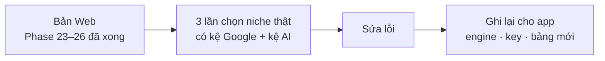

# Phase 27 · Review Version 4

> Dùng Version 4 **chọn niche thật 3 lần** có kệ Google + kệ AI ở bản Web, sửa lỗi. Phần gói vào app Mac tách sang
> [Phase 59 · Local App 4.0](../app/phase-59-local-app-4.md) — làm ở mục App, **sau khi hết phase Web**.

Chưa làm · sau Phase 26

## Chạy thế nào

## Làm gì

| | |
|---|---|
| :material-timer-outline: **3 lần chọn thật** | mỗi lần: so 3 niche có 2 cột kệ → chọn 1 → xuất gói GEO → chạy `geo.py` làm mốc. Ghi chi phí AI mỗi lần |
| :material-bug-check: **Sửa lỗi** | sửa ở bản Web |
| :material-database-outline: **Ghi cho app** | bảng mới (top 10, câu trả lời AI, điểm kệ) + key cần cất (API tìm kiếm, Gemini) để Phase 59 làm |

**Xong khi**

- 3 lần chọn thật xong, mỗi lần có gói GEO đã chạy `geo.py` làm mốc, chi phí dưới trần
- Tra kệ Google + kệ AI cho 1 niche chạy được trên bản Web, test xanh

**Không làm ở phase này**

- Tính năng mới (chỉ soát những gì Phase 23–26 đã xong)
- Gói app Mac → [Phase 59](../app/phase-59-local-app-4.md)

