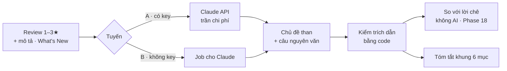

# Phase 28.1 · Tóm tắt niche + chủ đề than (AI)

> AI đọc review thay mình — đã chạy được qua job Claude (tuyến B). Phase này đưa nó lên mức **dùng hằng ngày**:
> chạy 1 bấm khi có key, tóm tắt theo khung cố định, kiểm chéo với lời chê không AI, mọi câu có trích dẫn đã kiểm.

Chưa làm · plan 2026-10-25

**Gộp vào [Phase 28](../app/phase-28-ai-tinh-nang.md) (2026-10-26)** — làm theo trang đó; trang này giữ để tra chi tiết.

**Hiện có (Phase 6 + 9).** Tuyến B (job `.json` → Claude in Chrome / Claude Code → nhập lại) chạy thật 5 niche: 47 chủ
đề, mọi câu khớp nguyên văn, tóm tắt 5 câu có trích dẫn. Tuyến A (Claude API) đã code, **chưa chạy thật — chờ key**.
Mức nặng chủ đề ×3 / ×2 / ×1 ở Phase 9. Code còn tuyến Ollama (model trên máy) nhưng Bước 0 Phase 6 đo thấy kém → **không
dùng ở phase này**; thử lại tuyến miễn phí ở [Phase 27.6](phase-27-6-ai-settings.md).

**Cần xong trước:** [Phase 6](phase-6-ai-web.md) (tuyến A / B) · [Phase 18](phase-18-competitor-complaints.md) (cụm để kiểm chéo + lịch sử review)

**Chia 2 phần để không bị chặn vì key.** Phần 1 làm hết bằng tuyến B (job), không cần key: khung 6 mục, kiểm trích dẫn,
kiểm chéo, chỉ gửi review mới, lịch sử. Phần 2 chỉ là đo tuyến A khi anh thêm `ANTHROPIC_API_KEY`. Xong phần 1 là phase
lên chip **"Code xong · tuyến A chờ key"** (như Phase 4, 6).

## Chạy thế nào

## Làm gì

| | |
|---|---|
| :material-key: **Chạy tuyến A thật** (phần 2) | khi có `ANTHROPIC_API_KEY`: đo token + tiền + thời gian trên 3 niche, ghi bảng; so chất lượng với tuyến B cùng dữ liệu |
| :material-cash-clock: **Báo giá trước khi bấm** | tuyến A: ước token + tiền **trước khi gửi** ("~42k token · ~$0,15"), anh bấm mới chạy; trần chi phí vẫn chặn sau |
| :material-format-list-checks: **Tóm tắt khung cố định** | 6 mục: ai dùng · đau gì nhất · đối thủ yếu chỗ nào · ai đang thu tiền · khoảng trống nên làm · rủi ro. Mục nào thiếu dữ kiện ghi "chưa đủ dữ liệu", không bịa |
| :material-check-decagram: **Trích dẫn đã kiểm** | mỗi câu tóm tắt ≥ 1 trích dẫn; hiện tỉ lệ khớp nguyên văn (VD 22/22); câu trượt kiểm bị gạch, không ẩn |
| :material-compare-horizontal: **Kiểm chéo** | chủ đề AI ↔ cụm lời chê không AI ([Phase 18](phase-18-competitor-complaints.md)): chủ đề AI không có cụm nào đỡ → gắn "chỉ AI thấy, nên kiểm" |
| :material-translate: **Review nhiều thứ tiếng** | review không phải tiếng Anh vẫn gom chủ đề; câu trích giữ nguyên văn gốc, tên chủ đề tiếng Việt |
| :material-cached: **Chỉ chạy phần mới** | dùng lịch sử review đã thấy của [Phase 18](phase-18-competitor-complaints.md); tra lại chỉ gửi review mới, ghép với chủ đề cũ |
| :material-history: **Lịch sử bản tóm tắt** | giữ các lần tóm tắt theo ngày, xem chủ đề nào mới xuất hiện |

**Luật AI** (giữ như Phase 6)

- AI **không đưa số** — số chỉ từ collector; AI chỉ đọc chữ và trả trích dẫn
- Có trần chi phí mỗi lần tra; vượt trần thì dừng và báo, không chạy tiếp
- Tắt AI thì mọi tính năng khác vẫn chạy

**Xong khi — phần 1 (không cần key, đủ để qua phase)**

- 3 niche có tóm tắt đủ 6 mục qua tuyến B, ≥ 95% câu trích khớp nguyên văn
- Tra lại 1 niche sau 7 ngày (giả lập) chỉ đưa review mới vào job (đếm review trong job chứng minh)
- Kiểm chéo gắn đúng nhãn "chỉ AI thấy" trên ≥ 1 niche thật
- Test xanh (kiểm trích dẫn, ghép cache, báo giá), screenshot đã Read

**Xong khi — phần 2 (khi có key)**

- Bảng tuyến A vs B trên 3 niche: chất lượng · thời gian · tiền (có số đo + ngày); báo giá trước khi bấm lệch ≤ 30% so với thật

**Không làm ở phase này**

- Hỏi dữ liệu bằng lời — [Phase 27.4](phase-27-4-ai-cite-ask.md)
- Thêm / thử lại tuyến AI khác (Gemini, OpenAI, AI trong trình duyệt, Ollama) — [Phase 27.6](phase-27-6-ai-settings.md)

Plan code chi tiết: [Phase 28.1](../superpowers/plans/2026-10-25-niche-radar-phase17-ai-summary.md)
