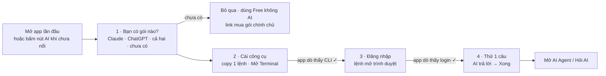

# Phase 28.17 · Quick Setup — tour nối Claude / ChatGPT trong 3 phút

> Hôm nay người mua PRO muốn dùng AI phải tự biết: cài Claude Code hay Codex, gõ lệnh gì trong Terminal, đăng nhập ra sao.
> Trang `/setup` (Phase 24) chỉ **báo** thiếu gì, và nút AI báo lỗi "chưa cài / chưa đăng nhập". Người không rành Terminal
> kẹt ngay đó. Phase này thêm **Quick Setup**: một tour từng bước, mỗi bước 1 việc, app **tự tick xanh** khi xong —
> người dùng chỉ copy 1 lệnh, dán, đăng nhập bằng trình duyệt.

Code xong 2026-10-31 · thử thật Claude Code trên máy dev · cửa sổ lần đầu chưa soát mắt

## Mục tiêu · cần làm · KHÔNG làm

- **Mục tiêu:** người có gói Claude (Pro / Max) hoặc gói ChatGPT (Plus / Pro), chưa từng mở Terminal, nối được AI vào
  ShotMatic trong **≤ 5 phút** mà không đọc README, không hỏi ai.
- **Cần làm:**
    - Tour **Quick Setup** 4 bước (trang `/quick-setup` + cửa sổ nổi lần đầu mở app).
    - Mỗi bước có 1 lệnh copy sẵn đúng máy (macOS / Windows), nút **Mở Terminal**, và app **tự dò lại** mỗi 3 giây → tick xanh.
    - Mỗi bước có link **Xem hướng dẫn trên web →** (ảnh + video). Chưa có trang web thì nút xám ghi "Hướng dẫn web · sắp có".
    - Mọi chỗ AI báo "chưa cài / chưa đăng nhập" đổi thành nút **Quick Setup** mở đúng bước còn thiếu.
- **KHÔNG làm:**
    - Không tự cài hộ, không chạy `sudo`, không chạy installer thay người dùng — chỉ đưa lệnh + kiểm.
    - Không nhập mật khẩu, không đọc / lưu token đăng nhập của Claude / ChatGPT. Đăng nhập luôn ở trang của họ.
    - Không bán gói AI, không link affiliate. Link mua gói = trang chính chủ claude.com / chatgpt.com.
    - Không thêm Gemini CLI, OpenCode, key API riêng vào tour (vẫn ở Cài đặt → AI như cũ).
    - Không viết trang hướng dẫn web trong phase này — chỉ chừa chỗ link (trang web làm ở Phase 46.x).
    - Không đổi luật Free / PRO: AI vẫn là PRO (Phase 33.2). Free vẫn xem được tour, bước cuối ghi rõ AI chạy ở PRO.

## Tour trông thế nào

Màn tour xếp **1 cột dọc**: thanh tiến độ `1 · 2 · 3 · 4` ở đầu, rồi đúng 1 bước đang làm. Bước xong thu thành 1 dòng
"✓ Đã cài Claude Code 2.x". Mỗi bước có 3 nút cố định: **Copy lệnh** · **Mở Terminal** · **Xem hướng dẫn trên web →**,
và nút nhỏ **Kẹt? Hỏi AI ▾** (dùng lại `AskAi` của Phase 24, câu hỏi đã che dữ liệu riêng).

## Bốn bước

**1 · Bạn có gói nào?**

- Người dùng: bấm 1 trong 4 thẻ — Claude · ChatGPT · Cả hai · Chưa có.
- App: nhớ lựa chọn. "Chưa có" → hiện link mua gói chính chủ + nút "Dùng Free trước".
- Xanh khi: đã chọn.

**2 · Cài công cụ**

- Người dùng: bấm Copy lệnh → Mở Terminal → dán → Enter.
- App: dò CLI mỗi 3 s bằng `findCli()` (đã tìm được ở mọi chỗ cài, kể cả app mở từ Dock).
- Xanh khi: thấy `claude` / `codex` + số bản.

**3 · Đăng nhập**

- Người dùng: dán lệnh đăng nhập → trình duyệt mở → đăng nhập tài khoản Claude / ChatGPT của mình.
- App: dò `loginStatus()` mỗi 3 s (< 1 s mỗi lần, không tốn lượt).
- Xanh khi: `loginStatus()` trả `ok: true`.

**4 · Thử 1 câu**

- Người dùng: bấm "Thử AI".
- App: gửi 1 câu ngắn nhất ("Reply OK"), hiện thời gian + model.
- Xanh khi: AI trả lời → hiện nút **Mở AI Agent**.

Chọn "Cả hai" → bước 2–3 làm Claude trước, xong mới tới ChatGPT; người dùng bỏ qua cái thứ hai được.
Thoát giữa chừng → lần sau mở lại đúng bước đang dở (lưu ở cài đặt app, không cần tài khoản).

### Lệnh đưa cho người dùng (kiểm lại trên máy thật ở Task 1 trước khi code)

| | macOS | Windows |
|---|---|---|
| Cài Claude Code | bộ cài chính chủ của Anthropic (1 dòng `curl … | bash`) — **không cần Node** | bộ cài PowerShell chính chủ |
| Đăng nhập Claude | `claude auth login` | `claude auth login` |
| Cài Codex | `npm i -g @openai/codex` — **cần Node**; máy chưa có Node → hiện thêm cách Homebrew / bộ cài Node (Phase 24) | `npm i -g @openai/codex` |
| Đăng nhập Codex | `codex login` | `codex login` |

Chữ lệnh lấy từ 1 chỗ chung với `setup-check.ts` + `cli.ts` (`LOGIN_CMD`), không chép tay lần hai — sửa 1 chỗ là tour,
`/setup`, thông báo lỗi AI cùng đổi.

## Link hướng dẫn trên web

- Một bảng duy nhất `GUIDE_LINKS` (`web/src/lib/quick-setup.ts`): mỗi bước 1 khoá (`choose`, `install-claude`,
  `login-claude`, `install-codex`, `login-codex`, `test`) → URL hoặc `null`.
- URL `null` → nút xám "Hướng dẫn web · sắp có" (luật: tính năng chưa làm thì giữ nút, để xám).
- Khi có trang thật (dự kiến `shotmatic.app/guide/quick-setup#<khoá>`) chỉ điền URL vào bảng, không sửa giao diện.
- Link mở bằng trình duyệt ngoài (app Mac / Windows không mở trong WebView).

## Chỗ mở tour

- **Lần đầu mở app:** cửa sổ nổi "Nối AI của bạn · 3 phút" — nút **Bắt đầu** · **Để sau**. Bấm Để sau thì không hiện lại,
  chỉ còn ở menu.
- Menu **Thêm → Quick Setup** · trang **Cài đặt → AI** (nút đầu khối) · trang `/setup` (dòng AI thiếu có nút "Sửa bằng Quick Setup").
- Bấm nút ✦ AI / Hỏi AI / AI Agent khi chưa nối AI → thay lỗi chữ bằng hộp "Chưa nối AI — Quick Setup 3 phút" mở thẳng bước còn thiếu.
- Trang `/guide` (Hướng dẫn) thêm dòng đầu "0 · Quick Setup".

## Việc code (Task)

1. **Kiểm lệnh thật** trên máy Mac (user macOS mới nếu được) + ghi lệnh cài / đăng nhập chính chủ hiện tại của Claude Code và Codex, kèm nguồn + ngày.
2. `web/src/lib/quick-setup.ts`: danh sách bước, lệnh theo OS, `GUIDE_LINKS`, hàm `nextStep(state)` tính bước còn thiếu từ kết quả dò.
3. API `GET /api/quick-setup/state` dùng lại `findCli()` + `loginStatus()` (nhanh, song song); `POST /api/quick-setup/test` gửi 1 câu thử.
4. Nút **Mở Terminal**: app Mac mở Terminal.app, Windows mở PowerShell; bản Web local chỉ copy lệnh + ghi "mở Terminal".
5. Trang `/quick-setup` + cửa sổ nổi lần đầu (`QuickSetupPage.tsx`, 1 cột, rộng đứng từ 960px) · dò 3 s chỉ khi trang đang mở, dừng khi xanh.
6. Nối các chỗ mở tour (menu, Cài đặt → AI, `/setup`, lỗi AI chưa nối, `/guide`) · thêm dòng vào `features.ts`.
7. Chữ tiếng Việt + English (Phase 10) · chip ★ PRO ở bước 4 cho bản Free.
8. Test `web/tests/quick-setup.test.ts`: chọn gói → đúng bước; CLI giả có / không; login giả ok / chưa; URL `null` → nút xám; lệnh đúng OS.
9. Soát 960 + 1340, English + tiếng Việt, cả 3 tình huống: chưa cài · đã cài chưa đăng nhập · xong hết. Screenshot đã Read.

**Xong khi**

- Máy Mac có gói Claude, chưa cài Claude Code: mở app → làm theo tour → AI trả lời câu thử trong ≤ 5 phút, không mở README.
- Sau khi gõ lệnh cài / đăng nhập trong Terminal, tick xanh hiện ≤ 5 giây mà không bấm gì.
- Bấm nút AI khi chưa nối → ra hộp Quick Setup đúng bước còn thiếu, không còn lỗi chữ trần.
- Mọi nút "Xem hướng dẫn trên web" có URL thì mở trình duyệt ngoài, chưa có thì xám "sắp có".
- `npm run check` xanh · `npm run docs:build` xanh · screenshot 960 + 1340 đã Read.

**Không làm** (nhắc lại cho rõ)

- Cài hộ, `sudo`, nhập mật khẩu, lưu token · trang hướng dẫn web (chỉ chừa link) · Gemini / OpenCode / key API trong tour ·
  video hướng dẫn · đổi luật Free / PRO.

## Liên quan

- [Phase 24 · Setup](phase-24-setup.md) — kiểm máy, `AskAi`, che dữ liệu riêng (dùng lại)
- [Phase 27 · AI của bạn](../app/phase-27-ai-cua-ban.md) — `findCli()`, `loginStatus()`, cầu AI (dùng lại)
- [Phase 33.2 · Chip PRO](phase-33-2-pro-chips.md) — chip ★ PRO ở bước thử AI

## Kết quả (2026-10-31)

- Trang `/quick-setup` (`web/src/client/QuickSetupPage.tsx`) + lõi `web/src/lib/quick-setup.ts` (bước, lệnh theo máy, `GUIDE_LINKS` — cả 6 khoá đang `null` → nút xám "Web guide · coming soon").
- API `GET /api/quick-setup/state` (2 CLI + Node trong Terminal + AI đang chọn) · `POST /api/quick-setup/terminal` (mở Terminal trống). Đăng nhập + thử dùng lại `/api/settings/ai/login` và `/check`; thử xong mà AI ở Cài đặt đang tắt → tự chọn AI vừa thử.
- Lệnh kiểm 2026-10-31: `claude.ai/install.sh` + `install.ps1` có thật; npm `@openai/codex` 0.166.0; brew cask `codex` 0.164.0. Mac chưa có Node → tour đưa lệnh Homebrew. `CliStatusSteps` (Cài đặt → AI) đổi lệnh cài Claude Code sang bộ cài chính chủ (không cần Node).
- Chỗ mở: menu Settings → Quick Setup · dải đầu Cài đặt → AI · dòng AI ở `/setup` · mục 0 trang `/guide` · mọi nút AI / Hỏi AI / chat khi chưa nối AI (trước dẫn về Cài đặt) · cửa sổ nổi lần đầu khi AI chưa nối.
- Thử thật trên máy dev (Claude Code 2.1.269 đã đăng nhập): chọn Claude → tour tự nhảy tới bước 4 → Test AI trả lời → Done. Giả lập máy trống ở 960px: bước 2 → "vừa cài" → tự sang bước 3 trong ≤ 3 s; nhánh Codex không Node ra `brew install --cask codex`.
- Test `web/tests/quick-setup.test.ts` (11) · `npm run check` xanh.

**Chưa làm:** soát mắt cửa sổ nổi lần đầu (cần DB / máy chưa nối AI) · thử trên Mac sạch thật · trang hướng dẫn web (điền URL vào `GUIDE_LINKS` khi có).
