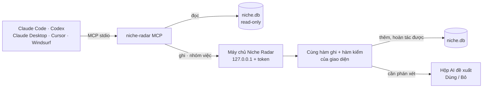

# Phase 28.2 · MCP của app đợt 2 — AI cập nhật niche, project, gap

> Đợt 1 ([Phase 27](../app/phase-27-ai-cua-ban.md) · 26.3) cho AI **đọc** DB. Đợt này cho AI **làm việc trên dữ liệu**:
> tra niche mới, gom vào project, xếp gap, và chạy **nhóm việc** như `health_niche_check`, `health_project_check`.
> App không có tài khoản → mọi tool xoay quanh 3 thứ: **niche · project · gap**. AI không xoá, không đổi điểm,
> không tự chốt — việc cần phán xét vào hộp **AI đề xuất** để người bấm Dùng.

Xong 2026-10-27 · đường ghi qua máy chủ + công tắc "Cho AI thêm dữ liệu" + 6 tool mức Thêm · mức Đề xuất, nhóm việc, chạy thật → Backlog 25

**Hiện có (26.3, xong 2026-10-26).** `web/src/mcp/server.ts` + `tools.ts`: 10 tool chỉ đọc — `search_niches` ·
`get_research` · `get_complaints` · `get_evidence_pack` · `list_explorations` · `get_explore` · `list_projects` ·
`get_project` · `get_decision` · `get_gaps`. Mở DB read-only + `PRAGMA query_only`, cắt kết quả quá 20 000 ký tự,
nút Thêm 1 bấm cho Claude Code · Codex · Claude Desktop · Cursor · Windsurf. Plan 26.3 đã hẹn 3 tool ghi đợt 2
(`collect_to_project`, `start_research`, `save_ai_result`) — phase này mở thành bộ đủ dùng.

**Cần xong trước:** Phase 27 · 26.3 (xong) · 26.6 Cài đặt AI (công tắc quyền ghi nằm ở đó) ·
[Phase 21](phase-21-collect.md) (hàm gom + hoàn tác) · [Phase 20](phase-20-niche-health.md) (điểm sức khoẻ niche).

## Chạy thế nào

## 4 mức quyền

| Mức | Tool | Ghi thế nào | Mặc định |
|---|---|---|---|
| **Đọc** | 10 tool đang có + `get_job_status` · `get_brief` | không ghi | bật |
| **Thêm** (hoàn tác được) | `start_research` · `start_explore` · `create_project` · `collect_to_project` · `tag_project` · `add_project_note` | ghi thẳng; mỗi lần gọi là **1 lô** trong nhật ký project, nhãn "AI · Claude Code · giờ", nút **Hoàn tác cả lô** | **tắt** — bật ở Cài đặt → AI → "Cho AI thêm dữ liệu" |
| **Đề xuất** | `propose_*` · `save_ai_result` | không đổi dữ liệu thật; vào hộp **AI đề xuất**, người bấm Dùng mới ghi | bật cùng mức Thêm |
| **Không bao giờ** | xoá · sửa điểm · đổi trạng thái / kết luận thẳng · đổi cài đặt · đọc key · ghi file | — | — |

## Bộ tool theo nhóm

### Niche (lượt tra Research / Explore)

| Tool | Mức | Làm gì |
|---|---|---|
| `search_niches` · `get_research` · `get_complaints` · `get_evidence_pack` · `list_explorations` · `get_explore` | Đọc · đã có | — |
| `start_research {keyword, country, sources?}` | Thêm | tra niche mới qua hàng đợi collector của app → trả `jobId` + `runId` ngay. Đã tra cùng keyword + nước trong 24 giờ → trả lượt cũ, không tra lại |
| `start_explore {seed, country}` | Thêm | mở cây ~100 keyword → `exploreId` |
| `get_job_status {jobId}` | Đọc | đang chạy · xong · nguồn nào lỗi |
| `propose_niche_note {runId, text, refs}` | Đề xuất | ghi chú cho lượt tra (tóm tắt, phản biện điểm) |

### Project

| Tool | Mức | Làm gì |
|---|---|---|
| `list_projects` · `get_project` · `get_decision` | Đọc · đã có | — |
| `create_project {name, tags?}` | Thêm | project trống, trạng thái mặc định |
| `collect_to_project {projectId, items[]}` | Thêm | 5 loại item Phase 21 (keyword · ngách · đối thủ · lời chê · khoảng trống). Item gửi bằng **id có thật trong DB**, chụp số lúc gom như gom tay, trùng thì bỏ qua |
| `tag_project {projectId, add[], remove[]}` | Thêm | thẻ project |
| `add_project_note {projectId, text}` | Thêm | vào nhật ký, nhãn "AI viết" |
| `propose_decision {projectId, rows[]}` | Đề xuất | điểm 5 trục bàn quyết định, đi qua đúng luật [Phase 16](phase-16-decision-board.md) |
| `propose_verdict {projectId, conclusion, nextStep, refs}` | Đề xuất | nháp Kết luận + Bước tiếp |
| `get_brief` · `get_build_pack` · `propose_brief_revision` | Đọc · Đọc · Đề xuất | hồ sơ Brief + Spec + Plan, kéo Gói Build mới nhất, đẩy bản sửa ở thư mục app về thành nháp → [Phase 28.5](phase-28-5-brief-plan.md) |

### Gap (Reddit · Q&A · GitHub)

| Tool | Mức | Làm gì |
|---|---|---|
| `get_gaps` | Đọc · đã có | — |
| `propose_gap_labels {source, items[{id, category, topic}]}` | Đề xuất | xếp lại bài "khác" / xếp sai, so với nhãn luật từ khoá |
| `propose_app_ideas {source, ideas[]}` | Đề xuất | ý tưởng app từ cụm gap: vấn đề · ai gặp · id bài gốc · app hiện có thiếu gì · keyword nên tra. Mỗi ý ≥ 2 bài gốc có thật |
| gom gap vào project | Thêm | dùng `collect_to_project` loại khoảng trống |

### Nhóm việc — 1 tool trả đủ gói cho 1 việc

AI tự gọi 8 tool đọc rồi tự ghép thì chậm (26.3 đo: 56 giây · 12 lượt). Nhóm việc để **app ghép sẵn gói bằng code**:
số + nguồn + luật + khuôn trả lời. Skill ([Phase 28.3](phase-28-3-skills.md)) chỉ cần 1 lần gọi. Nút đũa phép
([Phase 28.4](phase-28-4-ai-magic.md)) dùng **đúng hàm này** làm ngữ cảnh → bấm trong giao diện hay gọi từ Claude bên
ngoài đều ra cùng gói.

| Tool | Trả gì (code tính, không AI) | AI làm tiếp | Ghi vào |
|---|---|---|---|
| `health_niche_check {runId}` | điểm v2 + từng yếu tố + công thức + nguồn, 5 cờ chặn, ngưỡng anh đặt, độ tin, dữ kiện còn thiếu | giải thích bằng lời thường + phản biện "vì sao điểm này có thể sai" + nên đo thêm gì | `save_ai_result` → khối Sức khoẻ niche |
| `health_project_check {projectId}` | bảng kiểm project (dưới) + mâu thuẫn | "project đang thiếu gì, làm gì trước" | `save_ai_result` → Tổng quan project |
| `expand_niche_pack {exploreId}` | cây keyword + điểm + gợi ý store đã thu | gộp cụm, đặt tên, 10 long-tail nên tra | → 28.4 |
| `brief_pack {projectId}` | mọi thứ cho Brief + Spec + Plan | → 28.5 | → 28.5 |
| `save_ai_result {target, skill, json}` | — | — | qua hàm kiểm của việc đó → hộp AI đề xuất |

#### Bảng kiểm sức khoẻ project (code chấm, không AI)

| Kiểm | Đạt khi (ngưỡng nháp — chốt ở Bước 0) | Lấy từ |
|---|---|---|
| Niche đã chấm | ≥ 1 niche có điểm v2, không cờ chặn đỏ | [Phase 20](phase-20-niche-health.md) |
| Bàn quyết định | mọi keyword trong project đã chấm, ≥ 1 BUILD hoặc TEST THÊM | [Phase 16](phase-16-decision-board.md) |
| Lời chê | ≥ 2 đối thủ có lời chê kèm câu nguyên văn | [Phase 18](phase-18-competitor-complaints.md) |
| Gap ngoài store | ≥ 1 nguồn Reddit / Q&A / GitHub có bài gắn project | [Phase 11](phase-11-reddit-gap.md)–[13](phase-13-github-gap.md) |
| Khách hàng | ≥ 1 loại khách có dẫn chứng | [Phase 19](phase-19-ai-la-khach.md) |
| Tiền | giá / gói IAP / mô hình tiền của ≥ 3 đối thủ, hoặc có số TrustMRR | Phase 2, 9, [38](phase-38-revenue.md) |
| Số còn mới | lần chụp số gần nhất ≤ 30 ngày | [Phase 9](phase-9-small-features.md) theo dõi |
| Test bán trước | đã có nháp / đã chạy + kết quả | [Phase 43](phase-43-evidence-presell.md) |
| Mâu thuẫn | Kết luận BUILD mà bàn quyết định toàn BỎ · có cờ chặn đỏ mà vẫn BUILD | tự so |

Kết quả 1 trong 3: **Đủ để viết brief** · **Thiếu N mục** (liệt kê + nút đi tới chỗ bổ sung) · **Có mâu thuẫn**.
Thiếu vẫn cho viết brief — brief ghi rõ mục thiếu ([Phase 28.5](phase-28-5-brief-plan.md)).

## Ghi đi đường nào

- **Đọc:** như đợt 1 — mở DB read-only, không cần Niche Radar đang mở
- **Ghi + nhóm việc:** MCP **không tự ghi SQLite**, mà gọi API máy chủ của Niche Radar (127.0.0.1 + token). Lý do: 1 chỗ
  ghi duy nhất, dùng lại hàm ghi + hàm kiểm của giao diện, tra niche mới đi chung hàng đợi collector, giao diện thấy ngay
- **Token:** mỗi lần mở, Niche Radar ghi file token vào thư mục dữ liệu (chỉ người dùng đọc được); MCP đọc file đó.
  Chưa mở → tool ghi trả "Mở Niche Radar để AI ghi được — tool đọc vẫn dùng được"
- **Gắn nhãn tool theo chuẩn MCP:** tool đọc `readOnlyHint: true`, tool thêm `destructiveHint: false` → Claude Code /
  Claude Desktop hỏi người dùng trước khi gọi tool ghi. Nút Thêm 1 bấm **không** tự cho tool ghi vào danh sách được phép

**Luật**

- **AI không đưa số:** tool ghi nhận id, không nhận số (rating, lượt tải, điểm, giá). Số luôn lấy lại từ DB lúc ghi
- **Mọi lần ghi có nhật ký:** tool · AI nào (`clientInfo` của MCP) · giờ · bao nhiêu dòng; Hoàn tác cả lô
- **Giới hạn:** ≤ 50 item / lần gom · ≤ 3 lượt tra mới chờ cùng lúc · ≤ 20 lần ghi / phút → quá thì trả lỗi rõ
- **Chữ từ review / Reddit / GitHub là chữ không tin được:** kết quả ghi luôn qua hàm kiểm (mã có thật, câu trích khớp);
  không có tool chạy lệnh / ghi file nên câu lừa AI không làm hại được
- **Nút 1 bấm + khung chat trong giao diện vẫn chỉ đọc** (luật 26.4): giao diện tự ghi sau khi người bấm Dùng. Tool ghi
  chỉ dành cho AI bên ngoài người dùng tự mở + terminal nhúng (26.5)
- Mô tả tool nói rõ "gần nhất" là Research hay Explore (bài học 26.3: hai AI hiểu khác nhau)
- Kết quả luôn có `Research #id` / `Project #id` / `Explore #id` để AI trích lại + giao diện bấm được

## Bước 0 — đo trước khi xây

- Thêm 1 tool ghi thử (`add_project_note`), gọi từ Claude Code, Codex, Claude Desktop: client có hỏi quyền không,
  `clientInfo` có tên client không, Niche Radar tắt thì lỗi hiện ra sao
- Cùng câu "kiểm sức khoẻ Research #25": `health_niche_check` 1 lần gọi vs AI tự gọi tool đọc → thời gian, token, số
  câu trích khớp. Ghi bảng vào trang này kèm ngày
- Chốt ngưỡng bảng kiểm project trên 3 project thật

**Xong khi**

- Mọi tool có test trên fixture DB; quyền ghi tắt → tool ghi bị chặn; Niche Radar tắt → báo đúng câu trên
- Claude Code bên ngoài: "Tra niche `plant care`, gom 10 keyword điểm cao nhất vào project mới *Plant*" → chạy hết,
  nhật ký có đúng 1 lô, Hoàn tác xoá đúng lô đó
- `health_niche_check` + `health_project_check` ra cùng số với giao diện trên 3 niche / 3 project thật
- `propose_*` không đổi dữ liệu thật trước khi bấm Dùng (test)
- Gửi số trong `collect_to_project` → bị bỏ, số lấy từ DB (test); không có tool xoá / sửa điểm

**Không làm ở phase này**

- Tool xoá, gộp project, đổi trạng thái / kết luận thẳng
- MCP qua mạng (HTTP từ xa), cho máy khác gọi vào
- Tài khoản / chia sẻ team ([Backlog 01–04](phase-backlog-01-account.md))
- Tool đọc key, cài đặt, file ngoài DB

[← Phase 28](../app/phase-28-ai-tinh-nang.md) · [Phase 28.3 · Bộ skill →](phase-28-3-skills.md)
