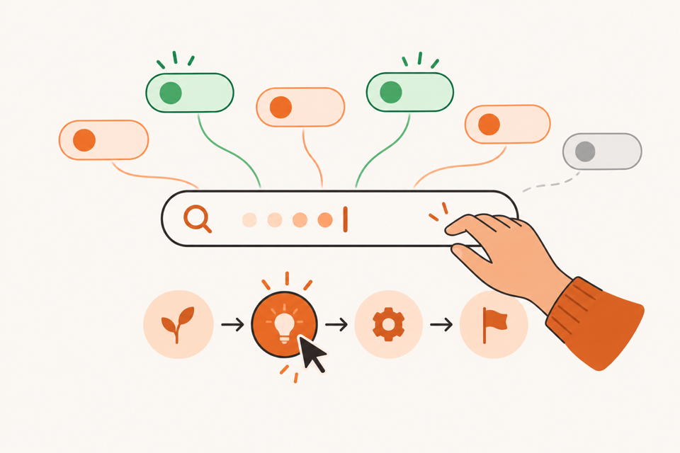
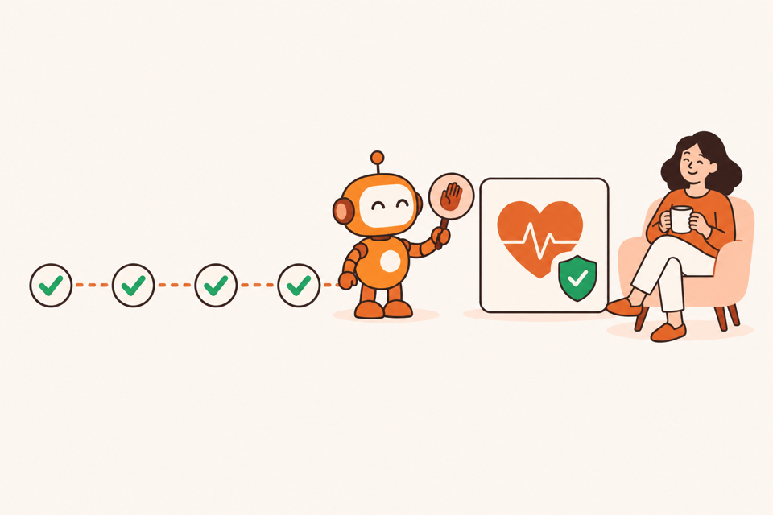

# Phase 28.20 · AI Agent — 3 lối vào: Niche Search · Autopilot · Đã có app

> Trang AI Agent (`/hunt`) hôm nay có 2 thẻ: **Find a new idea** và **I already have an app / site**. Thẻ đầu bắt người
> dùng tự bấm từng bước trong 7 bước — người đã quen thì thích, nhưng người mới không biết "BEST pack", "Collect more",
> "Health check" là gì nên dừng ngay ở bước 1. Phase này tách thành **3 lối vào rõ ràng**, mỗi lối có hình minh hoạ, và thêm
> lối **Autopilot**: AI tự chạy hết chặng Research rồi dừng ở Health check chờ người xem.

Đang làm · M1 xong 2026-11-02 · M2 xong 2026-11-03 · M3–M4 chưa làm

!!! note "Tiến độ M2 — Autopilot chạy được (2026-11-03)"
    - **Đã có:** cột `projects.pilot` (`manual` · `auto`, migration `0024_autopilot`) · bộ chạy `web/src/lib/hunt-autopilot.ts`
      (hàm thuần `nextAutoMove` + `autoStateOf`, vòng lặp ở máy chủ, mỗi máy 1 Autopilot) · `POST /api/hunt/:id/autopilot/start`
      và `/stop`, trạng thái trả kèm phiên (`autopilot`) và danh sách phiên · lõi `/api/ai/chat` tách thành `chatGate` + `chatTurn`
      để Autopilot đi đúng đường của khung chat (cổng Free / PRO, hàng đợi AI, `--resume`, sổ token) · thanh Autopilot ở trang
      phiên (bước n/4, Dừng, Chạy tiếp, lý do dừng) · nút bước và khung chat khoá khi đang chạy · chip "Autopilot · Bước n/4"
      ở Phiên săn gần đây · cờ `AUTOPILOT_ON = true`.
    - **Khác plan:** server khởi động lại thì không tự chạy tiếp — phiên báo "Bị ngắt giữa chừng", bấm **Chạy tiếp** là đi tiếp
      từ bước dở (số lần đã gửi đọc lại từ nhật ký). Câu trả lời của AI trong lượt Autopilot không hiện thành tin nhắn ở khung
      chat; kết quả hiện qua ứng viên, nhật ký việc AI làm và thanh Autopilot.
    - **Đã soát:** 14 test mới (`web/tests/hunt-autopilot.test.ts`: từng bước, gửi lại 1 lần rồi kẹt, Dừng + Chạy tiếp, lỗi
      hết lượt, quá giờ, 1 Autopilot / máy, app mở lại, API) · `npm run check` xanh · chạy thật Claude Code 1 lượt: bước 1 đề xuất
      + tra 3 keyword từ máy chủ, bấm Dừng → báo lý do, nút bước + chat mở lại · 960px + 1340px, sáng + tối.
    - **Chưa soát:** chạy hết 4 bước tới Health check bằng AI thật (để M4, đo số phút).

!!! note "Tiến độ M1 — 3 lối vào nhìn rõ (2026-11-02)"
    - **Đã có:** `/hunt` có 3 thẻ có hình (Niche Search · Niche Autopilot · I already have an app / site), khung ≥ 48rem thì
      3 cột, hẹp hơn xếp dọc. Thẻ 02 có chip "Best for beginners" + "Coming soon", hình nhạt; chọn vào thấy 4 bước AI sẽ chạy
      (viết bằng lời người mới) + nút **Start autopilot** khoá + link "Use Niche Search for now". Cờ `AUTOPILOT_ON` trong
      `web/src/lib/features.ts` (đang `false`), dòng "Niche Autopilot" trong danh sách tính năng là "sắp có".
    - **Hình:** bản gốc PNG 1536×1024 ở `design/ai-agent-3-modes/`, bản web JPG 768px (~50 KB) ở `web/public/hunt/`.
    - **Đã soát:** `npm run check` xanh + test mới `web/tests/hunt-modes.test.ts` · 960px + 1340px, sáng + tối, không cuộn ngang.
      Giao diện chỉ có tiếng Anh nên không soát bản tiếng Việt.

## 3 lối vào nhìn một lần

1. **01 · Niche Search** — cho người đã quen app, muốn tự quyết. Người dùng bấm từng bước, dừng lúc nào tuỳ ý.
   Kết quả: bảng sức khoẻ → Brief · Spec · Plan.
2. **02 · Niche Autopilot** — cho người chưa biết gì về niche / ASO. AI tự chạy 4 bước, **dừng ở Health check**.
   Kết quả: bảng sức khoẻ + 3 niche nên làm, nói bằng lời dễ hiểu.
3. **03 · I already have an app / site** — cho builder đã có app, web, sản phẩm. Chạy theo Phase 28.18, dừng theo mục tiêu.
   Kết quả: `audit.md` · `growth.md` và/hoặc Brief · Spec · Plan.

### 01 · Niche Search — tự lái từng bước

- Chính là thẻ **Find a new idea** hiện tại, đổi tên + thêm hình. Flow 7 bước giữ nguyên (`FLOW_STEPS`), mỗi bước một bấm.
- Ô ý tưởng để trống được (như bây giờ), gõ sau trong chat.
- Có chế độ Mặc định / Tuỳ chỉnh (Phase 28.16) như cũ.

### 02 · Niche Autopilot — AI tự chạy, dừng ở Health check

- Người dùng gõ **1 câu** (bắt buộc — không có ý tưởng thì không có gì để chạy), bấm **Start autopilot**.
- AI tự chạy nối 4 bước của chặng ① Research niche: **Tìm niche → AI Suggest → Collect thêm → Health check**. Mỗi bước
  chỉ bắt đầu khi bước trước xong thật (đọc từ `flowState`, mọi Research đã tra xong, không còn việc đang chạy).
- Tới Health check thì **dừng**, hiện thẻ "Xong phần research" viết bằng lời người mới hiểu:
    - 3 niche nên làm, mỗi niche 1 câu "vì sao" + mã `Research #id`.
    - Niche đã loại và lý do 1 dòng.
    - 2 nút: **Lên kế hoạch app (Brief → Spec → Plan)** · **Tự xem bảng sức khoẻ**. Chặng ② vẫn mỗi bước một bấm như Niche Search.
- Đang chạy luôn có thanh tiến độ "Bước 2/4 · AI đang chọn niche tốt nhất…" + nút **Dừng**. Dừng xong phiên thành phiên
  thường (như Niche Search), dữ liệu đã có giữ nguyên, bấm tiếp tay được.
- Không có chỗ chỉnh luật: Autopilot luôn chạy gói **Mặc định**. Muốn chỉnh thì dùng Niche Search + Tuỳ chỉnh.
- Từ ngữ cho người mới: chip bước có tooltip 1 câu ("Health check = chấm từng niche nên làm / thử thêm / bỏ"), không hiện
  chữ "BEST pack", "long-tail" mà không giải thích.

### 03 · I already have an app / site — cho builder

- Chính là tab đã làm ở [Phase 28.18](phase-28-18-ai-agent-da-co-app.md) (M1 xong): nguồn context, Hồ sơ app, 3 mục tiêu.
- Phase này chỉ đổi chỗ đứng (thẻ thứ 3) + thêm hình. Phần còn lại (M2 Đánh giá, M3 Mở rộng, M4 chạy thật) vẫn làm trong 28.18.

## Mục tiêu · cần làm · KHÔNG làm

- **Mục tiêu:** người mới mở trang AI Agent, liếc 3 hình là biết chọn thẻ nào; chọn Autopilot, gõ 1 câu, đi pha cà phê, quay
  lại thấy bảng sức khoẻ + 3 niche nên làm.
- **Cần làm:** 3 thẻ có hình · cột `projects.pilot` · bộ chạy Autopilot ở máy chủ · thanh tiến độ + nút Dừng · thẻ "Xong phần
  research" · chip Autopilot ở Phiên săn gần đây · test · chạy thật 1 lượt.
- **KHÔNG làm:**
    - Không cho Autopilot tự chạy chặng ② (Brief → Spec → Plan). Dừng ở Health check là cố ý: người dùng phải nhìn số trước
      khi AI viết kế hoạch. (Phase 28.9 đã chốt "không xếp nút tự chạy nối nhau" — phase này chỉ nới cho đúng 4 bước chặng ①,
      có nút Dừng.)
    - Không làm Autopilot cho thẻ 03 (để sau khi 28.18 xong M2–M3).
    - Không đổi điểm v2, prompt từng bước, số keyword Free / PRO, giá. Autopilot nằm trong PRO như AI Agent (chip ★ PRO).
    - Không tự đổi account khi hết lượt — chỉ dừng và báo (đổi account là việc của Phase 28.19 M2).
    - Không hiện số phase trên UI.

## Màn bắt đầu (`/hunt`)

- Header giữ nguyên. Dưới header là **3 thẻ** cùng hàng khi khung ≥ 760px, xếp dọc khi hẹp hơn (`@container`, lưới
  `minmax(0,1fr)`). Mỗi thẻ: hình (tỉ lệ 3:2, `object-cover`, bo góc) · số `01/02/03` nhỏ · tên · 1 câu · ✓ khi chọn.
- Thẻ 02 có chip nhỏ **Recommended for beginners**.
- Form dưới thẻ đổi theo thẻ chọn:
    - 01 → form hiện tại (ô ý tưởng, để trống được) + nút **Start a new session**.
    - 02 → ô ý tưởng bắt buộc + 1 dòng "AI chạy 4 bước, khoảng N phút, dừng ở Health check để bạn xem" (N = `chưa đo`,
      đo ở T8 rồi mới ghi) + nút **Start autopilot**.
    - 03 → form Phase 28.18 như cũ.
- Phiên săn gần đây: chip **Autopilot** (đang chạy thì chip có chấm cam nhấp nháy + "Bước n/4").

## Bộ chạy Autopilot

- **Chạy ở máy chủ**, không ở trình duyệt: đóng tab vẫn chạy tiếp; mở lại phiên thấy đúng bước.
- Vòng lặp cho mỗi bước trong `['find', 'best', 'more', 'health']`:
    1. Chờ tới khi bước trước xong (`flowState(...).done`) và `running = 0` (Research tra xong hết). Hỏi lại mỗi 3 giây.
    2. Gửi đúng câu của bước đó — `find` dùng `/find-niches` + ý tưởng, các bước sau dùng `STEP_PROMPT` — qua cùng đường gọi
       CLI mà khung chat đang dùng, để nhật ký, token (Phase 28.15) và Hoàn tác y như bấm tay.
    3. AI trả lời xong mà bước chưa thành `done` → thử lại 1 lần; vẫn không → **dừng**, ghi lý do.
- **Dừng khi:** người dùng bấm Dừng · lỗi `limit` / `login` từ CLI · 1 bước quá 15 phút · tới Health check (xong).
- Trạng thái lưu ở `projects.pilot` + dòng nhật ký (`autopilot: bắt đầu / bước n / dừng: lý do / xong`), để server khởi động
  lại thì đọc nhật ký mà chạy tiếp hoặc báo "đã dừng".
- Một máy chỉ chạy 1 Autopilot cùng lúc; mở cái thứ 2 thì hỏi "đang có phiên Autopilot chạy — mở nó hay chờ?".

## Dữ liệu và code

- **Database:** `projects.pilot`: `manual` · `auto`, mặc định `manual` (phiên cũ không đổi). Trạng thái chạy tính lại từ
  nhật ký, không thêm cột.
- **`web/src/lib/hunt-autopilot.ts` (mới):** vòng lặp trên, hàm thuần `nextAutoStep(view)` để test không cần AI.
- **`web/src/server/hunt-api.ts`:** `POST /` nhận `pilot`; thêm `POST /:id/autopilot/stop` và `GET /:id/autopilot`
  (bước, đang chạy, lý do dừng).
- **`web/src/client/HuntIndexPage.tsx`:** 3 thẻ có hình, form theo thẻ.
- **`web/src/components/HuntFlow.tsx`, `HuntChat.tsx`:** thanh tiến độ + Dừng, thẻ "Xong phần research", khoá nút bước
  khi Autopilot đang chạy (tránh 2 lệnh chồng nhau).
- **Hình:** `web/public/hunt/mode-1-search.jpg`, `mode-2-autopilot.jpg`, `mode-3-existing-app.jpg` — Codex sinh theo
  `design/codex-brief-ai-agent-3-modes.md` (PNG gốc ở `design/ai-agent-3-modes/`); bản cho docs ở `docs/images/phase-28-20/`.

## Việc làm

| # | Việc | File chính | Kiểm |
|---|---|---|---|
| T1 ✓ | Hình 3 thẻ (Codex) | `design/codex-brief-ai-agent-3-modes.md` | 3 ảnh không chữ, cùng style trang Guide |
| T2 ✓ | 3 thẻ + form theo thẻ, chip Recommended | `HuntIndexPage.tsx` | 960px + 1340px, sáng + tối, không cuộn ngang |
| T3 ✓ | Migration `pilot` + API tạo phiên nhận `pilot` | `db/schema.ts`, `hunt-api.ts` | test: phiên cũ đọc ra `manual` |
| T4 ✓ | `hunt-autopilot.ts`: vòng lặp, chờ Research, thử lại, dừng | `lib/hunt-autopilot.ts` | test `nextAutoStep` từng trạng thái; không bao giờ trả `brief` |
| T5 ✓ | API Dừng + trạng thái, chạy tiếp sau khi server khởi động lại | `hunt-api.ts`, server boot | test: dừng giữa bước 2 → phiên thành `manual`, dữ liệu còn |
| T6 ✓ | Thanh tiến độ, nút Dừng, khoá nút bước khi đang chạy | `HuntFlow.tsx` | bấm Dừng → nút bước mở lại |
| T7 | Thẻ "Xong phần research" + tooltip từ ngữ cho người mới + chip Autopilot ở danh sách | `HuntChat.tsx`, `HuntIndexPage.tsx` | mọi lý do có `Research #id` |
| T8 | Chạy thật Claude Code 1 ý tưởng từ đầu tới Health check; giả lập hết lượt giữa chừng | — | ghi số phút thật vào dòng mô tả thẻ 02 |

Thứ tự theo mốc:

- **M1 — 3 lối vào nhìn rõ:** T1 → T2 (thẻ 02 tạm xám "sắp có" theo `features.ts`).
- **M2 — Autopilot chạy được:** T3 → T4 → T5 → T6.
- **M3 — dễ hiểu cho người mới:** T7.
- **M4 — chạy thật:** T8, cập nhật trang Hướng dẫn + [Sơ đồ ShotMatic](../so-do-app.md).

## Xong khi

- [x] Trang `/hunt` có 3 thẻ có hình, liếc là phân biệt; 960px + 1340px, sáng + tối, không cuộn ngang, screenshot đã Read.
- [ ] Niche Search chạy y như "Find a new idea" cũ; phiên cũ mở lại không đổi.
- [ ] Autopilot: gõ 1 câu → AI tự chạy 4 bước → dừng ở Health check, không tự viết Brief.
- [ ] Đóng tab giữa chừng, mở lại thấy đúng bước đang chạy.
- [x] Bấm Dừng giữa chừng → phiên thành tay, bấm tiếp được (test + chạy thật ở bước 1).
- [x] Hết lượt CLI giữa chừng → dừng + báo rõ, không kẹt im lặng (test).
- [ ] Thẻ "Xong phần research" có 3 niche + lý do có `Research #id`.
- [ ] `npm run check` xanh · `npm run docs:build` xanh.
