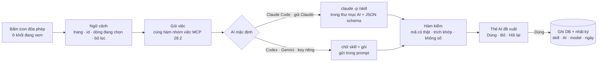

# Phase 28.4 · Nút AI đũa phép ở từng bước — AI có ngữ cảnh, chạy đúng skill

> Đi tay từng bước (tìm niche → mở rộng → soi đối thủ, lời chê, gap → gom vào project → chấm → brief) vẫn chạy đủ
> **không AI**. Ở mỗi bước có **1 icon đũa phép**: bấm → AI mặc định của người dùng (VD Claude Code trong gói Claude,
> hoặc key riêng) nhận **đúng thứ đang xem** + chạy **đúng skill của việc đó** → trả bản nháp có mã nguồn → người bấm
> **Dùng / Bỏ / Hỏi lại**.

Đang làm · 2026-10-27 · chỗ UI dễ làm trước, phần còn lại sau

**Hiện có.** `web/src/components/AiRunButton.tsx`: đũa phép + chữ "Chạy bằng AI" + ô chọn AI, gắn ở 4 khối (Chủ đề than,
Tóm tắt, Test bán trước, Feature Gap). Mỗi việc là 1 prompt trong `web/src/lib/ai/tasks.ts` / `gap-ai.ts`. Khung chat
gửi kèm `[Đang xem: Research #25]`. Thư mục AI có skill. **Thiếu:** icon gọn ở mọi bước, 1 sổ việc AI chung, ngữ cảnh
chuẩn hoá (đang chọn dòng nào, lọc gì), chạy qua skill thay prompt rời.

**Cần xong trước:** [Phase 28.2](phase-28-2-mcp-write.md) (gói nhóm việc) · [Phase 28.3](phase-28-3-skills.md) (skill
đợt 1) · Phase 27 · 26.6 (AI mặc định + chọn AI từng việc).

## Bấm icon thì chạy gì

## Icon đũa phép — một kiểu cho mọi chỗ

- **Dạng:** icon tròn nhỏ (`WandIcon` đang có), không chữ, ở góc phải tiêu đề khối. Tooltip + `aria-label` nói đúng
  việc: "Kiểm sức khoẻ niche bằng AI". Khối chưa có kết quả AI thì thêm 1 dòng mời nhỏ cạnh icon
- **Bấm → hộp nhỏ trước khi chạy:**
    - Việc: *Kiểm sức khoẻ niche* · skill `/health-niche-check`
    - Gửi gì: "Research #25 · điểm v2 + 7 yếu tố · 3 cờ · 110 review" — đếm từ gói, không đoán
    - AI: **Claude Code** (mặc định) ▾ — đổi được, nhớ lựa chọn từng việc (26.6)
    - Tốn: "~30k token · tính vào gói Claude của bạn"; key riêng thì ước tiền + trần
    - Nút **Chạy** · ô "Lần sau chạy luôn, không hỏi"
- **Đang chạy:** icon quay + dòng bước (đọc gói → gọi tool → viết → kiểm) + nút Dừng. Việc khác đang chạy → "Đang chờ 1 việc AI khác"
- **Xong:** thẻ **AI đề xuất** ngay trong khối: nội dung · mã nguồn bấm được · "22/22 câu khớp · 1 câu bị gạch" ·
  **Dùng** / **Bỏ** / **Hỏi lại** (gõ 1 câu: "ngắn hơn", "chỉ thị trường US" → chạy lại cùng ngữ cảnh + bản trước)
- **Đã có kết quả cũ:** icon có chấm nhỏ; mở ra thấy bản cũ + ngày + "Chạy lại (chỉ gửi phần mới)"
- **Xám:** chưa nối AI → "Nối AI để dùng" + link Setup · việc của đợt 2 → xám + "Phase 28.4 đợt 2" (luật `features.ts`) ·
  bản demo → hiện kết quả chạy sẵn, không chạy được
- 4 khối đang có nút chữ "Chạy bằng AI" đổi sang icon cùng kiểu

## Ngữ cảnh — AI biết người dùng đang làm gì

| Phần | Ví dụ | Lấy từ |
|---|---|---|
| Trang + đối tượng | Research #25 · Project #7 · Explore #12 · Gap Reddit r/MacOS | URL |
| Đang chọn | 8 keyword đã tick · 3 dòng lời chê | bảng đang mở |
| Bộ lọc | nước US · chỉ review 1–2★ · tab Khoảng trống | trạng thái trang |
| Việc | `health-niche-check` | icon nào được bấm |
| Gói việc | số + nguồn + luật + khuôn trả lời | hàm nhóm việc 28.2 (cùng hàm MCP) |
| Bản trước | kết quả lần trước + câu Hỏi lại | DB |
| Ngôn ngữ | vi · en · es — AI trả theo ngôn ngữ giao diện | [Phase 10](phase-10-i18n.md) |

**Một sổ việc AI:** `web/src/lib/ai/actions.ts` — mỗi việc 1 dòng: id · skill · chỗ đặt · hàm ghép gói · khuôn JSON ·
hàm kiểm · Dùng thì ghi vào đâu · đợt. Thêm chỗ đặt mới = thêm 1 dòng (như `features.ts`). `tasks.ts` + `gap-ai.ts`
chuyển dần vào đây, test cũ giữ nguyên.

## Bản đồ chỗ đặt — theo đúng các bước đi tay

**Đợt 1 = 10 chỗ** (in đậm), trong đó 4 chỗ đã có nút → đổi sang icon + skill. Còn lại đợt 2.

### Bước 1 · Tìm niche (ô tra ở trang chủ)

| Khối | Icon làm gì | Skill | Ngữ cảnh gửi | Dùng → ghi vào | Đợt |
|---|---|---|---|---|---|
| Ô tra Research / Explore | Gợi ý niche từ 1 ý mơ hồ ("app cho người trồng cây") → 5–10 keyword nên tra | `suggest-seeds` | câu người dùng gõ + nước + tên niche đã tra gần đây | điền vào ô tra, nút Tra từng cái; nhãn "AI gợi ý — chưa tra" | 2 |

### Bước 2 · Mở rộng niche (trang Explore)

| Khối | Icon làm gì | Skill | Ngữ cảnh gửi | Dùng → ghi vào | Đợt |
|---|---|---|---|---|---|
| **Đầu trang Explore** | **Mở rộng niche bằng AI:** gộp keyword cùng nghĩa, bỏ tên thương hiệu / từ lạc, đặt tên cụm, 10 long-tail nên tra tiếp | `expand-niche` | Explore #id · cây ~100 keyword + điểm + gợi ý store đã thu | lớp "Cụm AI" trên cây (bật / tắt) + nút Tra tiếp / + Collect từng long-tail | **1** |
| Bảng keyword (dòng đã tick) | "8 keyword này có cùng 1 app không, gom vào đâu" | `collect-suggest` | các dòng đã tick + danh sách project | tick sẵn trong hộp Collect | 2 |

Long-tail AI nghĩ ra mà **không có** trong gợi ý store đã thu → nhãn "AI nghĩ ra — chưa có trong gợi ý store", bấm Tra
mới biết có thật không.

### Bước 3 · Soi niche (trang kết quả Research)

| Khối | Icon làm gì | Skill | Ngữ cảnh gửi | Dùng → ghi vào | Đợt |
|---|---|---|---|---|---|
| **Đầu trang (câu trả lời)** | **Tóm tắt 6 mục:** ai dùng · đau gì nhất · đối thủ yếu chỗ nào · ai đang thu tiền · khoảng trống · rủi ro | `niche-summary` | Research #id · review 1–3★ · mô tả · What's New top app | khối Tóm tắt | **1** · đã có |
| **Chủ đề than** | chủ đề + câu nguyên văn | `complaint-themes` | review 1–3★ đang lọc | khối Chủ đề than | **1** · đã có |
| **Feature Gap** | điền ô Có / Không / Không nói, gợi ý 3 tính năng nên thêm | `feature-gap` | trang store top 5 | ô ma trận | **1** · đã có |
| **Sức khoẻ niche** | **Kiểm sức khoẻ niche bằng AI:** giải thích từng yếu tố bằng lời thường + phản biện + nên đo thêm gì | `health-niche-check` | gói `health_niche_check` | ghi chú dưới khối Sức khoẻ — **không đổi điểm** | **1** |
| **Test bán trước** | nháp landing fake-door + bài đăng | `presale-draft` | evidence pack | khối Test bán trước | **1** · đã có |
| Đối thủ bị chê gì | gộp lời chê nhiều thứ tiếng, rút "ước gì" từ review 3★ | `complaint-merge` | cụm lời chê [Phase 18](phase-18-competitor-complaints.md) | lớp AI trong khối lời chê | 2 |
| Ai là khách hàng | thêm loại khách từ review / Reddit, có dẫn chứng | `customer-roles` | bảng loại khách + câu tự nhận | khối Khách hàng (nhãn AI) | 2 |
| Đối thủ · mô hình tiền "Chưa biết" | phân loại từ mô tả + gói IAP | `money-model` | app "Chưa biết" + mô tả + IAP | nhãn tiền, kèm câu nguồn | 2 |
| Doanh thu TrustMRR | khớp tên app ↔ startup có doanh thu | `revenue-match` | danh sách đã thu | khối Doanh thu | 2 · [Phase 38](phase-38-revenue.md) |

### Bước 4 · Tìm gap ngoài store (Reddit · Q&A · GitHub)

| Khối | Icon làm gì | Skill | Ngữ cảnh gửi | Dùng → ghi vào | Đợt |
|---|---|---|---|---|---|
| **Đầu bảng gap** | **Gap → ý tưởng app:** vấn đề · ai gặp · link bài gốc · app hiện có thiếu gì · keyword nên tra | `gap-ideas` | nguồn + tab + bộ lọc + top cụm | thẻ ý tưởng + nút Research keyword này / + Collect | **1** |
| Dòng "khác" / xếp sai | xếp lại chuyên mục + chủ đề | `gap-label` | các bài đang lọc | nhãn AI, so với nhãn luật | 2 |

### Bước 5 · Gom vào Project (hộp Collect)

| Khối | Icon làm gì | Skill | Ngữ cảnh gửi | Dùng → ghi vào | Đợt |
|---|---|---|---|---|---|
| Hộp Collect | item nào đáng gom vào project nào + lý do | `collect-suggest` | Research / Explore đang xem + danh sách project | tick sẵn, người bấm Gom | 2 |

### Bước 6 · Chấm + quản lý (trang Project)

| Khối | Icon làm gì | Skill | Ngữ cảnh gửi | Dùng → ghi vào | Đợt |
|---|---|---|---|---|---|
| **Tab Tổng quan** | **Kiểm sức khoẻ project:** thiếu gì, mâu thuẫn, làm gì trước (bảng kiểm ở 28.2) | `health-project-check` | gói `health_project_check` | thẻ trên Tổng quan + nút đi tới chỗ thiếu | **1** |
| **Tab Keyword · Bàn quyết định** | **Chấm bằng AI** 1 bấm (thay Copy prompt → dán JSON) | `decision-score` | keyword project + dẫn chứng | bàn quyết định, luật [Phase 16](phase-16-decision-board.md) | **1** |
| Tab Tổng quan · Kết luận | nháp Kết luận + Bước tiếp | `project-verdict` | ghi chú + bàn quyết định + sức khoẻ | ô Kết luận / Bước tiếp, người sửa rồi lưu | 2 |
| Tab Lời chê / Khoảng trống | gom theo vấn đề → ý tưởng trong project | `gap-ideas` | item của project | thẻ ý tưởng | 2 |
| Tab Theo dõi | 3 dòng "điều gì đổi đáng chú ý" giữa 2 lần chụp | `tracking-diff` | 2 lần chụp số | dưới bảng theo dõi | 2 |

### Bước 7 · Đầu ra (Brief + Spec + Plan)

| Khối | Icon làm gì | Skill | Ngữ cảnh gửi | Dùng → ghi vào | Đợt |
|---|---|---|---|---|---|
| **Tab mới Brief & Plan** | **Viết Brief + Spec + Plan**, Hỏi lại tới khi Chốt | `project-brief` | gói `brief_pack` | → [Phase 28.5](phase-28-5-brief-plan.md) | **1** |
| Hộp Xuất | nút "Gửi thẳng cho AI" → mở tab Brief & Plan | — | — | — | 1 |

**Mọi trang · khung chat Hỏi AI:** đã có. Thêm: gõ `/tên-skill` trong chat là chạy skill với ngữ cảnh trang (đang ở
Project #7 gõ `/health-project-check`).

**Không đặt icon:** Backup / restore · Tải CSV · Google Trends (số thuần) · Cài đặt · Setup (đã có nút Hỏi AI riêng).

## Skill chạy theo từng tuyến AI

| Tuyến | Skill vào thế nào | Tool MCP được dùng |
|---|---|---|
| **Claude Code** (gói Claude) — mặc định khi máy có | `claude -p "/health-niche-check Research #25"`, cwd = thư mục AI, `--json-schema`, gói việc qua stdin | chỉ tool đọc niche-radar |
| Codex (gói ChatGPT) | Bước 0 đo Codex có đọc skill trong thư mục AI không; không thì gửi chữ skill trong prompt | tool đọc, truyền bằng `-c` như khung chat |
| Gemini CLI · Claude API (key) | chữ skill + gói trong prompt | không |
| Không nối AI | icon xám | — |

Nút 1 bấm **không có tool ghi** — giao diện ghi sau khi người bấm Dùng (giữ luật 26.4). Tool ghi chỉ dành cho AI bên
ngoài ([Phase 28.2](phase-28-2-mcp-write.md)).

## Bước 0 — đo trước khi xây

- `health-niche-check` + `expand-niche`: chạy qua skill (Claude Code) vs prompt rời trong `tasks.ts`, cùng gói, 3 niche × 5
  lần → JSON đúng khuôn, câu trích khớp, thời gian, token → chọn đường
- Codex có đọc skill trong thư mục AI không (ghi số phiên bản)
- `--effort low` cho việc ngắn (gợi ý từ Bước 0 Phase 27: Claude Code ra 8–14k token / việc)

Ghi bảng kết quả vào trang này kèm ngày.

**Xong khi**

- 10 chỗ đợt 1 có icon cùng kiểu, chạy được qua Claude Code **và** Codex trên 3 niche thật, ≥ 95 % câu trích khớp, 0 số do AI đưa
- Explore #id tick 8 dòng rồi bấm icon → gói gửi đi có đúng 8 dòng đó (test)
- 4 việc cũ chạy qua sổ việc mới, test cũ xanh
- Hỏi lại 1 câu → bản mới giữ ngữ cảnh, thấy được khác gì bản trước
- Không nối AI → icon xám + link Setup; mọi test không AI xanh
- Soát ở 960px + 1340px (luật Layout không vỡ), cả English lẫn tiếng Việt: icon không đè / đẩy tiêu đề khối dài; tooltip hiện khi focus bằng bàn phím

**Không làm ở phase này**

- AI tự chạy khi người dùng không bấm (theo lịch, tốn lượt của họ)
- Icon ở khối chưa có dữ liệu để gửi
- AI đổi điểm / trạng thái / kết luận không qua Dùng
- Viết nội dung skill ([Phase 28.3](phase-28-3-skills.md) — plan riêng)

[← Phase 28.3 · Bộ skill](phase-28-3-skills.md) · [Phase 28.5 · Brief + Spec + Plan →](phase-28-5-brief-plan.md)
