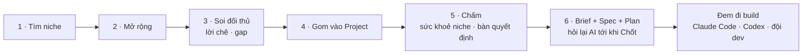
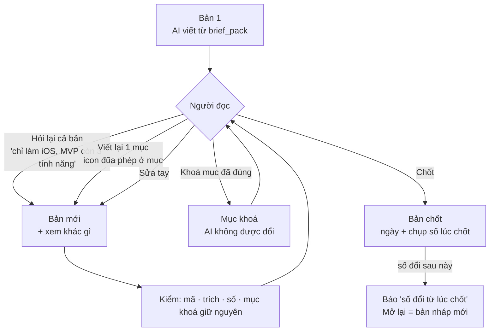

# Phase 28.5 · Brief + Spec + Plan — đầu ra cuối của Project

> Chọn niche không dừng ở bảng điểm. Khúc cuối của mỗi project là **một hồ sơ đem đi build được**: **Brief** (vì sao
> làm) · **Spec** (làm gì) · **Plan** (làm thế nào, theo thứ tự) — có sẵn **báo cáo sức khoẻ niche + sức khoẻ project**
> bên trong, mọi câu có mã nguồn. Người dùng **hỏi lại AI** để sửa tới khi bấm **Chốt**.

<span class="chip chip--todo">Backlog · làm sau · 2026-10-27</span>

<div class="box box--goal" markdown>
**Hiện có — rời rạc, chưa thành đầu ra.**

- [Phase 15](phase-15-export.md): gói cho LLM có khung brief tính năng (khách · vấn đề · MVP · giá thử) — chỉ là file xuất
  để dán sang AI khác, không viết trong app, không sửa vòng, không chốt
- [Phase 16](phase-16-decision-board.md) bàn quyết định ra BUILD / TEST THÊM / BỎ · [Phase 20](phase-20-niche-health.md)
  sức khoẻ niche · [Phase 22](phase-22-project-manage.md) Kết luận + Bước tiếp · [Phase 43](phase-43-evidence-presell.md)
  evidence pack + test bán trước
- [Version 12](version-12.md) có ứng viên "Niche → Spec / ASO" — **gộp vào đây**
</div>

**Cần xong trước:** [Phase 28.2](phase-28-2-mcp-write.md) (`brief_pack`, `health_project_check`) ·
[Phase 28.3](phase-28-3-skills.md) (skill `project-brief`) · [Phase 28.4](phase-28-4-ai-magic.md) (icon + Hỏi lại).

## Hành trình — hồ sơ là bước cuối



Bước 1–5 mỗi bước có icon AI ([Phase 28.4](phase-28-4-ai-magic.md)); bước 6 là **đầu ra** của cả tool.

## Hồ sơ có gì

**Code điền số + bảng, AI viết lời.** Khung hồ sơ có chỗ trống số (VD *rating của app X · Research #25*) — app điền lúc
dựng bản; AI chỉ viết chữ quanh đó. AI viết số không có trong gói → bị gạch + đếm. Mục thiếu dữ kiện → ghi
"chưa đủ dữ liệu — bổ sung ở …" + link tới chỗ bổ sung, không để AI lấp.

### Phần A · Brief — vì sao làm

| # | Mục | Code điền | AI viết | Nguồn |
|---|---|---|---|---|
| 1 | **Một câu** | — | "Làm app X cho Y, giải Z" | cả hồ sơ |
| 2 | **Khách hàng** | loại khách + dẫn chứng | ai đau nhất, gặp lúc nào | [Phase 19](phase-19-ai-la-khach.md) |
| 3 | **Nỗi đau + bằng chứng** | top lời chê, số review, gap kèm 👍 / lượt xem | xếp nỗi đau theo mức nặng | [Phase 18](phase-18-competitor-complaints.md), 11–13 |
| 4 | **Đối thủ** | top app: rating, lượt tải, giá, lần cập nhật cuối | chỗ yếu từng app | Phase 1–2, [41](phase-41-competitor-profile.md) |
| 5 | **Tiền** | mô hình tiền của niche, giá đối thủ, TrustMRR | ai đang thu tiền, mình thu đường nào | Phase 2, 9, [38](phase-38-revenue.md) |
| 6 | **Báo cáo sức khoẻ niche** | điểm v2 từng niche / keyword, yếu tố, cờ chặn, độ tin | giải thích + phản biện | Phase 20 · `health-niche-check` |
| 7 | **Báo cáo sức khoẻ project** | bảng kiểm 28.2: đủ / thiếu / mâu thuẫn | thiếu gì thì quyết định lung lay ra sao | 28.2 · `health-project-check` |
| 8 | **Quyết định** | BUILD / TEST THÊM / BỎ từ bàn quyết định | 3 lý do · rủi ro lớn nhất · "điều gì làm đổi quyết định" | Phase 16 |

### Phần B · Spec — làm gì

| # | Mục | Code điền | AI viết | Nguồn |
|---|---|---|---|---|
| 9 | **MVP 3–5 tính năng** | — | mỗi tính năng trỏ về 1 nỗi đau / gap có mã | Phase 18, 11–13, 4 |
| 10 | **Không làm ở bản đầu** | — | danh sách cắt + lý do | — |
| 11 | **Khác đối thủ** | bảng Feature Gap (Có / Không) | 1 câu khác biệt | [Phase 4](phase-4-feature-gap.md) |
| 12 | **Màn hình + luồng chính** | — | danh sách màn hình, luồng của 1 người dùng mới | — |
| 13 | **ASO** | keyword trong project + điểm + độ khó | title · subtitle · keyword field nháp | Phase 1–2, 16 |
| 14 | **Giá thử** | giá đối thủ | mức giá + lý do | Phase 2, 9 |
| 15 | **Nền tảng đầu tiên** | niche mạnh ở đâu (Play · App Store) | chọn nền tảng + lý do | Phase 1–2 |

### Phần C · Plan — làm thế nào, theo thứ tự

| # | Mục | Code điền | AI viết | Nguồn |
|---|---|---|---|---|
| 16 | **Test bán trước** | ngưỡng đạt anh đặt | nháp landing + 2 bài đăng (`presale-draft`) | Phase 43 |
| 17 | **Các mốc** | — | kiểm nhu cầu → MVP → ra mắt, mỗi mốc có "xong khi"; thời gian ghi "ước" | — |
| 18 | **Theo dõi** | niche / đối thủ nên theo dõi 7 · 30 · 90 ngày | lý do | Phase 9, [42](phase-42-tracking.md) |
| 19 | **Câu hỏi còn mở** | mục thiếu từ sức khoẻ project | cần đo gì, ở chỗ nào trong tool | 28.2 |

## Hỏi lại AI tới khi chốt



- **Bản:** mỗi lần AI viết / người sửa = 1 bản: số bản · ai làm (AI nào + model, hay người) · ngày · câu yêu cầu. Xem 2
  bản cạnh nhau, chỗ đổi tô màu. Quay về bản cũ = tạo bản mới giống bản cũ, không xoá lịch sử
- **Hỏi lại cả bản:** ô gõ dưới hồ sơ → AI nhận bản hiện tại + câu yêu cầu + cùng gói → bản mới
- **Viết lại 1 mục:** icon đũa phép ở đầu mỗi mục; chỉ mục đó đổi
- **Khoá mục:** 🔒 ở mục → lần hỏi lại sau AI không được đổi; code so chữ, AI đổi → bỏ phần đó + báo
- **Chốt:** nút **Chốt bản này** → trạng thái **Đã chốt** · ngày · chụp số lúc chốt (như chụp số lúc gom
  [Phase 21](phase-21-collect.md)). Hỏi trước khi ghi mốc đầu của Plan vào Bước tiếp của project. Đã chốt muốn sửa →
  **Mở lại** = bản nháp mới, bản chốt giữ nguyên
- **Số đổi sau khi chốt:** theo dõi định kỳ thấy đổi (đối thủ mới, rating, giá) → banner "3 số đổi từ lúc chốt" + nút
  **Cập nhật hồ sơ** (AI chỉ viết lại mục dính số đổi)
- **Hỏi qua khung chat / AI bên ngoài:** khung chat ở tab Brief → ngữ cảnh "Brief bản 3 · Project #7"; Claude Code bên
  ngoài dùng `get_brief` + `propose_brief_revision` ([Phase 28.2](phase-28-2-mcp-write.md)) → vào thành bản nháp chờ Dùng

## Hiện ở đâu

- **Tab mới Brief & Plan** trong trang Project (cuối dãy tab). Chưa có bản → thẻ sức khoẻ project (đủ / thiếu N mục) +
  icon đũa phép "Viết Brief + Spec + Plan"
- **Tổng quan project:** dòng trạng thái hồ sơ — Chưa viết · Nháp bản 3 · Đã chốt 2026-11-02
- **Danh sách Project:** thẻ "Hồ sơ đã chốt" để lọc
- **Thanh "Bạn đang ở bước nào":** thêm bước cuối Brief + Spec
- **Hộp Xuất:** thêm Brief; nút "Gửi thẳng cho AI" mở tab này. Gói cho LLM Phase 15 giữ nguyên cho ai muốn tự dán
- **Không nối AI:** tab vẫn hiện sức khoẻ project + khung 19 mục với phần số do code điền; phần lời ghi "Nối AI để viết"
  — người dùng tự viết tay vẫn chốt được

## Xuất hồ sơ

- **`.md`** 1 file 3 phần, giữ mã nguồn + bảng nguồn cuối file (link store, Reddit, GitHub, ngày)
- **`.json`** theo schema — thêm vào [Định dạng file xuất](../export-schema.md)
- **Gói Build `.zip`** cho AI code — xem mục dưới. Copy hoặc lưu vào thư mục AI (`briefs/<project>/`)
- PDF / link chia sẻ: để [Version 12](version-12.md) (Báo cáo chia sẻ)

## Gói Build — đúng khuôn `app-spec`, đưa agent là code được

Bản chốt xuất thêm **1 file .zip** theo đúng khuôn của dây chuyền `app-spec` (repo app-AI-skills): chép vào thư mục app,
chạy `/app-spec` để duyệt rồi đi tiếp `/app-design` → dựng project. Không có repo đó thì dán cả gói cho Claude Code /
Codex. Chỉ bật khi bàn quyết định có **đúng 1 BUILD** và hồ sơ đã **Chốt**.

- **`brief.md`** — khuôn `context-ai/brief.md`: `# Tên — 1 câu` · Làm gì · Cho ai / lúc nào · Khác đối thủ · Thu tiền ·
  Nền tảng · MVP · Research · `## Prompt — màn hình chính`. Lấy từ mục 1–5, 11, 14, 15 + 1 prompt mockup tiếng Anh
- **`spec.md`** — khuôn `templates/spec.md`: `Approved: no` · `## App` · `## MVP` · `## Màn hình` · `## Dữ liệu` ·
  `## Quyền` · `## Ngoài phạm vi v1`. Lấy từ mục 9, 10, 12, 15; Dữ liệu và Quyền AI viết thêm lúc dựng gói
- **`plan-mvp.md`** — khuôn `plan/active/plan-mvp.md`: frontmatter + P1 màn tĩnh · P2 data/logic · P3 nối · P4 visual,
  mỗi phase có **Xong khi**. Lấy từ mục 17, mỗi việc trỏ về 1 dòng MVP
- **`evidence.md`** — gói Phase 15 phạm vi Project + bản chốt bàn quyết định. Mọi mã `[C] [P] [G] [S] [K] [T]` dùng ở 3
  file trên tra được ở đây
- **`README.md`** — chép file nào vào đâu, lệnh chạy tiếp

**Khác `.md` hồ sơ ở chỗ nào:** MVP thành **lát cắt chạy được một mình** (màn hình + logic + dữ liệu + test), dòng
`- [ ]` để bước build tick; stack chọn theo nền tảng (Mac → `macos`, điện thoại → `flutter`, SaaS → `web`); bundle id để
trống kèm gợi ý.

**Code kiểm trước khi dựng** (sai báo đúng chỗ, không xuất):

- MVP 4–7 lát cắt, mỗi lát dẫn ≥ 1 mã `P` hoặc `G` có thật
- Mô hình tiền khác Free → bắt buộc lát Paywall + màn Paywall; có đăng nhập → bắt buộc lát xoá tài khoản (Apple 5.1.1(v))
- Mỗi quyền có lý do + lúc xin; mỗi màn có Free / Pro; ngoài phạm vi ≥ 3 dòng
- Tên tạm không là tên loại app bão hoà, không chứa Apple / Mac / iPhone / iPad / iOS (Apple 4.3, 5.2.5)
- Luôn `Approved: no` — CỔNG 2 là của người dùng

**Khuôn:** Niche Radar giữ bản sao khuôn trong `web/src/lib/build-pack/templates/` (ghim ngày) + test so heading với bản
gốc, để khuôn bên app-AI-skills đổi thì test đỏ.

## Đồng bộ sau khi chốt — kéo bản mới, sửa tiếp, không đè nhau

Gói Build không phải xuất 1 lần rồi thôi. Sau khi chép vào thư mục app, người dùng (hoặc agent) vẫn **kéo bản mới
nhất** từ Niche Radar và **sửa tiếp** được nhiều vòng. Hai đường: **MCP** (agent tự gọi) và **lệnh pull** (gõ tay /
script). Không canh thư mục, không ghi thẳng vào thư mục app khi người dùng chưa gọi.

### Ai giữ file nào

| File | Nguồn sự thật | Chiều đồng bộ |
|---|---|---|
| `brief.md` · `evidence.md` | Niche Radar | NR → app (pull). Sửa ở app → đề xuất ngược, chờ **Dùng** |
| `spec.md` | NR **tới khi** `Approved: yes` · sau đó là app | Trước CỔNG 2: như brief. Sau CỔNG 2: NR chỉ đọc |
| `plan-mvp.md` | App (bước build tick `- [ ]`) | NR chỉ đọc để hiện tiến độ — không bao giờ ghi |

Lý do chia: bản đang build mà NR đè `plan-mvp.md` là mất dòng đã tick. Nên phía nào giữ thì chỉ phía đó ghi; phía kia
**đề xuất**.

### Dấu trên từng file

Mỗi file trong gói có frontmatter để hai bên biết đang ở bản nào:

```yaml
nr_project: 7
nr_version: 3          # bản hồ sơ trong NR lúc xuất / pull
nr_hash: 9f2c…         # hash nội dung lúc ghi — khác = người đã sửa trên đĩa
nr_locked: [brief.mvp, spec.screens]   # mục 🔒, pull không đổi
```

### Đường 1 · MCP

Thêm vào [Phase 28.2](phase-28-2-mcp-write.md):

- **`get_build_pack(project)`** — trả gói bản chốt mới nhất (4 file + `nr_version`) + danh sách số đổi từ lúc chốt.
  Chỉ đọc
- **`propose_brief_revision(project, file, content, base_version)`** — đẩy bản sửa ở thư mục app về NR → vào thành **bản
  nháp chờ Dùng** (ai làm = agent + model). `base_version` cũ hơn bản trong NR → vẫn nhận, đánh dấu "sửa từ bản 2",
  hiện khác gì cạnh nhau. Mục khoá bị đổi → bỏ phần đó + báo
- Chỉ nhận `brief.md` · `evidence.md`, và `spec.md` khi còn `Approved: no`. File khác → từ chối, nói rõ lý do
- Skill `/app-spec` gọi `get_build_pack` lúc mở nếu file có `nr_project`: báo "NR có bản 4, đĩa đang bản 3"

### Đường 2 · Lệnh pull

`python3 scripts/brief_pull.py <slug>` (repo app-AI-skills) đọc API nội bộ của NR (cùng chỗ MCP đọc):

- File chưa sửa trên đĩa (`nr_hash` khớp) → ghi bản mới, cập nhật `nr_version` · `nr_hash`
- File đã sửa → **không ghi đè**: ghi `<file>.incoming.md` cạnh đó, tách theo từng mục `##`, in ra mục nào đổi; mục 🔒
  giữ nguyên. Người dùng (hoặc agent) gộp tay rồi xoá `.incoming`
- `spec.md` đã `Approved: yes` · `plan-mvp.md` → bỏ qua, in "app giữ file này"
- `--push` → gửi bản trên đĩa về NR như `propose_brief_revision`
- NR không mở → báo đúng câu "Mở Niche Radar rồi chạy lại", không đoán

### Số đổi sau khi chốt

Banner "3 số đổi từ lúc chốt" (mục trên) → **Cập nhật hồ sơ** tạo bản mới trong NR. Bản đó chỉ tới thư mục app khi người
dùng pull / agent gọi `get_build_pack`. Sau CỔNG 2, số đổi dính `spec.md` → NR ghi thành **ghi chú** ở project
("spec đã duyệt, số X đổi — cân nhắc `/app-feature`"), không sửa spec.

### Tiến độ ngược về NR

NR đọc `plan-mvp.md` khi pull / khi agent gọi MCP (đếm `- [x]` / tổng theo phase) → tab Brief & Plan hiện "P2 · 7/12
việc". Chỉ đọc, không có nút sửa plan trong NR.

## Trên landing + demo — khách nhìn là hiểu khúc cuối có brief

- **Landing ([Phase 46](phase-46-positioning-landing.md)):** dải 6 bước như sơ đồ hành trình, bước 6 nổi nhất (nháp:
  *"From niche idea to a build-ready brief + spec"* — chữ chốt ở Phase 46). Ảnh chụp tab Brief thật + nút tải 1 hồ sơ mẫu `.md`
- **Hồ sơ mẫu là hồ sơ thật** của 1 niche dogfood ([Phase 48](phase-48-dogfood-content.md)) — không viết tay cho đẹp, không bịa số
- **Demo ([Phase 50](phase-50-demo-site.md)):** project mẫu có tab Brief chạy sẵn (bản 1 → bản 3 → Đã chốt) để xem vòng hỏi lại

## Bước 0 — đo trước khi xây

- Viết tay khung 19 mục trên 1 project thật bằng `/app-demand` đang có → anh đánh dấu mục thừa / thiếu → **chốt khung trước khi code**
- Chạy `project-brief` trên 3 project thật × Claude Code + Codex: thời gian, token, % câu trích khớp, số bị gạch; anh chấm
  "đem đi build được không" (được · gần · không)
- 1 lần gọi cho cả hồ sơ vs viết theo từng phần A / B / C: cái nào nhanh hơn, ít câu trượt hơn → chọn
- Hỏi lại 3 vòng có khoá 2 mục: mục khoá giữ đúng 3/3?

<div class="box box--rules" markdown>
**Luật**

- **AI không đưa số**; mọi câu có mã nguồn; mục thiếu ghi thiếu
- **AI không tự Chốt**, không đổi Kết luận / trạng thái project. Chốt là người bấm
- Mục khoá không đổi; bản cũ không xoá
- Ngôn ngữ hồ sơ = ngôn ngữ giao diện; lúc xuất chọn được English (cho đội dev)
</div>

<div class="box box--star" markdown>
**Xong khi**

- 3 project thật có hồ sơ đủ 19 mục (hoặc ghi "chưa đủ dữ liệu" đúng chỗ), ≥ 95 % câu trích khớp, 0 số do AI đưa
- Hỏi lại 3 vòng trên 1 project: mỗi vòng ra bản mới, xem được khác gì, mục khoá giữ nguyên (test + chạy thật)
- Chốt → chụp số; giả lập số đổi → banner hiện đúng các số đổi
- Xuất `.md` / `.json` mở được; `.json` qua test schema
- Gói Build của 2 project thật chép vào app-AI-skills: `python3 scripts/app.py status <slug>` nhận bước 3 là `CHƯA · N tính
  năng · chưa Approved: yes`, không `invalid`; 100 % mã trong gói tra được ở `evidence.md`
- Một agent mới (không lịch sử chat) đọc Gói Build và bắt đầu P1, hỏi lại ≤ 2 câu về màn hình / dữ liệu / phạm vi
- Đồng bộ (test + chạy thật trên 1 app đã chép gói): pull khi đĩa chưa sửa → ghi bản mới; đĩa đã sửa → ra `.incoming`,
  file gốc nguyên vẹn, mục 🔒 giữ; `plan-mvp.md` và `spec.md` đã Approved không bị chạm 3/3 lần;
  `propose_brief_revision` → hiện bản nháp chờ Dùng trong NR; tab Brief & Plan hiện đúng số việc đã tick
- Không nối AI → tab vẫn dùng được với phần số + viết tay, chốt được
- Landing + demo có ảnh và hồ sơ mẫu thật (kiểm khi làm Phase 46, 50)
</div>

<div class="box box--danger" markdown>
**Không làm ở phase này**

- PDF / link chia sẻ / team (Version 12, Backlog)
- Build app từ spec ngay trong tool; chạy `app.py init` hay tạo project thay người dùng
- `design.md`, ảnh mockup, `money.md` đầy đủ trong Gói Build — để `/app-design`, `/app-mockup`, `/app-money`
- AI đoán lượt tải / doanh thu cho app mới
- Canh thư mục app (watch file) / tự ghi vào thư mục app khi người dùng chưa pull; sửa `plan-mvp.md` từ NR; tự gộp
  `.incoming` — để sau nếu pull tay thấy phiền
- Mẫu hồ sơ theo ngành (để sau khi có góp ý)
- Hồ sơ có thuộc gói trả phí không — quyết ở [Phase 31](phase-31-money-model.md); trang này chỉ ghi là ứng viên
</div>

[← Phase 28.4 · Nút đũa phép](phase-28-4-ai-magic.md) · [Phase 28.6 · AI Agent →](phase-28-6-ai-agent.md) · [Phase 28](../app/phase-28-ai-tinh-nang.md)
