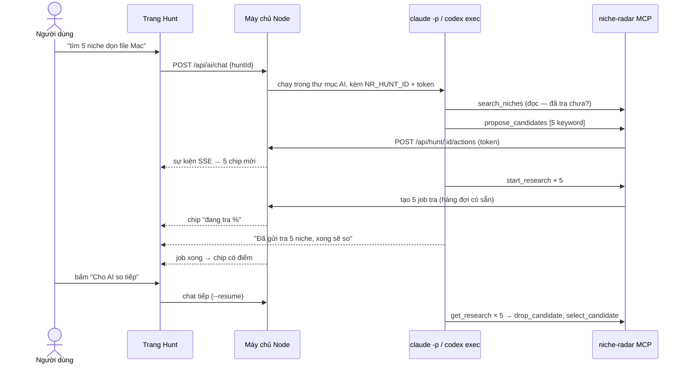

# Phase 28.6 · AI Agent — gõ lệnh, app tự làm, màn hình đổi theo

> Người dùng mở **AI Agent** ở cột phải, gõ *"tìm cho tôi 5 niche app Mac về dọn file, ít đối thủ"* (hoặc gõ `/` chọn
> skill) → AI **bấm nút thay người dùng**: tra niche, mở rộng long-tail, loại niche yếu, gom vào Project — cột trái hiện
> đúng màn hình Research / Explore đã có, số vẫn từ collector. Học cách làm của [Wow Keywords](../doi-thu-tham-khao.md#wow-keywords) nhưng giải bài khó riêng của
> mình: **dữ liệu không cố định, mỗi câu lệnh có thể sinh niche mới.**

<span class="chip chip--done">Xong 2026-10-27 · đã merge main (c47067c) · chạy thật Claude Code + Codex</span>

<div class="box box--goal" markdown>
**Hiện có — đỡ được khoảng 60 % việc.**

- **Khung chat chỉ đọc** ([Phase 27 · 26.4](../app/phase-27-ai-cua-ban.md#264-khung-chat-gop-phase-274)): `ChatPanel.tsx` nổi
  đè lên trang, biết "đang xem gì", gọi Claude Code / Codex trong thư mục AI, giữ phiên, nút Dừng
- **MCP 10 tool chỉ đọc** (26.3): AI đọc được mọi niche, project, lời chê, gap — kèm mã nguồn
- **API ghi đã có sẵn** trong `web/src/server/app.ts`: `POST /research` (tra niche), `POST /explore` + `/expand` (cây
  long-tail), `POST /projects` + `/items` + `/items/undo` (gom + hoàn tác)
- **Tool ghi của [Phase 28.2](phase-28-2-mcp-write.md)** (đang làm): `start_research` · `start_explore` ·
  `create_project` · `collect_to_project` + mức Đề xuất, ghi qua máy chủ local + token, công tắc "Cho AI thêm dữ liệu"
- **Thư mục AI** có skill `/app-demand`, `/compare-niches`; sổ skill ở [Phase 28.3](phase-28-3-skills.md)
- **Thiếu:** khung chat **trong app** vẫn chỉ đọc (luật 26.4, 28.2 giữ nguyên), khung chat che trang, không có chỗ neo
  khi AI sinh niche mới, giao diện không thấy ngay việc AI vừa làm
</div>

**Cần xong trước:** Phase 27 · 26.1–26.4 (✅ xong 2026-10-26) · [Phase 28.2](phase-28-2-mcp-write.md) mức Thêm (tool
ghi + đường ghi qua máy chủ — **phase này không viết lại**, chỉ thêm phần riêng của phiên săn) · skill đợt 1 của
[Phase 28.3](phase-28-3-skills.md) cho `/find-niches`.

<div class="box box--star" markdown>
**Kết quả (2026-10-27) — code xong ở nhánh `phase28-6-ai-agent`, chưa merge main**

- **Trang** `/hunt` (danh sách + mở phiên từ 1 ý tưởng, gõ sẵn `/find-niches …`) và `/hunt/:id`: dải chip ứng viên (điểm v2 +
  chấm màu gợi ý, % khi đang tra, ★ đã giữ, "Đã loại (n)"), khối Câu trả lời + Sức khoẻ của ứng viên đang chọn (dùng lại
  `AnswerRow`, `HealthBlock`), nút Tra / Mở trang đầy đủ / Giữ / Loại bỏ (bắt buộc lý do) / Đưa về ứng viên, ô "+ thêm
  keyword", nút **Tra nốt N ứng viên**. Chat AI ghim bên phải (40 % chiều ngang, chữ 15px), ≤ 900px thành tab
- **Lối vào:** mục **AI Agent** ở menu, ngay sau "Q&A Gap" (main từng đặt nhãn trang Gap là "AI Hunt" — đổi về "Q&A Gap"
  2026-10-27 vì trang Gap không chạy AI, đứng cạnh AI Agent dễ nhầm). < 1000px nằm trong "More features". Link "Or let the AI Agent find niches for you →" ở trang chủ. Bản demo tĩnh không có
- **Gộp main trên máy (2026-10-27):** lấy Phase 10 English + menu mới của main; giữ Cài đặt AI v2, tool ghi 28.2, Hoàn tác lô
  của origin và bọc `tr()` lại chỗ còn sót; "More features" có cả So 2 project (main) lẫn So sánh niche `/compare` (Phase 44).
  Menu ≤ 720px: Cài đặt vào "More features" (nhãn dài làm tràn ngang) — không tràn ở 360–1920px
- **Dữ liệu:** không bảng mới — phiên = project `kind = 'hunt'` (migration 0021: `kind`, `chat_session`), ứng viên = item
  keyword Phase 21/22 (`ứng viên · giữ · loại`). Dòng thời gian + Hoàn tác đọc từ nhật ký project (`by: AI · …`)
- **Tool của phiên** (chỉ khi MCP chạy kèm `NR_HUNT_ID`): `propose_candidates` · `keep_candidate` · `drop_candidate` (lý do +
  `Research #id` có thật) · `suggest_view` (nút "Open" + tô khối `answer` / `health` — gộp `highlight` vào đây).
  `start_research` trong phiên tự thành ứng viên; `create_project` / `tag_project` bị chặn; collect chỉ vào project của phiên
- **Chat:** Claude Code nhận file `.mcp.json` tạm có `NR_HUNT_ID` (xoá sau lượt); Codex nhận env qua `-c` + duyệt sẵn tool
  niche-radar (`default_tools_approval_mode="approve"`) — không có thì Codex từ chối `start_research` ("requires approval").
  Công tắc "Cho AI thêm dữ liệu" tắt → chat phiên chỉ đọc, có nút bật ngay trong khung chat
- **3 skill mới** trong thư mục AI: `/find-niches`, `/long-tail`, `/kill-weak` + mục "Hunt sessions" trong CLAUDE.md / AGENTS.md
- **Khác plan:** cập nhật bằng hỏi lại mỗi 1,5 giây khi AI đang chạy / còn ứng viên đang tra (không SSE — đủ dùng, ít code);
  4 tool thay vì 5 (`highlight` gộp vào `suggest_view`, thêm `keep_candidate`)
- **Chạy thật** trên bản sao DB thật (35 lượt tra): Claude Code `/find-niches mac file cleanup for designers` → 25 giây, 11 lần
  gọi tool, 7 ứng viên, gửi tra 3 (trần 28.2), bấm Tra nốt 4; `/kill-weak` → 36 giây, 15 lần gọi tool, loại 6 kèm điểm + số
  đo thật, giữ `cache cleaner mac` (5/10 TEST THÊM, Research #41), gợi ý Open. Codex: thêm 2 long-tail + tra 29 giây
- **Test:** `tests/hunt.test.ts` 11 test (lib, tool MCP, chặn ngoài phiên, chat 2 tuyến, API) · 455 test xanh · typecheck,
  lint sạch · header không tràn ở 375–1920px · 1340 + 375 đã xem
- **Còn lại:** 320–340px menu còn tràn 16–36px (máy rất cũ); tên / kết luận project người dùng tự gõ tiếng Việt vẫn là tiếng Việt
  (dữ liệu, không dịch)
</div>

## Bài khó: Wow Keywords sửa 1 thứ cố định, mình thì không

| | Wow Keywords | Niche Radar |
|---|---|---|
| Đang làm trên gì | **1 listing** của 1 app (tên, subtitle, keyword) | **nhiều niche**, mỗi câu lệnh có thể sinh niche mới |
| AI thay đổi gì | chữ trong vài ô | cả danh sách niche + mỗi niche một trang dữ liệu riêng |
| Cột trái | luôn là cùng 1 form, chỉ đổi số | nếu AI tự nhảy trang → người dùng lạc, không biết đang xem gì |
| "Biến thể" | tab Current · 1 · 2 · 3, mỗi tab một bản listing, có `+237` so với hiện tại | ? |

**Giải pháp — 3 ý, dùng chung:**

1. **Neo vào một "Phiên săn" (= 1 Project).** Cột trái không chạy theo AI mà theo **dải ứng viên** của phiên: chip
   `Hiện tại · 1 file cleanup · 2 duplicate finder · 3 large file …`, mỗi chip có điểm sức khoẻ + chênh với ứng viên đang
   chọn. Đúng chỗ của tab biến thể bên Wow Keywords — biến thể của mình là **niche**, không phải bản listing.
   AI thêm ứng viên thì chip mới hiện ra (đang tra · %), **trang đang xem không bị giật**; người dùng tự bấm chip, hoặc
   AI gợi ý "mở ứng viên 2" bằng nút trong chat.
2. **AI không vẽ dữ liệu — AI ra lệnh, app chạy, màn hình vẽ lại từ DB.** Mỗi việc AI làm là một tool gọi đúng API mà nút
   tay đang dùng → số trên màn hình y hệt lúc người dùng tự bấm, không có "số AI". Đổi ngữ cảnh không phải vấn đề vì
   mọi thứ hiện ra đều là bản ghi thật trong `niche.db` (Research #id), xem lại được, hoàn tác được.
3. **Một trang mới `/hunt/:id`, nhưng ghép từ component cũ.** Không dựng lại màn hình: cột trái dùng lại khối của
   RunPage / ExplorePage ở dạng gọn; cột phải là `ChatPanel` ở chế độ **ghim** (đẩy nội dung sang, không đè). Các trang
   khác giữ khung chat chỉ đọc như hiện tại + nút **Mở thành phiên săn**.

### Vì sao chọn cách 3 (so 3 cách)

- **A · Gắn agent vào mọi trang** — AI tự điều hướng giữa Research / Explore / Project. Được: không thêm trang.
  Mất: AI nhảy trang làm người dùng lạc, mỗi trang phải dạy AI riêng, khó khoá quyền ghi. → **bỏ**
- **B · Trang AI dựng mới hoàn toàn** — AI trả JSON, trang mới tự vẽ bảng / thẻ. Được: đẹp, gọn.
  Mất: vẽ lại mọi khối đã làm ở Phase 1–26, hai bản số dễ lệch nhau. → **bỏ**
- **C · Trang Hunt ghép khối cũ + neo Project** — dải ứng viên + khối có sẵn + chat ghim. Được: dùng lại ~80 % UI, số chỉ
  1 nguồn, lưu được như Project, quyền ghi chỉ ở 1 trang. Mất: thêm 1 route + 1 kiểu Project. → **chọn**

## Flow 6 bước — AI Agent chạy cùng người dùng (thêm 2026-10-27)

Mục tiêu: không bắt người dùng tự nghĩ lệnh. Trang AI Agent gợi ý sẵn 1 luồng; mỗi bước người dùng bấm 1 nút, AI của họ làm.
Tới bước 6 là xong flow — có brief + spec mang đi làm app.

| # | Bước | AI / app làm gì | Xong khi (đọc từ dữ liệu phiên) |
|---|---|---|---|
| 1 | **Tìm niche** | `/find-niches <ý tưởng>` — AI đề xuất 5–8 keyword, gửi tra | phiên có ≥ 1 ứng viên |
| 2 | **Gói BEST** | AI giữ tối đa 3 niche tốt nhất (BUILD trước, điểm cao, đo nhiều), loại cái yếu — lý do có Research #id | có ≥ 1 niche **giữ** |
| 3 | **Collect thêm** | `/long-tail` các niche đã giữ → 3 long-tail ít đối thủ hơn mỗi cái, gửi tra | có ứng viên thêm **sau** niche đã giữ |
| 4 | **Health check** | còn ứng viên chưa tra → nút **Tra nốt N** (không tốn lượt AI); tra xong → **bảng sức khoẻ** (điểm v2, gợi ý, đã giữ) + AI đọc bảng | bước 3 xong + mọi ứng viên còn sống đã tra |
| 5 | **Brief tính năng** | AI viết brief (vấn đề · ai dùng · 5–7 tính năng MVP từ lời chê / gap · khác đối thủ · Free/Pro · rủi ro), lưu bằng `add_project_note` mở đầu `BRIEF:` | có ghi chú AI `BRIEF:` chưa hoàn tác |
| 6 | **Spec đề xuất** | AI viết spec (màn hình · luồng · Free vs Pro · dữ liệu · quyền · ngoài phạm vi · stack), lưu `SPEC:` | có ghi chú AI `SPEC:` chưa hoàn tác |

- **Không lưu trạng thái riêng** — `flowState()` (`web/src/lib/hunt-flow.ts`) tính lại từ ứng viên + nhật ký AI; Hoàn tác 1 việc
  của AI thì bước tự lùi. Test: `web/tests/hunt-flow.test.ts`.
- **Trang `/hunt`:** 6 bước xếp 1 cột, mỗi bước 1 hình SVG nhẹ (`HuntFlowArt.tsx`) + tên + 1 câu giải thích.
- **Trang `/hunt/:id`:** thanh 6 bước (✓ xong · cam = đang ở đây, bấm để xem lại bước cũ) + thẻ bước có hình + 1 nút gửi lệnh
  cho chat AI bên phải (điện thoại: tự chuyển sang tab AI). Brief / Spec hiện ngay trong thẻ, có nút Copy.
- **Không tự chạy** — mỗi bước người bấm (luật Phase 28: AI không chạy khi người dùng không bấm).
- Brief / Spec ở đây là **bản đề xuất trong phiên** (≤ 2000 ký tự / ghi chú). Bản đầy đủ có Chốt + Gói Build là việc của
  [Phase 28.5](phase-28-5-brief-plan.md).
- Cùng đợt: mục **Nâng cao** trên trang Research gỡ "Cần đo thêm gì" + "Tự chấm 2 trục" (người dùng thấy rối) — tắt bằng
  comment trong `HealthBlock.tsx`, API `score-manual` giữ nguyên, bật lại được.

## Trang Phiên săn trông thế nào

```text
+------------------------------------------+--------------------------+
| < Projects   Phien san: app Mac don file | AI Agent      [Claude v] |
|                                          |                          |
| [Hien tai] [1 file cleanup 6.1*]         | Ban: tim 5 niche don     |
| [2 duplicate 5.4] [3 large file 40%..]   | file tren Mac, it doi thu|
| [+ them tay]                             |                          |
|                                          | v De xuat 5 keyword      |
| -- Ung vien 1 . file cleanup (R#41) --   | v Tra #41 #42  .. #43    |
| Cau tra loi: TEST THEM . 3 ly do . 5 so  | x Loai "mac cleaner"     |
| Suc khoe . Doi thu bi che gi . Ai tra    |   qua dong  [Hoan tac]   |
| (khoi co san cua trang Research, gon)    | > Nen xem ung vien 1     |
|                                          |   [Mo]                   |
| [Mo trang day du] [+ Collect] [Loai]     | [Go lenh... hoac /] [^]  |
+------------------------------------------+--------------------------+
```

*(Phác bằng chữ không dấu cho thẳng cột. `v` xong · `..` đang chạy · `x` đã loại.)*

- **Dải ứng viên** ở trên cùng, nằm ngang (chip ngắn: tên + điểm). Nhiều quá thì cuộn ngang, không xuống 2 hàng
- **Khối ứng viên đang chọn**: 1 cột từ trên xuống, dùng lại khối của trang Research (Phase 23 "đầu trang là câu trả
  lời"); ứng viên Explore thì dùng bản đồ ngách gọn
- **Chat ghim** 400 px bên phải; mỗi hành động AI là **1 dòng trong dòng thời gian** (✓ xong · ⏳ đang chạy · ✗ đã loại),
  có **Hoàn tác** và link `Research #id` bấm được
- **Màn ≤ 900 px:** chat thành tab thứ hai (`Dữ liệu | AI Agent`), không chen 2 cột

## Một câu lệnh chạy ra sao



**Đường đi của lệnh ghi:** tool MCP **không tự ghi DB** (MCP mở DB chỉ đọc — giữ nguyên luật 26.3). Tool ghi gọi HTTP vào
máy chủ local `127.0.0.1` kèm token của lần mở app → máy chủ chạy đúng hàm của nút tay → đẩy sự kiện SSE cho trang Hunt.
Đường này **là của 28.2** (token đọc từ file trong thư mục dữ liệu, gắn nhãn `readOnlyHint` / `destructiveHint`).
Phase này chỉ thêm: máy chủ đẩy sự kiện cho trang Hunt đang mở, và tool biết phiên săn nào. Vì cùng một đường, **Claude
Code bên ngoài** người dùng tự mở cũng lái được trang Hunt (miễn app đang chạy) — đúng câu bán hàng "Give your AI agent
access" của Wow Keywords, khác ở chỗ AI không chỉ đọc mà lái được cả app.

<div class="box box--rules" markdown>
**Ngoại lệ có giới hạn cho luật "khung chat trong app chỉ đọc" (26.4 · 28.2)**

- Chỉ ở trang **Phiên săn**, và chỉ khi công tắc **Cho AI thêm dữ liệu** của 28.2 đang bật — tắt thì chat Hunt chỉ đọc
  và tự đề xuất bằng nút (người bấm mới tra / gom)
- Chỉ mức **Thêm** + **Đề xuất** của 28.2, và chỉ ghi vào **project của phiên đang mở**
- Trang khác: khung chat giữ nguyên chỉ đọc
</div>

### Việc chạy lâu

Research 1 keyword ~1 phút, Explore ~6 phút (đo Phase 3). AI **không đứng chờ** (tốn lượt, dễ quá hạn):

- Tool `start_research` / `start_explore` trả ngay mã job; chip hiện %
- Lượt chat kết thúc bằng câu "đã gửi tra N niche"; khi mọi job của lượt xong → nút **Cho AI so tiếp** trong chat
- Công tắc **Tự so khi tra xong** — **mặc định tắt** (Phase 28: không tự chạy AI khi người dùng không bấm)
- Giới hạn lấy của 28.2: **≤ 3 lượt tra chờ cùng lúc** (lệnh 5 keyword thì 2 cái xếp hàng, chip ghi "chờ") · ≤ 20
  lần ghi / phút. Thêm riêng phiên săn: **≤ 8 ứng viên mới mỗi câu lệnh, ≤ 1 Explore** — vượt thì AI phải hỏi lại

## Tool trong phiên săn

**Dùng lại của 28.2 (không viết lại):** `start_research` · `start_explore` · `get_job_status` · `collect_to_project` ·
`propose_*` · mọi tool đọc. Trong phiên săn, máy chủ tự gắn lượt tra mới thành ứng viên của phiên.

**Thêm ở phase này** (chỉ hiện khi MCP được mở kèm `NR_HUNT_ID`, tức là chat của trang Hunt hoặc AI bên ngoài đang trỏ vào
1 phiên):

- **`propose_candidates`** · mức Thêm — thêm chip ứng viên chưa tra, mỗi cái 1 câu lý do. Hoàn tác: bỏ chip
- **`drop_candidate`** · mức Thêm — loại ứng viên, bắt buộc lý do + mã nguồn (lý do loại của Phase 22). Hoàn tác: khôi phục
- **`suggest_view`** · mức Đọc — hiện nút "Mở ứng viên 2" trong chat, **không tự đổi** trang đang xem
- **`keep_candidate`** · mức Thêm — đánh dấu giữ, lý do + mã nguồn. Hoàn tác: về ứng viên
- `highlight` gộp vào `suggest_view` (tham số `block`) khi làm — 1 tool ít hơn cho AI chọn

**Không có tool:** xoá research, đổi điểm, đổi kết luận / BUILD-BỎ, đổi trạng thái Project, sửa ghi chú, chạy lệnh máy.

### Skill gõ `/` trong ô nhập

Gõ `/` trong chat là chạy skill (đúng như 28.4 đã ghi cho khung chat). Phiên săn cần thêm **3 skill** — ghi tên vào sổ skill
[Phase 28.3](phase-28-3-skills.md), viết nội dung ở lượt plan skill riêng của 28.3:

| Skill | Làm gì |
|---|---|
| `find-niches` | từ 1 ý tưởng / nhóm người dùng → 5–8 keyword ứng viên → tra → xếp theo sức khoẻ |
| `long-tail` | mở rộng ứng viên đang chọn bằng Explore → đề xuất 3 long-tail ít đông hơn (dùng `expand_niche_pack` 28.2) |
| `kill-weak` | loại ứng viên có cờ chặn của Phase 20, mỗi cái 1 lý do có nguồn |
| `compare-niches` · `app-demand` | đã có |

## Làm gì

### T1 · Dữ liệu phiên săn

- Phiên săn = 1 Project có `kind = 'hunt'` (dùng lại bảng `projects`, bàn quyết định, xuất, theo dõi định kỳ chạy được ngay)
- Bảng mới `hunt_candidates` (keyword, store, nước, research_id / explore_id, trạng thái `đề xuất · đang tra · xong · loại`,
  lý do, ai thêm: người / AI) + `hunt_actions` (dòng thời gian: tool, tham số, kết quả, có hoàn tác chưa)
- Lưu `chat_session_id` theo phiên → mở lại phiên là chat nối tiếp được
- Migration có backup trước như mọi migration (Phase 8)

### T2 · Sự kiện + phần riêng của phiên săn ở máy chủ

- `GET /api/hunt/:id/events` — SSE đẩy: chip mới, job %, job xong, hành động bị chặn
- Khi tool 28.2 chạy với `NR_HUNT_ID` → máy chủ gắn kết quả thành ứng viên + ghi `hunt_actions`
- `POST /api/hunt/:id/actions/:aid/undo` — gọi đúng hoàn tác lô của 28.2
- Token + kiểm `Host` / `Origin` như mọi `/api/ai/*`

### T3 · 4 tool riêng của phiên săn

- `propose_candidates` · `drop_candidate` · `suggest_view` · `highlight` trong `web/src/mcp/tools.ts`, chỉ hiện khi có
  `NR_HUNT_ID`
- Chat trang Hunt mở MCP kèm `NR_HUNT_ID` + bật mức Thêm (khi công tắc 28.2 bật); chat trang khác không đổi

### T4 · Trang `/hunt/:id`

- Route mới trong `main.tsx`; layout 2 cột ≥ 900 px, tab dưới 900 px
- Dải ứng viên + khối ứng viên đang chọn (dùng lại khối Research / Explore ở dạng gọn) + nút Mở trang đầy đủ / Collect / Loại
- Tạo phiên: nút **Phiên săn mới** ở trang chủ (cạnh ô tra) + **Mở thành phiên săn** trong khung chat các trang khác
- Người dùng vẫn thêm / loại ứng viên bằng tay — AI và tay dùng chung bảng

### T5 · Chat ghim + dòng thời gian

- `ChatPanel` thêm chế độ `docked` (không `fixed` đè trang) — giữ chế độ nổi cho các trang khác
- Sự kiện tool trong luồng chat → dòng thời gian ✓ / ⏳ / ✗ + Hoàn tác; nút gợi ý `[Mở ứng viên 2]`
- Ô nhập gõ `/` mở danh sách skill (T6); placeholder gợi ý câu lệnh theo trạng thái phiên (trống → "tìm niche về…",
  có ứng viên → "so 3 cái đang có…")

### T6 · Skill

- 3 skill `find-niches`, `long-tail`, `kill-weak` theo luật của 28.3 (tiếng Anh, 1 skill = 1 việc, có bài thử fixture)
- Mỗi skill bắt AI: đọc trước (đã tra chưa) → mới ghi; mọi lý do kèm `Research #id`

### T7 · Codex

- Cùng khung, `codex exec --json` + MCP qua `-c` (như 26.4); Codex sandbox read-only vẫn gọi được MCP → tool ghi đi qua
  HTTP local nên chạy được — **đo thật**, không đoán

### T8 · Kiểm + chạy thật

- Test bằng AI giả (CLI giả in stream-json có tool_use): hành động đúng → chip; vượt trần → bị chặn; tool cấm → không có;
  hoàn tác từng loại; token sai → 403; không `NR_HUNT_ID` → không thấy 4 tool riêng; công tắc 28.2 tắt → chat Hunt chỉ đọc
- Chạy thật 3 kịch bản trên DB thật bằng Claude Code **và** Codex:
  1. "Tìm 5 niche app Mac dọn file, ít đối thủ" → ≥ 4 ứng viên tra xong, AI chọn 1 kèm lý do có nguồn
  2. `/long-tail` trên ứng viên tốt nhất → ≥ 3 long-tail có trong gợi ý đã thu
  3. "Loại cái nào quá đông, gom phần còn lại vào project" → loại có lý do, collect đúng, hoàn tác được hết
- Screenshot trang Hunt ở 1340 px và 375 px, Read từng ảnh

<div class="box box--rules" markdown>
**Luật an toàn — AI giờ đã ghi được**

- Chat trong app chỉ ghi được **ở phiên săn đang mở** + khi công tắc 28.2 bật, ghi đúng vào phiên đó (`NR_HUNT_ID` cố
  định lúc mở chat, AI không đổi được)
- Không tool xoá · không đổi điểm, kết luận, trạng thái — vẫn đúng luật Phase 28 "AI đề xuất, người duyệt"
- Giới hạn 28.2 (≤ 3 lượt tra chờ, ≤ 20 lần ghi / phút) + ≤ 8 ứng viên / câu lệnh + 1 việc AI chạy một lúc (hàng đợi
  26.1) → không đốt lượt của người dùng
- Review / Reddit / GitHub là chữ không tin được: câu lừa tệ nhất chỉ làm AI tra thêm keyword (có trần) hoặc loại 1 ứng
  viên (hoàn tác được) — không đọc file, không chạy lệnh
- Mọi hành động có dòng trong `hunt_actions`; nhật ký AI vẫn không ghi nội dung câu hỏi / trả lời
- Bản demo web tĩnh: trang Hunt chỉ xem phiên mẫu đã chụp, ô chat xám "Chạy trên app"
</div>

<div class="box box--star" markdown>
**Xong khi**

- Từ trang chủ tạo phiên săn, gõ 1 câu → ≥ 4 chip ứng viên tra xong, cột trái không tự nhảy trang lúc AI đang làm
- Số ở khối ứng viên = số ở trang Research đầy đủ của cùng `Research #id` (test so 2 nguồn)
- 3 kịch bản T8 chạy được bằng Claude Code và Codex trên DB thật, mọi lý do loại / chọn có mã nguồn có thật
- Mọi hành động AI hoàn tác được; vượt trần / tool cấm bị chặn và hiện trong dòng thời gian
- Claude Code bên ngoài (đã Thêm MCP) gọi `propose_candidates` khi app đang mở → chip hiện trên trang Hunt
- Tắt AI → trang Hunt vẫn dùng tay được (thêm / tra / loại ứng viên); toàn bộ test không AI xanh
- Screenshot 1340 + 375 đã xem, không cột hẹp, chat không đè dữ liệu
</div>

<div class="box box--danger" markdown>
**Không làm ở phase này**

- AI điều khiển các trang khác ngoài phiên săn (Research, Explore, Project vẫn chỉ đọc)
- AI tự chạy theo lịch / tự so khi người dùng không bấm (công tắc có, mặc định tắt)
- Terminal nhúng (26.5) — việc riêng của Phase 27 đợt 2
- Tool xoá, AI đổi điểm / kết luận / BUILD-BỎ
- Nhiều phiên săn chạy song song, chia sẻ phiên cho người khác
- Voice (nút micro như Wow Keywords) — ghi Appendix nếu có người xin
</div>

**Câu cần anh chốt (đã có mặc định, không chốt thì làm theo mặc định):**

1. Số phase: **28.6** — làm sau 28.2 mức Thêm, trước bán 29. Hay kéo lên ngay sau 28.2 làm "wow" cho landing?
2. Ngoại lệ "chat trong app ghi được" chỉ ở trang Phiên săn + công tắc 28.2 bật — **có**
3. Công tắc **Tự so khi tra xong** mặc định **tắt**
4. ≤ 8 ứng viên mới mỗi câu lệnh, ≤ 1 Explore

[← Phase 28.5 · Brief + Spec + Plan](phase-28-5-brief-plan.md) · [Phase 28](../app/phase-28-ai-tinh-nang.md) · [Phase 28.2 · MCP đợt 2](phase-28-2-mcp-write.md)
