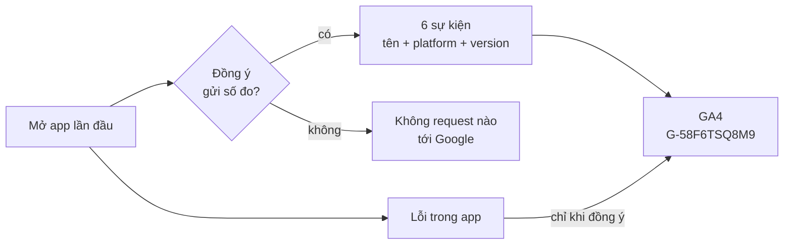

# Phase 29 · Analytics + báo lỗi

> Đo **người dùng đi tới bước nào** trong phễu và **biết khi app lỗi** trên máy người khác — có hỏi đồng ý, không gửi
> chữ người dùng gõ. Bản gọn: 6 sự kiện, báo lỗi đi chung GA4, không thêm dịch vụ nào.

Xong 2026-10-27 · bản gọn

## Chạy thế nào

**GA4** (Google Analytics 4, công cụ đếm lượt dùng miễn phí) nhận sự kiện — cùng property với landing shotmatic.app,
tách bằng `platform` (mac · windows · web). **Phễu** là chuỗi bước người dùng đi qua; nhìn phễu biết họ rơi ở bước nào.

## Sự kiện gửi đi

| Sự kiện | Khi nào |
|---|---|
| `app_open` | mở app (đã đồng ý) |
| `niche_search` | `POST /api/research` thành công |
| `explore_start` | `POST /api/explore` thành công |
| `ask_ai` | `POST /api/ai/chat` hoặc chấm bàn quyết định bằng AI |
| `export` | bấm tải file ở hộp Xuất |
| `app_error` | lỗi JS chưa bắt — chỉ gửi **tên loại lỗi** (`TypeError`…), không gửi message |

Mỗi sự kiện kèm `platform` · `app_version` · mã máy ngẫu nhiên. Không gửi keyword, niche, project, email, URL trang.

## Đã làm

- **`web/src/lib/analytics.ts`** — chỗ gửi duy nhất. Gửi thẳng `google-analytics.com/g/collect`, **không nạp gtag.js**:
  gtag tự gửi thêm scroll / bấm link ngoài (link store, Reddit → lộ niche) theo cài đặt property. Đếm bằng cách bọc
  `fetch` một lần (`eventFor(method, url)` — test được), không rải `track()` khắp nơi
- **`web/src/lib/analytics-consent.ts`** + `GET/POST /api/settings/analytics` — đồng ý + mã máy lưu trong DB (bảng
  `settings`), không localStorage: app Tauri đổi port mỗi lần mở nên localStorage / cookie mất
- **`AnalyticsConsent.tsx`** — thanh hỏi lần đầu (Allow / No thanks + link Privacy) và mục **Settings → Data & backup**
  bật / tắt lại; tắt là ngừng gửi ngay. Bản demo không hiện
- Test `tests/analytics.test.ts`: map đường → sự kiện, lỗi không lộ message, đồng ý lưu + giữ mã máy

**Xong khi — đã kiểm 2026-10-27 (chạy thật, DB tạm)**

- Chưa chọn → thanh hỏi hiện, 0 request tới Google
- **No thanks** → mở lại không hỏi nữa, 0 request tới Google
- Bật ở Cài đặt → request `g/collect` chỉ có `en=app_open` / `app_error` + `ep.platform` · `ep.app_version` ·
  `ep.error_name=RangeError`; message lỗi chứa keyword không bị gửi; không có `scroll` hay sự kiện tự động
- Tắt giữa chừng → gây lỗi tiếp, không thêm request nào
- 450 test xanh · typecheck sạch

**Chưa kiểm (để lúc build bản sau):** bảng phễu trong GA4 (cần vài ngày số thật) · chạy trong app Tauri đã ký.

**Bỏ khỏi bản gọn**

- `trial_start`, `license_activate` — làm cùng [Version 10](version-10.md) khi có trial / license
- `compare_open`, `geo_pack`, `explore_done` — thêm khi cần đọc phễu sâu hơn
- Dịch vụ báo lỗi riêng (Sentry…), báo lỗi phía máy chủ Node
- Gửi nội dung người dùng gõ, email, tên · quảng cáo · session replay / heatmap · server analytics riêng

[Tổng quan Version 9](version-9.md) · [Phase 30 · Trang Riêng tư →](phase-30-privacy-delete.md)
