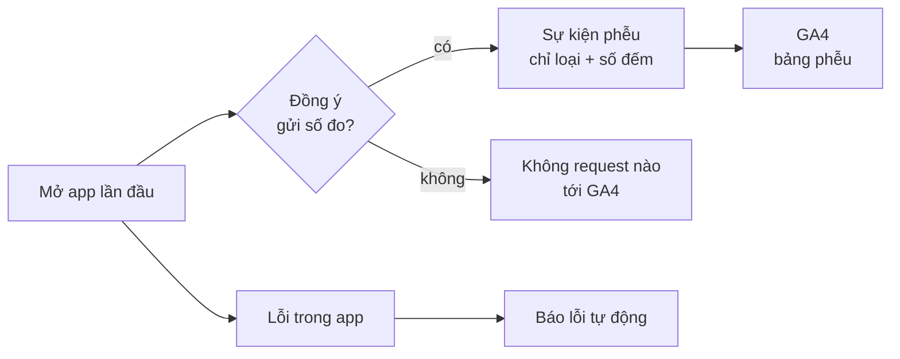

# Phase 29 · Analytics + báo lỗi

> Đo **người dùng đi tới bước nào** trong phễu để biết tính năng nào đáng giữ, và **biết khi app lỗi** trên máy người
> khác mà không cần họ báo. Có hỏi đồng ý, không gửi chữ người dùng gõ.

Chưa làm · đầu Version 9 · sau Phase 45

## Chạy thế nào

**GA4** (Google Analytics 4, công cụ đếm lượt dùng miễn phí) nhận sự kiện. **Phễu** là chuỗi bước người dùng đi qua;
nhìn phễu biết họ rơi ở bước nào.

## Sự kiện gửi đi

| Sự kiện | Khi nào |
|---|---|
| `app_open` | mở app / bản Web |
| `trial_start` | lần đầu mở app, bắt đầu dùng thử ([Phase 33](phase-33-paywall-trial.md)) |
| `niche_search` | tra một niche |
| `explore_done` | explore xong |
| `compare_open` | mở so sánh |
| `ask_ai` | hỏi AI |
| `export` | xuất file |
| `geo_pack` | xuất gói GEO |
| `license_activate` | nhập license key thành công |

Chỉ gửi **loại sự kiện + số đếm**. Không gửi chữ keyword, niche, email, tên.

## Làm gì

| | |
|---|---|
| :material-chart-timeline-variant: **Sự kiện GA4** | 9 sự kiện ở bảng trên, phễu: mở app → dùng thử → tra niche → explore → xuất → nhập license. Mỗi sự kiện kèm `platform` (mac · windows · web) và số phiên bản app |
| :material-hand-okay: **Hỏi đồng ý** | hỏi lần đầu mở, tắt / bật lại được trong cài đặt |
| :material-bug: **Báo lỗi tự động** | chọn lúc làm: dịch vụ có gói miễn phí, không cần server riêng (bỏ Firestore 2026-10-26). Ghi lựa chọn + lý do vào plan |
| :material-file-code: **File** | mới: một chỗ gửi sự kiện duy nhất trong `web/src/lib/`, cạnh `errors.ts` hiện có (tên chốt ở plan) |

**Xong khi**

- Bảng phễu GA4 hiện đủ bước
- Từ chối đồng ý → không có request nào tới GA4 (kiểm bằng network log)
- Kiểm payload của cả 9 sự kiện: không có chữ keyword / niche / email
- Gây lỗi thử trong app → lỗi hiện ở chỗ báo lỗi đã chọn

**Không làm ở phase này**

- Gửi nội dung người dùng gõ, email, tên
- Quảng cáo, bán dữ liệu người dùng
- Ghi lại thao tác màn hình (session replay), heatmap
- Server analytics riêng, tài khoản người dùng

[Tổng quan Version 9](version-9.md)

Plan code chi tiết: [Phase 29](../superpowers/plans/2026-10-25-niche-radar-phase64-analytics-errors.md)
