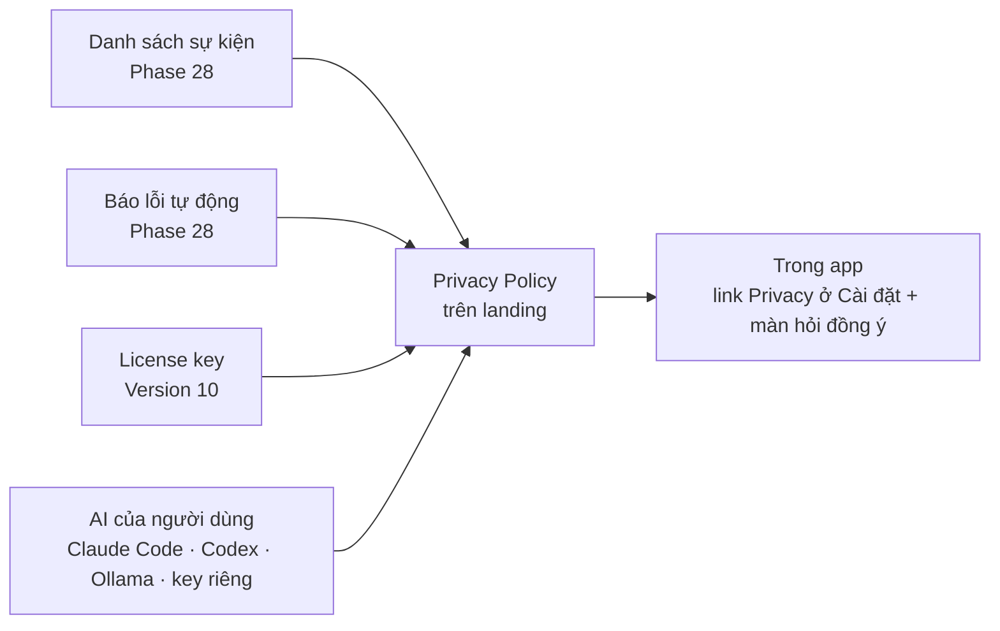

# Phase 29 · Trang Riêng tư

> Người tải app đọc được **trang Privacy** ghi đúng thứ app gửi đi. Đây là điều kiện để mở bán ở Version 10.
>
> **Đổi 2026-10-26:** bỏ tài khoản nên bỏ luôn phần **xoá tài khoản** và **xuất dữ liệu cloud** — không còn gì trên
> cloud để xoá. Dữ liệu trên máy đã xuất / xoá được từ [Phase 8](phase-8-project-data.md).

Chưa làm · sau Phase 28

## Chạy thế nào

## Làm gì

- **Privacy Policy** ghi đúng từng thứ gửi đi: 9 sự kiện ở [Phase 28](phase-28-analytics-errors.md), báo lỗi, kiểm
  license + cập nhật app, chữ gửi tới AI do người dùng tự chọn. Ghi rõ: dữ liệu niche, project, key ở lại máy
- **Đặt trang** trên landing (cùng chỗ trang tải app) và link trong app: Cài đặt + màn hỏi đồng ý lần đầu mở
- **File:** trang Privacy ở landing (chỗ đặt chốt ở plan) · link trong `web/src/client/`

**Xong khi**

- Privacy Policy khớp danh sách sự kiện Phase 28 (đối chiếu từng dòng)
- Mở app lần đầu → màn hỏi đồng ý có link Privacy, bấm mở đúng trang
- Kiểm network log 1 phiên dùng thử: không có request nào ngoài danh sách trong Privacy

**Không làm ở phase này**

- Tài khoản, xoá tài khoản, xuất dữ liệu cloud — bỏ 2026-10-26
- Thanh toán, license: [Version 10](version-10.md)

[Tổng quan Version 9](version-9.md)

Plan code chi tiết: [Phase 29](../superpowers/plans/2026-10-25-niche-radar-phase65-privacy-delete.md) (bản cũ có phần tài khoản — bỏ phần đó khi code)
