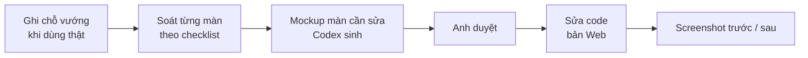

# Phase 29 · UI / UX Improvement

> Làm cho tool **dễ dùng hơn** dựa trên chỗ vướng thật — ít bấm hơn, đọc nhanh hơn, không lạc.

Chưa làm

## Cách chạy

## Soát gì

| | |
|---|---|
| :material-map-marker-path: **Luồng chính** | gõ niche → ra quyết định mất mấy bước, chỗ nào phải đoán |
| :material-progress-clock: **Trạng thái** | đang tải · rỗng · lỗi · bị chặn — màn nào thiếu |
| :material-table-eye: **Bảng dày** | keyword, matrix, đối thủ — đọc được ở cửa sổ app nhỏ không |
| :material-theme-light-dark: **Sáng / tối** | đủ tương phản cả hai chế độ |
| :material-keyboard: **Bàn phím + đọc màn hình** | dùng được không cần chuột |
| :material-monitor-cellphone: **Cỡ màn** | 1280 · 1340 · 375 |

**Xong khi**

- Danh sách chỗ vướng có trạng thái từng mục (sửa / bỏ + lý do)
- Mỗi màn sửa có screenshot trước / sau đã Read ở bản Web

**Không làm**

- Thêm tính năng mới (ghi sang Phase 9)
- Đổi hết giao diện vì thích — chỉ sửa chỗ có vướng thật

