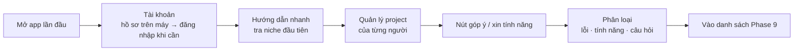

# Phase 30 · Account + Flow người dùng

> Khi có **người khác** dùng tool: tài khoản, luồng từ lúc mở app tới lúc ra quyết định, và **đường nhận tính năng mới**
> từ người dùng.

Không làm · 2026-10-26

**Không làm (chốt 2026-10-26):** bỏ tài khoản — app bán bằng license key, dữ liệu ở máy (học Wow Keywords). Trang giữ lại để tra, không code.

## Cách chạy

## Làm gì

| | |
|---|---|
| :material-account: **Tài khoản** | bắt đầu bằng hồ sơ trên máy (tên, nơi lưu dữ liệu); đăng nhập thật chỉ khi có bán / chia sẻ |
| :material-key-variant: **License key** (nếu bán) | dùng lại mẫu Lemon Squeezy của RAM Rescue — dùng thử N ngày, kích hoạt key |
| :material-routes: **Flow người dùng** | lần đầu mở → tra niche đầu tiên → xem kết quả → lưu project, không cần đọc tài liệu |
| :material-folder-account: **Quản lý project** | project của từng người, chia sẻ bằng file (Phase 8), không sync cloud |
| :material-message-plus: **Tiếp nhận tính năng mới** | nút góp ý trong app → file / email / issue → phân loại → vào danh sách Phase 9 |

**Xong khi**

- 1 người ngoài (không phải anh) cài app, tra 1 niche, gửi 1 góp ý — không cần hỏi anh
- Góp ý đó hiện trong danh sách Phase 9 với nhãn phân loại

**Không làm**

- Server nhiều người dùng, sync cloud realtime — chỉ khi có quyết định host (Idea Lab qua test)
- Thanh toán trong tool khi chưa có quyết định bán

Plan code chi tiết: [Phase 30](../superpowers/plans/2026-10-25-niche-radar-phase30-account.md)
