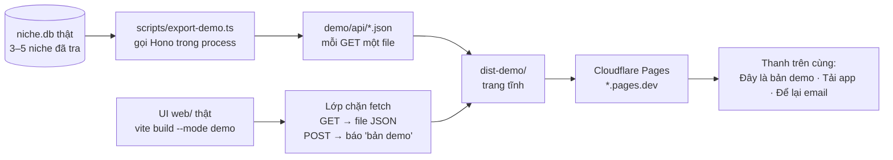

# Phase 31a · Demo Site (show hàng)

> Một trang web **tĩnh** để đi marketing: khách bấm thử **giao diện thật** của Niche Radar trên **dữ liệu chụp sẵn**
> từ vài niche đã tra, không cần server. Muốn xài thật → để lại email + tải app về máy. Host server để các phase sau.

Chưa làm · plan 2026-10-25 · đầu Version 2, trước Phase 31

## Vì sao làm trước

- Host server bản Web (Cloudflare Workers, Railway…) phải viết lại tầng DB (`better-sqlite3` → D1) + job chạy dài,
  và IP datacenter dễ bị Google chặn. Trang demo tĩnh **không đụng** mấy thứ đó.
- App tải về chạy trên máy khách → tra bằng IP nhà của họ, dữ liệu nằm trên máy họ.
- Trang demo cũng là **bài test bán trước** ([Phase 7](phase-7-review-validate.md)): đếm email + lượt tải trước khi đổ
  công vào server, tài khoản, thanh toán.

## Chạy thế nào

## Làm gì

| | |
|---|---|
| :material-database-export: **Xuất dữ liệu mẫu** | `web/scripts/export-demo.ts`: chọn 3–5 niche đã tra (Research + Explore + Trends + Feature Gap) → gọi đúng các route GET của `src/server/app.ts` trong process → ghi `demo/api/…json`. Bỏ trường nhạy cảm (key, đường dẫn máy, ghi chú riêng) |
| :material-swap-horizontal: **Chế độ demo** | `vite build --mode demo` → `dist-demo/`. Một lớp chặn `window.fetch` duy nhất: GET `/api/*` đọc file JSON tương ứng (query string đổi thành tên file); POST / DELETE không gọi đi đâu, hiện thông báo "Bản demo — tải app để tra niche của bạn". Không sửa từng component |
| :material-eye: **Giới hạn UI trong demo** | ô gõ niche mới, Cài đặt, Dữ liệu (backup/restore), Project sửa được → giữ nút nhưng xám + "Có trong app" (không xoá nút). TrustMRR và mọi số "tiền thật" lấy từ nguồn cấm quét → ẩn khỏi demo |
| :material-flag: **Thanh demo** | dính trên cùng mọi trang: "Bản demo · dữ liệu chụp ngày …" + nút **Tải app** + **Để lại email** |
| :material-download: **Nút tải** | trỏ tới file `.dmg` mới nhất (ký + notarize sẵn). Chỗ để file + chế độ tải → chốt ở mục "Cần anh chốt" |
| :material-email-outline: **Form email** | 1 form nhỏ trong thanh demo + trang cuối. Dịch vụ email anh tự mở tài khoản; Claude chỉ nối form |
| :material-chart-line: **Đo** | GA4 (hoặc Cloudflare Web Analytics, 0đ): `demo_view`, `download`, `generate_lead`, `demo_blocked_action` (khách bấm nút chỉ có trong app — biết họ muốn gì) |
| :material-cloud-upload: **Deploy** | Cloudflare Pages, thư mục `web/dist-demo`. Anh tự đăng nhập Cloudflare / tạo project; Claude viết lệnh `npm run demo:build` + `npm run demo:deploy` |
| :material-check-decagram: **Kiểm** | test lớp chặn fetch (GET đủ file, POST không rò ra mạng); mở `dist-demo` local xem 1340 + 375; bấm hết các trang, không trang nào trắng / lỗi console |

## Cần anh chốt trước khi code

| Câu hỏi | Gợi ý của Claude |
|---|---|
| Khách là ai, **ngôn ngữ** demo? UI hiện tiếng Việt | Đang có nhánh `phase9c-i18n` (worktree `niche-radar-i18n`). Đã vào `main` trước 29a → demo build cả tiếng Anh; chưa vào → demo tiếng Việt, không gộp việc dịch vào phase này |
| Niche nào làm mẫu? | 3–5 niche đã tra đầy đủ trên DB thật, đủ màu (1 niche đông, 1 niche trống, 1 niche có tiền) |
| Nút tải: **beta miễn phí** hay **trial có khoá**? | Phase này: beta miễn phí + bắt để email trước khi tải. Trial + license key cần [Version 10](version-10.md) (Phase 68) + Phase 79 — chưa có thì không hứa "trial" trên trang |
| File `.dmg` để đâu? | GitHub Releases của một repo public (kiểu TapRec) hoặc Cloudflare R2 |
| Domain? | `*.pages.dev` cho đợt đầu (0đ); gắn subdomain riêng sau khi có người vào |

**Luật**

- Demo chỉ dùng **dữ liệu thật đã tra**, ghi rõ ngày chụp. Không bịa niche, không bịa số, không bịa lời khen khách
- Không có route nào gọi ra Google Play / App Store / Trends từ trang demo — trang tĩnh 100%
- Không đưa key, đường dẫn máy, ghi chú riêng của anh vào file JSON (soát bằng script trước khi deploy)
- Một lớp chặn fetch cho cả app, không rẽ nhánh `if (demo)` rải trong component
- Claude không đăng nhập Cloudflare / dịch vụ email, không trả phí

**Xong khi**

- `npm run demo:build` ra `dist-demo/` chạy được khi mở bằng server tĩnh bất kỳ, không cần `npm start`
- 3–5 niche bấm qua được Research · Explore · Trends · Feature Gap, không trang trắng, console sạch; đã xem 1340 + 375
- Bấm nút chỉ có trong app → hiện "Bản demo", không request nào ra ngoài
- Trang live trên Cloudflare Pages; tải `.dmg` từ link trên trang mở được trên máy Mac khác
- Gửi 1 email test → vào đúng danh sách; GA thấy `demo_view`, `download`, `generate_lead`

**Không làm ở phase này**

- Host server thật (Workers + D1, Railway, Fly, VPS) — phase sau, khi có người tải / người hỏi mua
- Tài khoản, đăng nhập, thanh toán, trial + license key — [Version 10](version-10.md) + Phase 79
- Dịch UI (việc của nhánh `phase9c-i18n`), bản Windows
- Landing bán hàng đầy đủ (định vị, hook, video) — [Phase 70](phase-70-positioning-landing.md); trang demo chỉ là "bấm thử"
- Đăng bài kênh nào — Version 11

[Tổng quan Web](index.md)
