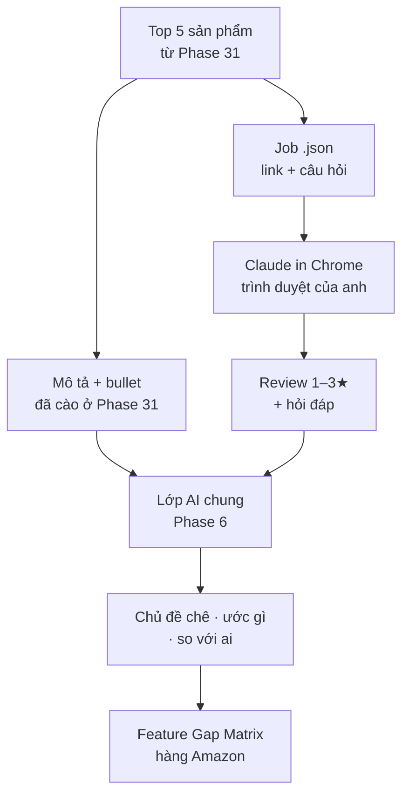

# Phase 32 · Amazon Research (AI)

> Để AI **đọc review Amazon** thay mình: người mua chê gì, ước gì, so với sản phẩm nào — ra danh sách điểm yếu đối thủ
> có trích dẫn.

Chưa làm · sau Phase 31

## Chạy thế nào

## Chọn tuyến AI

| Tuyến | Đọc gì | Tiền | Ghi chú |
|---|---|---|---|
| **Claude in Chrome** (đề xuất chính) | trang review trong trình duyệt anh đang dùng | gói Claude đang có | Amazon giấu phần lớn review sau đăng nhập — Claude đọc trong phiên anh đã tự đăng nhập, **chỉ đọc**, nhập kết quả bằng file `.json` |
| **Lớp AI Phase 6** | mô tả, bullet, vài review hiện công khai trên trang sản phẩm | theo tuyến Phase 6 | không cần đăng nhập, ít review hơn |
| Gemini / AI khác có duyệt web | trang công khai | trả theo lượt | thử ở bài thử chuẩn nếu 2 tuyến trên yếu |

Bài thử chuẩn: 5 sản phẩm × review 1–3★ của 1 niche → so chủ đề + trích dẫn giữa các tuyến, chọn 1.

## Làm gì

| | |
|---|---|
| :material-emoticon-angry: **Chủ đề chê** | gom review 1–3★ thành chủ đề + số lần + câu nguyên văn |
| :material-star-shooting: **Ước gì** | "I wish it had…", "would be perfect if…" → nhu cầu chưa được đáp |
| :material-swap-horizontal: **So với ai** | sản phẩm / app người mua nhắc tới khi so sánh |
| :material-cellphone-link: **Gợi ý cho app** | chỗ một app làm tốt hơn sản phẩm vật lý / template (nhắc lại, theo dõi, đồng bộ…) — mỗi gợi ý kèm review gốc |
| :material-table-plus: **Vào Feature Gap Matrix** | thêm cột nguồn Amazon cho matrix Phase 4 |

**Luật**

- Claude không đăng nhập thay anh, không nhập mật khẩu — anh tự đăng nhập Amazon trong Chrome nếu muốn đọc nhiều review
- Chỉ đọc; không viết review, không thêm giỏ hàng, không mua
- AI không bịa số — giá, sao, BSR lấy từ Phase 31

**Xong khi**

- Bảng thử tuyến điền đủ
- 3 niche thật có chủ đề chê + ước gì, mọi câu có link review
- Có ít nhất 1 "gợi ý cho app" được anh đánh giá là đáng soi

**Không làm ở phase này**

- Cào review sau đăng nhập bằng script (dễ bị khoá tài khoản)
- Tự mua / tự đặt hàng để xem sản phẩm

