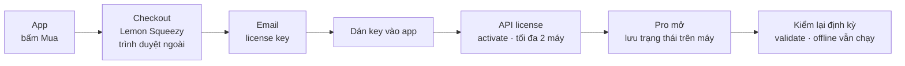

# Phase 32 · Thanh toán + license key

> Bấm Mua → trả tiền → **email gửi license key** → dán vào app → Pro mở. Dùng **Lemon Squeezy** (nền tảng bán phần
> mềm, lo thuế VAT các nước thay mình) và **API license key** có sẵn của nó: app tự kích hoạt / kiểm / gỡ máy, không
> cần server riêng, không tài khoản. Anh tạo cửa hàng, Claude nối code.
>
> **Đổi 2026-10-26:** bỏ webhook + Cloud Functions + quyền Pro trên tài khoản Firebase. Học Wow Keywords: license key là đủ.

Xong 2026-10-28 · plan + checklist cửa hàng · code gắn ở Phase 33

## Chạy thế nào

**License key** = chuỗi mã gửi qua email sau khi mua, dán vào app để mở bản đầy đủ. **Activate** = gắn key với một máy;
Lemon Squeezy tự đếm số máy và từ chối khi vượt giới hạn.

## Làm gì

- **Sản phẩm:** theo `money.md` Phase 31, bật "Generate license keys", giới hạn 2 máy. Anh tạo cửa hàng, nhập ngân hàng, thuế
- **Checkout:** nút Mua mở trang checkout trong trình duyệt ngoài, có sẵn mẫu RAM Rescue
- **Kích hoạt:** dán key → gọi API activate, lưu mã máy trên máy · key sai / hết lượt máy → báo rõ bằng lời thường
- **Kiểm lại:** validate lúc mở app tối đa 1 lần / ngày; mất mạng vẫn dùng được tới 14 ngày; hoàn tiền / huỷ key → về
  trạng thái hết dùng thử ở lần kiểm sau
- **Gỡ máy:** nút "Chuyển license sang máy khác" gọi deactivate
- **File:** mới: lớp license trong `web/src/server/` (gọi API Lemon Squeezy) + màn nhập key ở `web/src/client/` (tên chốt ở plan)

**Xong khi**

- Mua bằng chế độ test → nhận key → kích hoạt → Pro ≤ 30 giây, không khởi động lại
- Kích hoạt máy thứ 3 → báo "đã dùng trên 2 máy" kèm nút gỡ máy cũ
- Hoàn tiền / tắt key trên dashboard → lần kiểm sau app về hết dùng thử, dữ liệu còn đủ
- Tắt mạng → Pro vẫn chạy trong 14 ngày

**Không làm ở phase này**

- Tài khoản, webhook, Cloud Functions, server riêng
- Mac App Store / Microsoft Store / thanh toán trong app của Apple
- Tự xử lý thẻ, crypto, chuyển khoản tay
- Claude tạo tài khoản Lemon Squeezy, nhập ngân hàng / thuế, bấm bán thật
- Dùng thử, paywall (Phase 33)

## Kết quả (2026-10-28)

Phase này chốt **cách nối** và **việc anh làm trên Lemon Squeezy**. Code license (activate / validate / deactivate) viết
chung với màn mua ở [Phase 33](phase-33-paywall-trial.md) — tách ra thì không có màn nào để thử.

### Việc của anh trên Lemon Squeezy (Claude không làm thay)

Dùng lại cửa hàng **icecraft** đang bán RAM Rescue (ngân hàng, thuế đã xong).

1. **Products → New product:** tên `ShotMatic Pro`, giá **$39.99**, *Single payment*
2. Bật **Generate license keys** · *Activation limit* **2** · *License length* **Unlimited**
3. Phần mô tả: "Lifetime license for ShotMatic for Mac · 2 Macs · free 1.x updates"
4. Bật **Test mode** → mua thử 1 lần bằng thẻ test → giữ key để thử ở Phase 33
5. Gửi Claude 2 thứ: **link checkout** (`https://icecraft.lemonsqueezy.com/checkout/buy/…`) và **Product ID** (số, ở trang sản phẩm)

Chưa có 2 thứ trên thì app vẫn build được: nút **Mua** hiện xám "Sắp mở bán", ô nhập key vẫn chạy.

### Hợp đồng code (Phase 33 làm theo)

| | |
|---|---|
| API Lemon Squeezy | `POST https://api.lemonsqueezy.com/v1/licenses/activate` · `/validate` · `/deactivate` — không cần API key, không webhook |
| Kiểm đúng sản phẩm | `meta.product_id` khớp Product ID đã cấu hình → key của RAM Rescue không mở được ShotMatic |
| Lưu trên máy | `license.json` trong thư mục dữ liệu app (key, instance id, lần kiểm cuối) |
| Kiểm lại | khi mở app, tối đa 1 lần / ngày · mất mạng vẫn Pro tới 14 ngày từ lần kiểm được cuối |
| Hoàn tiền / tắt key | lần kiểm sau trả `valid: false` → về hết dùng thử, dữ liệu giữ nguyên |
| Cấu hình | `web/src/lib/license/config.ts`: giá, số ngày thử, link checkout, Product ID |

[Tổng quan Version 10](version-10.md)

Plan code chi tiết: [Phase 32](../superpowers/plans/2026-10-25-niche-radar-phase67-payments.md) (bản cũ dùng webhook + Firebase — viết lại theo trang này khi code)
