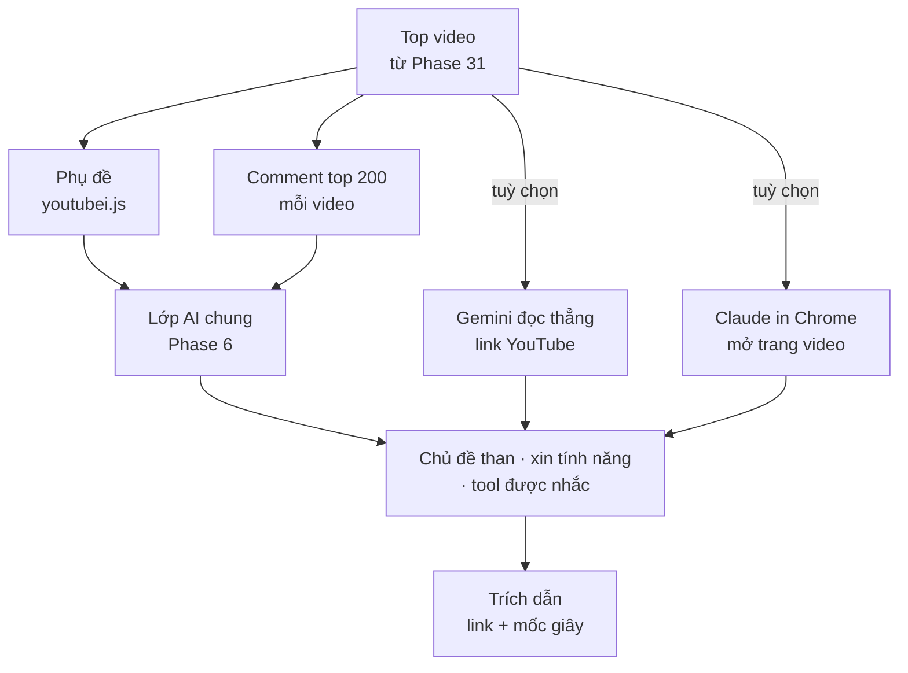

# Phase 32 · YouTube Research (AI)

> Để AI **xem / đọc thay mình** video và comment của niche: người xem than gì, xin gì, đang dùng app / tool nào —
> có trích dẫn kèm mốc thời gian.

Chưa làm · sau Phase 31

## Chạy thế nào

## Chọn tuyến AI

| Tuyến | Đọc gì | Tiền | Ghi chú |
|---|---|---|---|
| **Phụ đề + comment → lớp AI Phase 6** (đề xuất chính) | chữ đã lấy bằng `youtubei.js` | theo tuyến đã chọn ở Phase 6 (có thể 0 đ) | rẻ nhất, dùng lại toàn bộ Phase 6 |
| **Gemini API đọc link YouTube** | cả hình + tiếng của video | trả theo lượt (rẻ với Flash) | hợp video không có phụ đề / demo app trên màn hình — kiểm giới hạn lúc làm |
| **Claude in Chrome** | trang video + comment trong trình duyệt của anh | gói Claude đang có | tool xuất *job* `.json` (danh sách video + câu hỏi) → Claude đọc → nhập kết quả `.json` |

Không biết tuyến nào tốt hơn → chạy cùng **bài thử chuẩn** trên 10 video của 1 niche (như Bước 0 Phase 6), ghi
chất lượng · thời gian · tiền rồi chọn.

## Làm gì

| | |
|---|---|
| :material-emoticon-angry: **Chủ đề than** | gom comment thành chủ đề + số lần + câu nguyên văn |
| :material-lightbulb-on: **Xin tính năng** | "wish there was an app that…", "how do I…" → danh sách nhu cầu chưa ai đáp |
| :material-apps: **Tool / app được nhắc** | app, web, template người xem đang dùng → nối sang đối thủ ở Phase 1–2 |
| :material-text-box-check: **Tóm tắt video** | 5 dòng mỗi video, mỗi câu có mốc giây bấm được |
| :material-table-plus: **Vào Feature Gap Matrix** | tính năng được xin nhiều → gợi ý hàng mới cho matrix Phase 4 |

**Luật AI** (giống Phase 6)

- AI không bịa số — view, sub, số comment lấy từ Phase 31
- Mọi câu kèm link video + mốc giây hoặc link comment
- Tắt AI → Phase 31 vẫn chạy

**Xong khi**

- Bảng thử tuyến điền đủ (ít nhất phụ đề + comment và 1 tuyến khác)
- 3 niche thật có chủ đề than + xin tính năng, mọi câu có trích dẫn bấm được
- Mỗi lần tra dưới trần chi phí đặt sẵn

**Không làm ở phase này**

- Tải video về máy, xử lý video bằng ffmpeg
- Đăng comment / tương tác với kênh

Plan code chi tiết: [Phase 32](../superpowers/plans/2026-10-25-niche-radar-phase32-youtube-ai.md)
