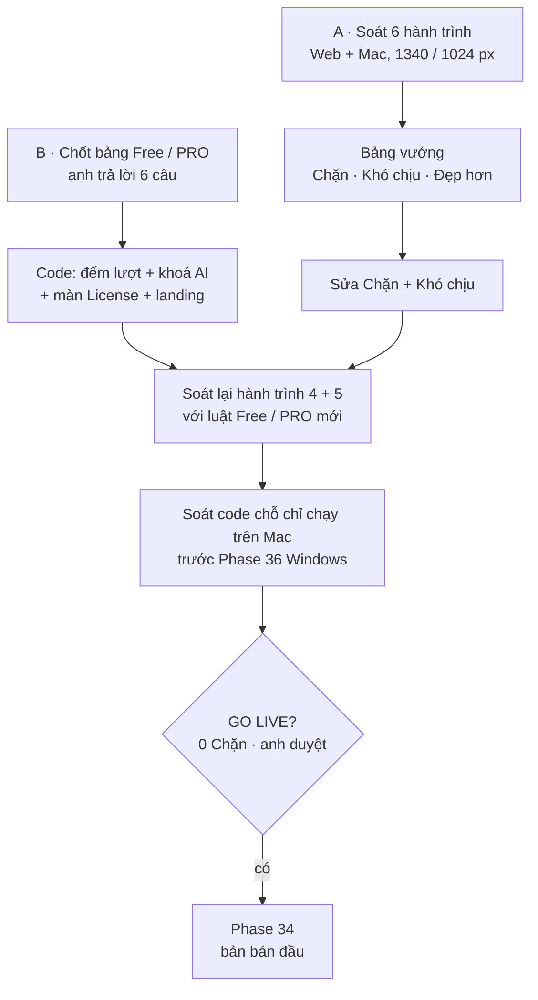

# Phase 33.1 · Review trước GO LIVE

> Cổng cuối trước khi bán bản đầu (Phase 34). Hai việc: **(A)** soát lại UI / UX của bản Web và bản app Mac / Windows theo
> đúng các hành trình người mua sẽ đi, sửa hết chỗ chặn; **(B)** chốt lại **Free / PRO Lifetime** — tính năng nào cho xài
> free, tính năng nào phải mua. Đề xuất của anh (2026-10-29): Niche Research vẫn free nhưng giới hạn **10–15 lượt**, AI
> phải trả phí hoặc free chỉ chạy được **1–2 bước**.

Phần B chốt đủ 6 câu 2026-10-29 · làm trong ⭐ Phase đặc biệt Build App + Money

## Mục tiêu · cần làm · KHÔNG làm

- **Mục tiêu:** người lạ tải app về, trong 10 phút tra được niche đầu tiên, hiểu mình đang ở Free hay PRO, còn bao nhiêu
  lượt, mua thì được thêm gì — không vấp lỗi, không gặp chữ tiếng Việt, không thấy nút bấm ra trang trống.
- **Cần làm:** (A) soát 6 hành trình trên bản Web + bản Mac, ghi bảng vướng có ảnh, sửa mức Chặn + Khó chịu, chụp lại;
  soát trước những chỗ sẽ vỡ trên Windows. (B) bảng Free / PRO chốt, đổi code đếm lượt + khoá AI theo bảng, đổi landing +
  `/terms` + màn License cho khớp.
- **KHÔNG làm:** tính năng mới; đổi giá $39.99 (Phase 31 đã chốt — chỉ đổi nếu anh nói); gói tháng / năm; tài khoản; đếm
  lượt trên server của mình (app chạy trên máy, không có server); mã giảm giá; đánh bóng mức "Đẹp hơn" — ghi vào
  [Appendix](../appendix.md).

## Chạy thế nào

Làm **B trước A**: luật Free / PRO đổi màn License, thanh dùng thử, menu xám — soát UI trước rồi đổi luật là soát hai lần.
Riêng phần A không phụ thuộc B (hành trình 1, 2, 3, 6) thì soát song song được.

---

## Phần A · Review UI / UX

### Bản nào, cỡ nào

| Bản | Chạy bằng | Cỡ soát |
|---|---|---|
| **Web local** (bản đầy đủ) | `npm run dev` | 1340px (laptop) · 1024px · 375px chỉ để chắc không vỡ |
| **App Mac** (bản bán, `NR_EDITION=research` hoặc bản mới theo B) | `.dmg` mới build bằng `npm run mac:quick`, cài vào `/Applications` | cửa sổ mặc định · thu nhỏ hết cỡ · toàn màn hình · sáng + tối |
| **App Windows** | chưa có bản build (Phase 36) | chỉ soát code, xem mục cuối phần A |

Dữ liệu soát: **bản sao DB thật** (có kết quả cũ) và **DB trống** (người mua mới). Hành trình 1 bắt buộc chạy trên tài
khoản macOS mới (việc còn treo từ Phase 17).

### 6 hành trình phải đi hết

Mỗi hành trình đi từ đầu tới cuối như người lạ, không mở code, không gõ lệnh.

1. **Lần đầu mở app** — mở `.dmg` → kéo vào Applications → mở (Gatekeeper không chặn, đã notarize) → màn đầu tiên nói app
   làm gì → Setup báo máy thiếu gì → thanh Free / dùng thử hiện đúng số.
2. **Tra 1 niche** — gõ keyword → màn đang tải nói đang làm gì + còn bao lâu → trang kết quả: 3 dòng đầu trả lời được
   "niche này đáng làm không" → mở từng khối (đối thủ, lời chê, khách hàng, Feature Gap, sức khoẻ) → nguồn lỗi thì chạy lại
   riêng được.
3. **Explore** — mở cây keyword → bản đồ ngách → lọc → tải CSV mở được bằng Numbers / Excel.
4. **Hết lượt Free → mua** — dùng tới lượt cuối → câu báo trước 1–2 lượt → hết lượt bấm Tra ra màn mua → mở checkout →
   dán key → PRO ngay → kết quả cũ vẫn còn. Thêm: key sai · máy thứ 3 · "Mất key?" · gỡ máy.
5. **AI** — Setup nối Claude Code / Codex → chạy AI ở bản Free (tới giới hạn chốt ở B) → thấy rõ bước nào là PRO → ở PRO
   chạy hết 7 bước AI Agent → tải Brief / Spec / Plan .md. Thêm: chưa cài CLI · CLI chưa đăng nhập · AI chạy lâu.
6. **Quay lại hôm sau** — mở lại app → thấy niche đã tra → Lịch sử tra cứu → mở lại 1 kết quả cũ không tra lại.

Bản Web đi thêm: Projects · Bàn quyết định · Find Gaps (Reddit / Q&A / GitHub) · So sánh niche — các trang này đã soát ở
[Phase 25](phase-25-ui-ux.md) + [Phase 26](phase-26-review-core.md), lần này chỉ đi nhanh xem có gì vỡ sau Phase 27–28.14.

### Soát gì ở mỗi màn

Dùng lại [checklist Soát gì của Phase 25](phase-25-ui-ux.md), cộng thêm 6 điểm riêng cho bản bán:

- **Chữ:** 100% tiếng Anh trên bản Mac — tìm sót chữ tiếng Việt (Project / Projects / HealthBlock còn sót từ 2026-10-27)
  bằng lệnh tìm ký tự có dấu trong `web/src/client`, rồi xem tận mắt.
- **Free / PRO rõ ràng:** mọi chỗ khoá có 1 câu "vì sao khoá + mua thì được gì", không có nút bấm vào mà không ra gì.
- **Số khớp nhau:** giá, số lượt Free, số máy, chính sách hoàn tiền giống hệt nhau ở app · landing shotmatic.app · `/terms`
  · checkout Lemon Squeezy (cùng đọc từ `web/src/lib/license/config.ts`).
- **Trạng thái:** mỗi màn có đủ rỗng · đang tải · lỗi mạng · nguồn bị chặn (Google 429) · đã PRO.
- **Cửa sổ Mac:** thu nhỏ hết cỡ không cuộn ngang, menu app (About, Quit, ⌘Q, ⌘W) chạy đúng, đóng cửa sổ thì server tắt.
- **Hiệu năng cảm nhận:** mở app < 2 s tới màn dùng được, mọi bấm có phản hồi trong 0,3 s (nút xoay / chữ đang làm).

### Bảng vướng

Mỗi chỗ vướng 1 dòng, có ảnh ở `docs/images/phase-33-1/`:

| # | Hành trình | Màn | Vướng gì | Mức | Sửa | Ảnh trước / sau |
|---|---|---|---|---|---|---|

- **Chặn** — người mua kẹt, mất dữ liệu, mua không được, hoặc chữ / số sai sự thật → **phải sửa** trong phase này.
- **Khó chịu** — đi được nhưng phải đoán, phải thử 2 lần → sửa trong phase này nếu sửa đúng chỗ, không đụng bố cục lớn.
- **Đẹp hơn** — chạy đúng, chỉ chưa đẹp → ghi Appendix, không làm.

### Trước Windows (soát code, chưa build)

Phase 36 mới có `.exe`; phase này chỉ tìm trước chỗ sẽ vỡ để ghi vào plan Phase 36, **không sửa**:

- đường dẫn cứng kiểu Mac: `~/Library/...` (bản sao ngày dùng thử ở `~/Library/Preferences/...`), dấu `/`
- phím tắt viết cứng `⌘` trong chữ hướng dẫn
- lệnh gọi CLI AI (`claude`, `codex`) qua shell Mac
- font hệ thống SF, khung cửa sổ Tauri riêng của Mac

---

## Phần B · Free / PRO Lifetime

### Hiện có (chốt ở Phase 31 + 33, 2026-10-28)

- **Dùng thử 14 ngày đủ tính năng** → hết hạn: không tra mới, vẫn mở + xuất kết quả cũ.
- **PRO $39.99 trả một lần**, 2 máy, cập nhật 1.x miễn phí. Landing + `/terms` đang ghi "hoàn tiền 14 ngày".
- **Bản Mac 1.0 chỉ Niche Research** (Research + Explore + trang kết quả); AI Agent, Projects, Find Gaps xám "Full version".
- Chặn ở server: `POST /api/research` + `POST /api/explore` trả `402` khi hết hạn.

Đề xuất của anh đổi hai chỗ: **dùng thử theo ngày → Free mãi mãi theo số lượt**, và **AI thành thứ chính để mua PRO**.
Mà bản Mac hiện **không có AI** — nên phải chốt lại bản bán có gì trước (câu B1).

### Bảng Free / PRO · anh chốt 2026-10-29

Anh chốt cả 6 câu theo đề xuất (2026-10-29):

| Tính năng | Free | PRO Lifetime |
|---|---|---|
| Research 1 keyword (Play + App Store + Trends + đối thủ + lời chê + khách hàng + Feature Gap luật từ khoá) | **15 lượt tổng** | không giới hạn |
| Explore (cây ~100 keyword, bản đồ ngách) | tính chung vào 15 lượt, **1 lượt / lần** (B3) | không giới hạn |
| Mở lại kết quả cũ · Lịch sử tra cứu · chạy lại 1 nguồn lỗi của niche đã tra | ✅ không tính lượt | ✅ |
| Tải CSV · Xuất .md / JSON | ✅ | ✅ |
| Sức khoẻ niche + gợi ý BUILD / TEST THÊM / BỎ | ✅ | ✅ |
| AI tóm tắt niche · Feature Gap "Điền bằng AI" · nút ✦ Hỏi AI | **3 lần dùng thử** (B4) | ✅ |
| AI Agent chặng 1 · Research niche (Tìm → AI Suggest → Collect thêm → Health check) | **2 bước đầu**: Tìm niche + AI Suggest, AI tra **≤ 3 keyword** mỗi lần (B5) | ✅ đủ 4 bước |
| AI Agent chặng 2 · Lên kế hoạch app (Brief → Spec → Plan) + tải bộ .md | 🔒 | ✅ |
| MCP cho Claude / Codex · khung chat Hỏi AI | 🔒 | ✅ |
| Projects · Bàn quyết định | ✅ mở ở bản bán (B1) | ✅ |
| Find Gaps · So sánh niche | xám "Coming soon" (B1) | xám "Coming soon" (B1) |
| Dùng thử 14 ngày | **bỏ** (B6) — thay bằng 15 lượt Free | — |
| Số máy | 1 | 2 |

**Vì sao 15 lượt tổng, không reset theo tháng:** người tra 3–5 niche / tháng sẽ xài free mãi nếu reset — lượt là để thử
cho thấy giá trị, giống dùng thử 14 ngày nhưng không bị "cài xong quên mở, mở lại đã hết hạn". 15 đủ tra 1 ý tưởng kỹ
(5 keyword) + 1 Explore + vài lần thử. **Anh chốt 2026-10-29** (đã cân 10 lượt / tháng và 3 lượt / tuần: người tra niche
theo đợt, reset thì phần lớn không cần mua).

**Vì sao AI là phần PRO:** AI chạy bằng gói Claude / ChatGPT của chính người dùng — mình không tốn đồng nào, nên khoá AI là
khoá theo **giá trị**, không phải theo chi phí. Hai bước đầu AI Agent cho người dùng thấy "AI tự tìm + tự chọn niche" —
đúng chỗ wow; phần ra Brief / Spec / Plan mang đi build là thứ người ta trả tiền.

### Cái bẫy phải xử lý

- **AI Agent bước "Tìm niche" gửi tra 5–8 keyword một lần** → 1 lần bấm ở Free ăn hết nửa số lượt. Phải chọn: (a) lượt do
  AI Agent gửi cũng tính, báo trước "lần này dùng 6 lượt"; hoặc (b) Free chỉ cho AI tra tối đa 3 keyword. **Chốt (b)** — câu B5, 2026-10-29.
- **Xoá dữ liệu để được lượt mới:** đếm lượt lưu cùng chỗ với ngày dùng thử hiện có (`license.json` + bản sao ngoài thư mục
  dữ liệu, Keychain ở Phase 35) — không chặn tuyệt đối được trên app offline, chỉ cần không dễ.
- **Người đã tải bản dùng thử 14 ngày:** chưa có người mua, chưa phát hành `.dmg` bán → đổi luật không ảnh hưởng ai. Vẫn ghi
  vào CHANGELOG.
- **Landing đang ghi "14-day trial" / hoàn tiền 14 ngày:** đổi chữ trial thành "15 free searches"; hoàn tiền 14 ngày giữ
  nguyên (đó là chính sách hoàn tiền, không phải dùng thử).

### 6 câu anh chốt · ✅ đủ 6/6 (2026-10-29)

1. **B1 · Bản bán có gì:** ✅ **chốt 2026-10-29: mở AI Agent + Projects** (AI Agent gom niche vào project), Find Gaps +
   So sánh niche vẫn xám "Coming soon".
2. **B2 · Số lượt Free:** ✅ **anh chốt 2026-10-29: 15 lượt tổng**, không làm mới theo ngày / tuần / tháng — dùng hết là hết.
3. **B3 · Explore:** ✅ **chốt 2026-10-29: 1 lượt** như Research — luật dễ hiểu hơn tiết kiệm.
4. **B4 · AI lẻ (tóm tắt, Điền bằng AI, ✦):** ✅ **chốt 2026-10-29: 3 lần dùng thử** — để người dùng thấy AI chạy được trên máy họ.
5. **B5 · AI Agent ở Free:** ✅ **chốt 2026-10-29: 2 bước đầu** (Tìm + AI Suggest), AI tra tối đa **3 keyword** mỗi lần.
6. **B6 · Dùng thử 14 ngày:** ✅ **chốt 2026-10-29: bỏ hẳn**, thay bằng 15 lượt Free — hai luật chồng nhau khó nói trên landing.

### Code sau khi chốt

!!! success "Đã code 2026-10-29 (làm sớm 1 ngày)"
    - `license/config.ts`: `freeSearches 15` · `freeAiTries 3` · `freeAgentSteps 2` · `freeAgentKeywords 3`; bỏ `trialDays`.
    - `state.ts` + `service.ts`: trạng thái `free` · `free_used_up` · `pro`; số đã dùng ghi ở `license.json` **và** bản sao
      `~/Library/Preferences/com.oneclicktool.nicheradar.usage` (lấy số lớn hơn → xoá dữ liệu không ra lượt mới).
    - Trừ lượt ở server: Research, Explore, tra sâu (N keyword = N lượt), tra lại Project, AI Agent / MCP `start_research`.
      Mọi nguồn lỗi → trả lại lượt. Dùng lại lượt tra trong 24 giờ → không trừ.
    - Khoá AI bằng `402`: Hỏi AI / tóm tắt / Điền bằng AI hết 3 lần thử · AI Agent qua bước 2 · AI tra keyword thứ 4 trong 1 lần chạy.
    - Giao diện: thanh "12/15 free searches left · Get PRO $39.99" · `/license` bảng Free vs PRO · AI Agent bước 3–7 hiện 🔒 PRO + nút
      Get PRO · mở AI Agent + Projects + khung Hỏi AI ở bản Mac; Find Gaps + So sánh niche xám "Coming soon".
    - Kiểm: `npm run check` xanh (533 test) · xem tận mắt bản research ở 1340px: tra 1 niche 12 → 11, hết lượt → màn mua, AI Agent có ổ khoá.
    - Còn chờ: `checkoutUrl` + `productId` từ Lemon Squeezy (nút Mua đang "On sale soon").

- `web/src/lib/license/config.ts`: thêm `FREE_SEARCHES`, `FREE_AI_TRIES`, `FREE_AGENT_STEPS` — landing + màn License đọc
  cùng số.
- `web/src/lib/license/state.ts` + `service.ts`: trạng thái `free` (còn N lượt) · `free_used_up` · `pro` thay cho
  `trial` / `expired`; đếm lượt khi `POST /api/research` / `POST /api/explore` thành công (lỗi nguồn không trừ lượt).
- Khoá AI ở server (route AI trả `402` + lý do), không chỉ xám nút ở giao diện.
- `web/src/lib/edition.ts`: danh sách trang của bản bán theo B1.
- AI Agent (`hunt-flow.ts`): bước PRO hiện ổ khoá + câu "PRO: …", bấm mở `/license`.
- Thanh trên cùng: "12 free searches left · Get PRO $39.99" thay "14 days left".
- `/license`: bảng Free vs PRO (lấy từ bảng ở trên), nút Mua, ô dán key.
- Test: hết lượt → `402`; lượt lỗi không trừ; AI Agent Free dừng đúng bước; PRO không bị chặn; xoá `license.json` không
  ra lượt mới.
- Landing shotmatic.app + `/terms` + FAQ: đổi chữ trial theo luật mới (repo shotmatic, cùng ngày deploy bản app).
- Docs: sửa kết quả Phase 31 + 33 (ghi "đổi ở Phase 33.1"), Version 10.

---

**Xong khi (GO LIVE)**

- Bảng Free / PRO anh đã chốt, ghi ngày ở đầu phần B
- 6 hành trình đi hết trên bản Mac (tài khoản macOS mới) + bản Web, bảng vướng có ảnh, **0 dòng mức Chặn còn mở**
- Hết 15 lượt → tra mới trả `402` + màn mua; kết quả cũ mở + xuất được; xoá dữ liệu không ra lượt mới
- AI ở Free dừng đúng giới hạn đã chốt, ở PRO chạy đủ 7 bước ra bộ Brief / Spec / Plan .md
- Bản Mac 0 chữ tiếng Việt (lệnh tìm ký tự có dấu ra 0 ngoài file dịch `vi`)
- Giá · số lượt · số máy · hoàn tiền giống nhau ở app, landing, `/terms`, checkout
- Danh sách chỗ sẽ vỡ trên Windows đã ghi vào [Phase 36](../app/phase-36-windows-app.md)
- `npm run check` xanh · `.dmg` mới ký + notarize · anh duyệt GO LIVE

**Không làm ở phase này**

- Tính năng mới, nguồn dữ liệu mới
- Đổi giá $39.99, gói tháng / năm, giá bậc thang
- Tài khoản, đếm lượt trên server
- Sửa mức "Đẹp hơn" — ghi Appendix
- Build Windows (Phase 36)
- Đếm ngược giả, giấu nút đóng, khoá dữ liệu cũ của người dùng

Trước: [Phase 33 · Dùng thử + paywall](phase-33-paywall-trial.md) · Sau: [Phase 34 · Local App 2.0](../app/phase-34-local-app-2.md)
