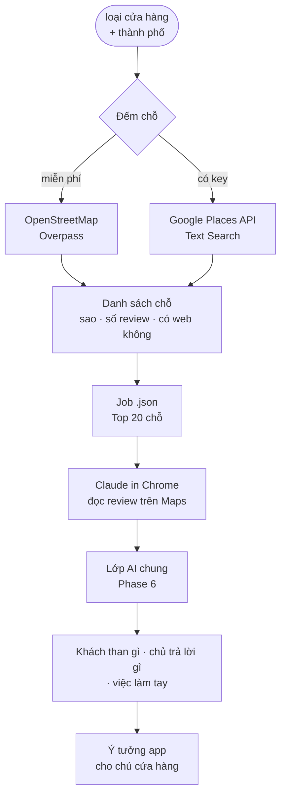

# Phase 33 · Google Maps Research (AI)

> Cho niche **phục vụ cửa hàng / dịch vụ địa phương** (salon, phòng gym, phòng khám, quán ăn…): ở một thành phố có
> bao nhiêu chỗ, chủ quán và khách đang than gì — tìm chỗ một app nhỏ giải được.

Chưa làm · sau Phase 32

## Chạy thế nào

## Chọn cách lấy (kiểm lại lúc làm)

| Cách | Lấy gì | Tiền | Ghi chú |
|---|---|---|---|
| **OpenStreetMap Overpass** | đếm chỗ theo loại + vùng, có web / điện thoại không | 0 đ | số đếm thiếu hơn Google, không có review |
| **Google Places API (New)** | tên · sao · số review · giờ mở · web, vài review mới nhất | có hạn mức miễn phí mỗi tháng, quá thì trả — kiểm bảng giá lúc làm | key trong `.env.local`, tắt mặc định, có trần số lần gọi |
| **Claude in Chrome** (đề xuất cho phần AI) | đọc review trên Google Maps trong trình duyệt của anh | gói Claude đang có | tool xuất job `.json` → Claude đọc → nhập kết quả |
| Cào Google Maps bằng script | — | — | **không làm** — trái điều khoản, chặn rất nhanh |

## Làm gì

| | |
|---|---|
| :material-map-marker-multiple: **Đếm chỗ** | loại cửa hàng × thành phố → số chỗ, % có website, sao trung bình |
| :material-chart-bar: **So nhiều thành phố** | tối đa 5 thành phố cùng một loại |
| :material-emoticon-angry: **Khách than gì** | gom review 1–3★ của Top 20 chỗ thành chủ đề: đặt lịch, chờ lâu, nhắc hẹn, thanh toán… |
| :material-reply: **Chủ trả lời gì** | chủ quán hay xin lỗi vì việc gì → việc đang làm tay, app có thể làm thay |
| :material-lightbulb-on: **Ý tưởng app** | mỗi ý tưởng kèm ≥ 3 review gốc làm bằng chứng → đưa vào evidence pack Phase 7 |

**Luật**

- Không lưu tên / ảnh người viết review — chỉ lưu câu trích + link
- Places API có trần số lần gọi mỗi lần tra; vượt trần thì dừng, không âm thầm trả tiền
- AI không bịa số — số chỗ, sao, số review lấy từ Overpass / Places

**Xong khi**

- 3 loại cửa hàng × 2 thành phố có số đếm + chủ đề than có trích dẫn
- Ít nhất 1 ý tưởng app có ≥ 3 review làm bằng chứng
- Chạy được không cần key (Overpass + Claude in Chrome); có key thì Places API dưới trần

**Không làm ở phase này**

- Cào Google Maps bằng script / headless browser
- Thu thập liên hệ chủ cửa hàng để bán hàng (lead list)

