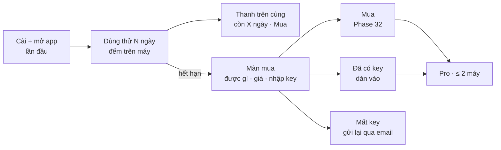

# Phase 33 · Dùng thử + paywall

> Tải về là **dùng thử đủ tính năng N ngày**, không đăng ký, không thẻ. Hết hạn → màn mua nói rõ được gì, giá, nhập key.
> Mất key → nhập email để gửi lại. Đây là chỗ mình **khác Wow Keywords** (họ bắt nhập key ngay khi mở).

Xong 2026-10-28 · chạy thử bản research trên máy · chờ anh tạo sản phẩm Lemon Squeezy để mua thử

## Chạy thế nào

**Paywall** = màn chặn khi hết dùng thử, mời mua.

## Bản bán 1.0: app Mac chỉ Niche Research

Chốt ở [Phase 31](phase-31-money-model.md#ket-qua-2026-10-28). Một biến lúc build quyết định bản nào:

| Biến | Bản | Có gì |
|---|---|---|
| `NR_EDITION=research` (mặc định của `npm run mac`) | **ShotMatic for Mac 1.0** | Research + Explore + trang kết quả + Cài đặt · Setup · Hướng dẫn · Giới thiệu. Có dùng thử + license |
| `NR_EDITION=full` | Bản đầy đủ (như bản Web) | Mọi tính năng, không dùng thử, không license |
| không đặt (`npm run dev`) | Bản Web local | như `full` |

Tính năng ngoài Niche Research **giữ trên menu nhưng xám + "Bản đầy đủ"**, mở thẳng đường dẫn thì hiện trang giải thích —
không xoá code.

## Làm gì

- **Biến bản:** `web/src/lib/edition.ts` đọc `VITE_NR_EDITION` (giao diện) + `NR_EDITION` (server); `build-mac.sh` truyền cả hai
- **Đếm dùng thử:** ngày mở đầu tiên lưu ở `license.json` trong thư mục dữ liệu **và** một bản sao ở
  `~/Library/Preferences/com.oneclicktool.nicheradar.trial` — xoá thư mục dữ liệu không có thêm ngày. Keychain ở Phase 35
- **Chặn khi hết hạn:** server trả `402` cho `POST /api/research` và `POST /api/explore`; mọi API đọc + xuất vẫn chạy
- **License:** `web/src/lib/license/` gọi API Lemon Squeezy (activate · validate · deactivate), kiểm Product ID, offline 14 ngày
- **API app:** `GET /api/license` · `POST /api/license/activate` · `POST /api/license/deactivate`
- **Thanh dùng thử:** "Còn X ngày dùng thử · Mua" dưới header, không che nội dung, ẩn khi đã Pro
- **Màn mua `/license`:** được gì · $39.99 trả một lần · 2 Mac · cập nhật 1.x miễn phí · nút Mua (mở checkout bằng trình duyệt
  ngoài) · ô dán key · "Mất key?" → `https://app.lemonsqueezy.com/my-orders` · Đã Pro: hiện key che bớt + nút "Gỡ máy này"
- **Hết hạn:** bấm Tra / Explore → mở màn mua kèm câu "Kết quả cũ vẫn mở + xuất được"
- **Khớp landing:** giá + 14 ngày lấy từ `config.ts`, landing dùng cùng số

**Xong khi**

- Cài mới → dùng được ngay, thanh hiện đúng số ngày
- Chỉnh ngày máy qua hạn → màn mua hiện, project cũ vẫn mở + xuất được (đếm project trước / sau)
- Dán key test → Pro ngay, thanh dùng thử biến mất
- Xoá DB, cài lại → không có thêm ngày dùng thử
- Link "Mất key?" mở đúng trang gửi lại key

**Không làm ở phase này**

- Tài khoản, đăng nhập
- Mã giảm giá phức tạp, affiliate: xét sau đơn thứ 10
- Gói team / nhiều chỗ ngồi
- Ép mua bằng đếm ngược giả, giấu nút đóng, khoá dữ liệu cũ

## Kết quả (2026-10-28)

Chạy bản research (`NR_EDITION=research`) bằng bản sao DB thật, cửa sổ 1340px:

| Xong khi | Kết quả |
|---|---|
| Cài mới → dùng được ngay, thanh hiện đúng số ngày | ✅ Thanh "14 days left in your full-feature trial · Buy for $39.99" dưới header; AI Agent, Projects xám "Full version" |
| Qua hạn → màn mua, project cũ vẫn mở + xuất được | ✅ Lùi ngày bắt đầu 15 ngày → bấm Tra mở `/license?reason=expired`; `POST /api/research` trả `402`, trang kết quả cũ trả `200`, CSV Explore tải được (10,6 KB) |
| Dán key → Pro ngay, thanh dùng thử biến mất | ✅ Trạng thái Pro: thanh ẩn, màn License hiện key che bớt `••••-ABCD`, email, nút "Remove this Mac"; tra mới không còn bị chặn. Key sai gọi API Lemon Squeezy thật → câu "That key is not valid…" |
| Xoá dữ liệu → không có thêm ngày | ✅ Xoá `license.json` → vẫn `expired` (lấy ngày từ bản sao ngoài thư mục dữ liệu) |
| Link "Mất key?" mở đúng trang | ✅ `https://app.lemonsqueezy.com/my-orders` |

Thêm sau khi chạy thử: mục **Cài đặt → License** (bản research) — đã Pro thì thanh dùng thử ẩn, đây là đường vào màn
License để gỡ máy. `npm run check` xanh (512 test) · `npm run mac:quick` ra `ShotMatic-0.10.0-mac-arm64.dmg` (build 9, 47 MB, ký xong, chưa notarize).

**Còn chờ anh:** tạo sản phẩm "ShotMatic Pro" trên Lemon Squeezy → gửi link checkout + Product ID → điền
`web/src/lib/license/config.ts` → mua thử chế độ test, máy thứ 3 bị báo, hoàn tiền → app về hết hạn (thước đo
[Version 10](version-10.md)).

[Tổng quan Version 10](version-10.md)

Plan code chi tiết: [Phase 33](../superpowers/plans/2026-10-25-niche-radar-phase68-paywall-trial.md)
