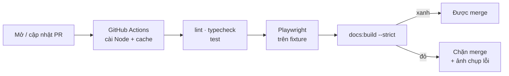

# Phase 36 · CI cho pull request

> Mỗi lần mở **pull request** (PR — yêu cầu gộp code vào `main`), máy chủ GitHub tự chạy hết các bước kiểm. Đỏ là không
> gộp được. Bỏ việc "quên chạy test trước khi merge".

Chưa làm · sau Phase 35

## Chạy thế nào

## Các bước CI chạy

Dùng đúng lệnh đang có trong `package.json`, không viết lệnh riêng cho CI.

| Bước | Lệnh |
|---|---|
| Lint (soát lỗi kiểu viết code) | `npm run lint` |
| Typecheck (soát kiểu dữ liệu) | `npm run typecheck` |
| Test đơn vị | `npm test` (fixture, không cần mạng — Phase 32) |
| Test giao diện | Playwright trên fixture (Phase 33) |
| Site tài liệu | `npm run docs:build` (strict, gãy link là đỏ) |

## Làm gì

| | |
|---|---|
| :material-file-code: **Workflow** | file mới `.github/workflows/ci.yml`, chạy khi mở hoặc cập nhật PR |
| :material-nodejs: **Môi trường** | cài Node, cache `node_modules` để lần sau nhanh hơn · cài Python cho MkDocs (`requirements-docs.txt`) |
| :material-check-all: **Chạy kiểm** | lint · typecheck · test · Playwright trên fixture · `docs:build --strict` |
| :material-camera: **Ảnh lỗi** | E2E đỏ → ảnh chụp màn lỗi đính kèm vào kết quả CI để mở ra xem |
| :material-shield-lock: **Chặn merge** | bật luật GitHub: PR phải CI xanh mới merge được |

**Xong khi**

- PR cố tình làm đỏ 1 test → CI đỏ, nút merge bị khoá
- PR cố tình làm đỏ 1 test giao diện → kết quả CI có ảnh chụp lỗi mở xem được
- PR xanh chạy xong ≤ 10 phút
- CI không gọi nguồn thật nào (tắt mạng ngoài vẫn xanh)

**Không làm ở phase này**

- Build app Mac, ký, notarize (Phase 62)
- Chạy canary nguồn thật trên CI (IP của GitHub dễ bị chặn)
- Tự động merge PR
- Bản Windows / Linux

[Tổng quan Version 7](version-7.md)
