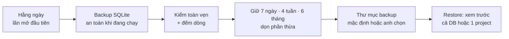

# Phase 39 · Backup / restore dữ liệu

> Dữ liệu tra cứu tích luỹ hàng tháng — **không được mất**. Backup tự chạy, tự dọn, tự kiểm; restore xem trước được
> và lấy lại được cả **một project** từ bản cũ mà không đè cả DB.

Chưa làm · plan 2026-10-25

**Hiện có (Phase 8).** Cài đặt → Dữ liệu: **Backup ngay**, danh sách backup, **Restore** (luôn backup an toàn trước khi
đè), mở thư mục dữ liệu; tự backup trước mỗi lần nâng DB (`schema_version`). Backup chỉ chạy khi bấm tay.

**Cần xong trước:** [Phase 8](phase-8-project-data.md) (backup / restore bản đầu)

## Chạy thế nào

## Làm gì

| | |
|---|---|
| :material-calendar-clock: **Backup tự động** | mỗi ngày một bản ở lần server chạy đầu tiên trong ngày; thêm bản trước mỗi lần nhập gói / gộp project / xoá hẳn |
| :material-delete-sweep: **Giữ có chừng** | giữ 7 bản ngày + 4 bản tuần + 6 bản tháng, dọn phần thừa (đưa vào Thùng rác trên Mac, không xoá thẳng) |
| :material-folder-cog: **Chỗ để backup** | đúng thư mục dữ liệu của bản đang chạy — bản Web `web/data/`, app Mac `~/Library/Application Support/niche-radar/` (hai DB riêng, mỗi bản tự backup DB của mình); mặc định trong thư mục dữ liệu; chọn thêm thư mục khác (VD thư mục iCloud Drive / Dropbox) để có bản ngoài máy |
| :material-shield-check: **Kiểm sau backup** | `PRAGMA integrity_check` + đếm dòng từng bảng; bản hỏng gắn đỏ, không dùng để restore |
| :material-eye: **Restore xem trước** | chọn bản → bảng số dòng từng bảng + ngày, so với DB hiện tại → mới cho bấm Restore |
| :material-folder-restore: **Restore 1 project** | lấy lại 1 project (cùng run / explore / app liên quan) từ bản cũ, gộp vào DB hiện tại không nhân đôi (dùng lại nhập `.niche.json`) |
| :material-zip-box: **Nén** | backup nén `.zip` khi lưu ra thư mục ngoài |
| :material-information: **Lần backup cuối** | Cài đặt + chân trang hiện "Backup cuối: hôm nay 09:12 · 14 MB"; quá 3 ngày chưa có bản tốt → báo vàng |

**Luật**

- Backup dùng cơ chế backup của SQLite (không copy file thô khi đang ghi)
- Restore luôn tạo bản an toàn trước khi đè (giữ như Phase 8); không bao giờ đè khi bản chọn trượt kiểm
- Không gửi backup lên server nào; thư mục ngoài là do anh chọn

**Xong khi**

- Để server chạy qua 3 ngày (giả lập giờ): đúng 3 bản ngày, dọn đúng luật giữ
- Tắt server giữa lúc backup → bản đó trượt kiểm và bị gắn đỏ, DB không hỏng
- Xoá DB → restore bản mới nhất → đếm dòng bằng nhau; restore 1 project từ bản cũ → không nhân đôi
- Chạy đúng trên cả bản Web và app Mac `.dmg` (mỗi bản backup đúng DB của nó, kiểm đường dẫn trong Cài đặt)
- Test xanh, screenshot Cài đặt → Dữ liệu đã Read

**Không làm ở phase này**

- Backup lên cloud gắn tài khoản — [Backlog 04](phase-backlog-04-project-sync.md)
- Mã hoá backup (ghi Appendix nếu có dữ liệu nhạy cảm)

Plan code chi tiết: [Phase 39](../superpowers/plans/2026-10-25-niche-radar-phase19-backup-restore.md)
