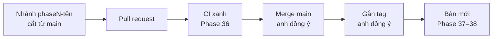

# Phase 39 · Quy trình nhánh

> Khoá `main`: chỉ vào được qua PR có CI xanh. Mỗi phase một **nhánh** (bản sao code để làm riêng), xong mới gộp và
> gắn tag. Ghi hết cách làm vào [Quy trình build](../quy-trinh-build.md).

Chưa làm · sau Phase 38

## Chạy thế nào

## Làm gì

| | |
|---|---|
| :material-shield-lock: **Bảo vệ `main`** | không đẩy thẳng lên `main`, phải qua PR + CI xanh |
| :material-source-branch: **Mỗi phase một nhánh** | tên `phaseN-<tên>` như bước Implement đang ghi |
| :material-file-document-edit: **Quy trình build** | thêm mục nhánh → PR → tag → release vào `quy-trinh-build.md` |
| :material-check-decagram: **Chạy thử 1 vòng** | lấy 1 phase thật đi đủ vòng để kiểm quy trình |

**Xong khi**

- 1 phase thật đi đủ vòng nhánh → PR → CI → merge → tag → bản mới
- Thử đẩy thẳng lên `main` → GitHub từ chối
- Trang Quy trình build có mục nhánh, PR, tag, release và vẫn qua `docs:build --strict`

**Không làm ở phase này**

- Tự động merge PR
- Claude tự merge hoặc gắn tag khi anh chưa đồng ý
- Tính năng mới cho app

[Tổng quan Version 7](version-7.md)
