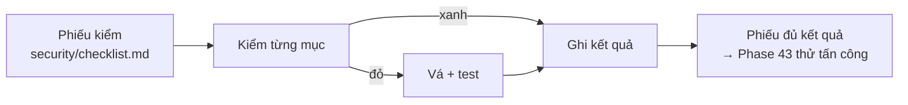

# Phase 40 · Kiểm + vá bảo mật

> Soát từng chỗ đang mở theo một **phiếu kiểm**, chỗ nào đỏ thì vá và viết test giữ lại. Làm trước khi có người ngoài
> đăng nhập (Version 9) và trả tiền (Version 10).

Chưa làm · sau Version 7

## Chạy thế nào

## Phiếu kiểm gồm gì

| Mục | Kiểm |
|---|---|
| **API cục bộ** | chỉ nghe `127.0.0.1` (đã có ở `web/src/server/index.ts`) + token ngẫu nhiên mỗi lần mở app · kiểm `Origin` · chặn trang web khác gọi vào (CSRF — trang lạ mượn trình duyệt gọi API; DNS rebinding — trang lạ giả tên miền trỏ về máy mình) |
| **Key** | `.env.local` (web) · không log key — Keychain cho app Mac ở [Phase 61](../app/phase-61-app-only.md) |
| **Chữ cào về** | review, comment, mô tả hiện dạng chữ, không render HTML (chặn XSS — chèn code chạy trên giao diện) · link chỉ `http(s)` |
| **App Mac** | CSP (luật trình duyệt chỉ cho chạy code của mình) cho WebView Tauri · quyền Tauri tối thiểu → làm ở [Phase 61](../app/phase-61-app-only.md), sau khi hết phase Web |
| **Thư viện** | `npm audit` + Dependabot (bot báo thư viện có lỗ hổng) |
| **Secret trong repo** | quét secret trong toàn bộ lịch sử git |

## Làm gì

| | |
|---|---|
| :material-clipboard-check: **Phiếu kiểm** | file mới `security/checklist.md`, mỗi mục: cách kiểm · kết quả · ngày |
| :material-key-chain: **Token API** | sinh token ngẫu nhiên mỗi lần mở app, giao diện gửi kèm mỗi lần gọi, thiếu / sai token là từ chối |
| :material-web-cancel: **Chặn Origin lạ** | API chỉ nhận `Origin` của chính app |
| :material-text-box-check: **Hiện chữ an toàn** | soát mọi chỗ hiện chữ cào về, bỏ render HTML, lọc link không phải `http(s)` |
| :material-bug-check: **Vá + test** | mỗi mục đỏ vá xong có test giữ lại |

**Xong khi**

- Mọi mục phiếu có kết quả
- Mục đỏ đã vá kèm test
- `npm audit` không còn lỗ hổng mức cao
- Quét lịch sử git không thấy secret (thấy thì anh đổi key, ghi vào phiếu)

**Không làm ở phase này**

- Thuê pentest bên ngoài, chứng nhận bảo mật (SOC 2…)
- Đăng nhập qua mạng (Version 9)
- Đổi framework
- Claude đọc, in hay đổi giá trị key của anh

[Tổng quan Version 8](version-8.md)
