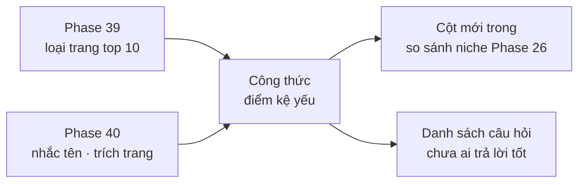

# Phase 41 · Chỗ trống AI + SEO

> Gộp kệ Google (Phase 39) và kệ AI (Phase 40) thành **điểm "kệ yếu"** theo công thức cố định, rồi thêm vào
> **bảng so sánh niche** (Phase 26). Niche kệ yếu = người dùng đang hỏi mà chưa ai trả lời tốt. **Không AI.**

Chưa làm · sau Phase 40

## Chạy thế nào

## Làm gì

| | |
|---|---|
| :material-google: **Điểm kệ Google** | % top 10 là `forum` + `blog nhỏ` (cao = dễ chen) · có app chính chủ nào đứng top không |
| :material-robot-outline: **Điểm kệ AI** | % câu trả lời yếu (Phase 40) · độ tập trung: 1 app chiếm > 50% lượt nhắc = khó chen · trang được trích có phải trang mình viết được không (blog / so sánh) |
| :material-scale-balance: **Công thức** | ghi rõ trên UI (di chuột vào cột), không có điểm bí ẩn. Trọng số chốt sau khi chạy 3 niche thật, ghi vào trang này |
| :material-table-plus: **Vào so sánh niche** | 2 cột mới **Kệ Google**, **Kệ AI** trong bảng Phase 26, tô ô thắng như các hàng khác |
| :material-format-list-bulleted-type: **Câu hỏi chưa ai trả lời tốt** | câu có kệ Google dễ **và** kệ AI yếu → đầu vào cho Phase 42 |

**Xong khi**

- 3 niche thật có điểm kệ Google + kệ AI, bảng so sánh có 2 cột mới
- Mỗi điểm bấm ra được số gốc (câu nào, URL nào)
- Thử với 1 niche biết chắc là đông (ví dụ "habit tracker") → điểm ra "khó chen"

**Không làm ở phase này**

- Đổi công thức điểm cơ hội Phase 1 (kệ yếu là cột riêng, không trộn vào)
- AI chấm điểm hay giải thích (đã có ô hỏi Phase 36 nếu cần)

