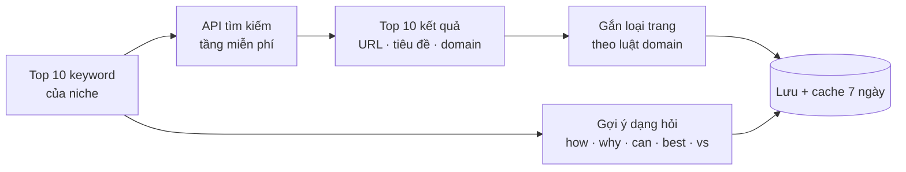

# Phase 41 · Kệ Google (SEO)

> Với keyword chính của niche: **top 10 Google là ai**, loại trang gì, còn chỗ chen không. Kèm **câu hỏi người dùng
> hay gõ** (AEO). **Không AI.**

Chưa làm · sau Phase 40

## Chạy thế nào

## Chọn nguồn top 10

Đo trước khi code (quota thật, bị chặn không, kết quả có gần Google không). Ghi bảng thử vào trang này.

| Nguồn | Tiền | Ghi chú |
|---|---|---|
| **Brave Search API** (đề xuất chính) | tầng miễn phí, có giới hạn lượt / tháng | không phải Google nhưng gần, có API chính thức |
| **API tìm kiếm của Google** (Programmable Search) | miễn phí giới hạn / ngày | kiểm còn mở cho tài khoản mới không trước khi chọn |
| **Search Console** | 0 đ | chỉ có số cho **site của mình**, dùng ở Phase 44 khi đã có trang |

Không cào trang kết quả Google bằng script.

## Làm gì

| | |
|---|---|
| :material-format-list-numbered: **Top 10** | mỗi keyword trong Top 10 cơ hội: URL, tiêu đề, domain, thứ hạng |
| :material-tag-multiple: **Loại trang** | gắn theo luật domain có sẵn: `store` (App Store / Play) · `forum` (Reddit, Quora, forum) · `blog nhỏ` · `site lớn` (danh sách domain lớn) · `app chính chủ` · `video` |
| :material-door-open: **Độ dễ chen** | đếm số kết quả `forum` + `blog nhỏ` trong top 10. Càng nhiều = Google chưa có trang tốt cho câu này |
| :material-help-circle: **Câu hỏi người dùng** | autocomplete Google với tiền tố `how / why / can / best / vs / alternative` → bộ câu hỏi của niche, gộp câu trùng |
| :material-file-export: **Xuất** | CSV top 10 + bộ câu hỏi |

**Xong khi**

- Bảng thử nguồn điền đủ, chọn 1 nguồn chính
- 3 niche thật có top 10 cho 10 keyword + loại trang + bộ ≥ 20 câu hỏi
- Kiểm tay 10 URL với Google mở bằng tay: ≥ 6/10 có trong top 10 Google
- Hết quota → UI báo đúng, phần khác vẫn chạy

**Không làm ở phase này**

- Lượt tìm thật, độ khó keyword kiểu Ahrefs
- Phân tích nội dung trang top 10 (độ dài, heading…)
- Theo dõi thứ hạng theo thời gian

