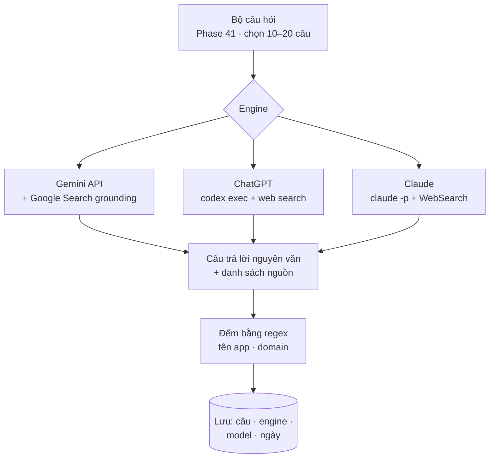

# Phase 42 · Kệ AI (GEO / AEO)

> Hỏi **Gemini, ChatGPT, Claude** đúng câu người dùng hay hỏi về niche, như một người dùng thật. Đếm **app nào được
> nhắc**, **trang nào được trích**. Ở đây LLM là **nguồn dữ liệu**, không phải người phân tích.

Chưa làm · sau Phase 41

## Chạy thế nào

## Engine

Dùng lại cách hỏi của `scripts/geo.py` bên App-AI-Skills (cùng câu lệnh mẫu "trả lời như cho người dùng thường, liệt
kê nguồn") để số của niche-radar và `/app-geo` so được với nhau.

| Engine | Gần với | Tiền | Ghi chú |
|---|---|---|---|
| **Gemini + Google Search grounding** (chính) | Google AI Overviews | tầng miễn phí của AI Studio, rồi theo lượt | proxy gần nhất của AI Overview đo tự động được |
| **ChatGPT** qua `codex exec` | ChatGPT search | gói đang có | chạy trên máy, không key trong app |
| **Claude** qua `claude -p` | Claude có web search | gói đang có | như trên |

Engine nào không chạy được → ghi lý do trên UI, các engine khác vẫn đếm.

## Làm gì

| | |
|---|---|
| :material-format-list-checks: **Chọn câu** | 10–20 câu từ bộ câu hỏi Phase 41, ưu tiên dạng "best app for…", "how to … on phone", "X alternative" |
| :material-robot: **Hỏi** | mỗi câu × mỗi engine 1 lần, chạy song song có giới hạn, trần chi phí mỗi niche |
| :material-counter: **Đếm nhắc tên** | regex tên đối thủ (từ bảng đối thủ Phase 1–2, 30) → app nào được nhắc bao nhiêu câu / engine |
| :material-link-variant: **Đếm trang được trích** | domain + URL trong phần nguồn → AI hay tin trang nào (Reddit? site review? app chính chủ?) |
| :material-alert-circle-outline: **Câu trả lời yếu** | không nhắc app cụ thể nào, hoặc chỉ nhắc app bị chê nhiều (đối chiếu Phase 6) → gắn cờ |
| :material-text-box-search: **Xem nguyên văn** | bấm vào ô → mở câu trả lời đầy đủ đã lưu |

**Luật**

- Đếm bằng regex trên chữ đã lưu, không nhờ AI tự đếm hay tự tóm "ai thắng"
- Mỗi lần đo ghi engine + model + ngày. AI đổi câu trả lời theo thời gian, số cũ không dùng như số mới

**Xong khi**

- 3 niche thật × 10 câu × ≥ 2 engine chạy xong dưới trần chi phí
- Kiểm tay 10 câu trả lời: số lần nhắc tên đếm đúng
- Kết quả 1 niche khớp với `geo.py analyze` chạy trên cùng câu hỏi (cùng cách đếm)

**Không làm ở phase này**

- Hỏi Perplexity / Copilot (không có đường đo tự động ổn định, thêm khi có)
- Hỏi nhiều lần một câu để lấy trung bình
- Đo app của mình (việc của `/app-geo`)

Plan code chi tiết: [Phase 42](../superpowers/plans/2026-10-25-niche-radar-phase42-ai-shelf.md)
