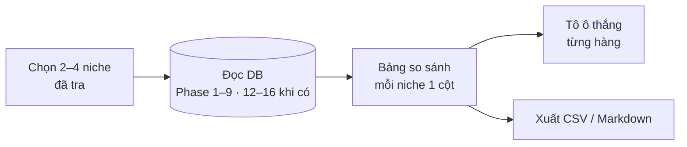

# Phase 43 · So sánh niche

> Đặt **2–4 niche đã tra** cạnh nhau trên một màn: niche nào nhiều keyword trống hơn, đối thủ yếu hơn, nhu cầu đang lên,
> người dùng than nhiều hơn, có người trả tiền thật. **Không AI.**

Chưa làm · sau Phase 25 (dời lên 2026-10-25)

**Vì sao dời lên Version 1.** Phase này chỉ đọc DB, không cần nguồn mới hay AI — chạy được ngay với dữ liệu Phase 1–9.
Chọn giữa vài niche là câu hỏi chính của tool, không nên chờ YouTube / Amazon / Maps (Phase 50–54): nhóm **Nguồn mới**
ghi "chưa tra" tới khi các phase đó xong. Số cũ: 18 → 10 → 26 (2026-10-25, khi chèn Phase 18–25 làm kỹ tính năng chính).

## Chạy thế nào

## Làm gì

| | |
|---|---|
| :material-playlist-check: **Chọn niche** | tick 2–4 niche trong danh sách đã tra. Niche cũ hơn 7 ngày → nút "tra lại trước khi so" |
| :material-table-column: **Bảng so sánh** | mỗi niche một cột. Hàng chia nhóm: **Cơ hội** (số keyword Top cơ hội, điểm cao nhất) · **Đối thủ** (số app, sao trung bình top 10, app bỏ bê) · **Xu hướng** (Trends 12 tháng lên/xuống, mùa vụ) · **Đau** (số chủ đề than, review 1–2★) · **Tiền** (tỷ lệ app thu phí, khoảng giá, TrustMRR verified) · **Nguồn mới** (YouTube, Amazon, Maps nếu đã tra) |
| :material-trophy: **Ô thắng** | mỗi hàng tô ô tốt nhất theo luật cố định (ít đối thủ hơn = thắng, nhu cầu lên = thắng…). Đếm số hàng thắng mỗi niche |
| :material-help-circle-outline: **Ô thiếu** | niche chưa tra nguồn nào → ô ghi "chưa tra", không tính thắng thua |
| :material-link: **Bấm vào ô** | mở đúng màn chi tiết của niche đó (cây keyword, bảng đối thủ…) |
| :material-file-export: **Xuất** | CSV + Markdown (bảng + link) để dán vào `/app-research` |

**Luật**

- Mọi số lấy từ DB đã có. Phase này **không cào thêm**
- Luật tô ô thắng ghi rõ trên UI (di chuột vào tên hàng), không có "điểm tổng hợp" bí ẩn

**Xong khi**

- So 3 niche thật đã tra ra bảng đủ nhóm, ô thiếu ghi đúng "chưa tra"
- Kiểm tay 10 ô ngẫu nhiên khớp với màn chi tiết của niche
- Bảng 4 niche đọc được ở 1340px, không cột hẹp vỡ chữ
- Xuất Markdown dán vào được `research/*.md`

**Không làm ở phase này**

- So hơn 4 niche một lần
- AI viết kết luận ([Phase 56](phase-56-ai-cite-report.md))
- So cùng niche giữa hai thời điểm (ứng viên Phase 9)

Plan code chi tiết: [Phase 43](../superpowers/plans/2026-10-25-niche-radar-phase28-compare-niche.md)
