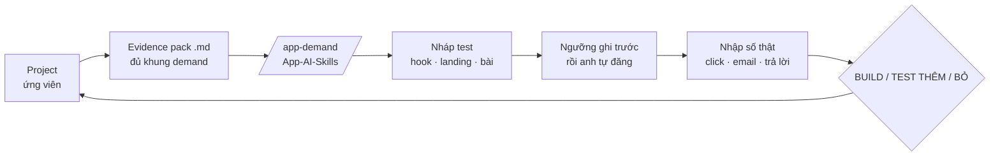

# Phase 43 · Evidence pack + test bán trước

> Cầu nối từ tool sang **quyết định làm app**. Phase 7 đã code evidence pack và bảng kết quả test, nhưng vòng thật chưa
> chạy. Phase này làm luồng đó trơn tru và **chạy hết 1 vòng thật**: niche → evidence pack → `/app-demand` → test bán
> trước → số thật → BUILD / TEST THÊM / BỎ.

Backlog · làm sau · 2026-10-28 · làm một phần · soát code 2026-10-27: có evidence pack theo khuôn /app-demand · khối test bán trước đang tắt, chưa khoá ngưỡng + nhập số thật

**Hiện có (Phase 7).** Evidence pack `.md` theo khung `templates/demand.md`; nháp test bán trước (hook · landing fake
door · bài X / Reddit); bảng kết quả với ngưỡng ghi trước. Còn lại: anh chọn 1 niche và chạy vòng thật.

## Chạy thế nào

## Làm gì

| | |
|---|---|
| :material-file-check: **Evidence pack đủ khung** | đối chiếu từng mục `templates/demand.md`, mục thiếu ghi "chưa đo" + nút đi lấy; thêm bảng "Ai thu tiền" ([Phase 38](phase-38-revenue.md)), lời chê ([Phase 18](phase-18-competitor-complaints.md)), điểm + cờ ([Phase 20](phase-20-niche-health.md)) |
| :material-rocket: **1 bấm sang pipeline** | từ project: tạo evidence pack + lệnh `/app-demand` copy sẵn, đường dẫn file đúng repo App-AI-Skills |
| :material-ruler-square: **Ngưỡng trước khi chạy** | form ngưỡng (VD ≥ 3% click landing, ≥ 20 email / 1k lượt xem) khoá lại sau khi bắt đầu test |
| :material-counter: **Nhập số thật** | lượt xem, click, email, trả lời, kèm nguồn + ngày; đổi ngưỡng sau khi có số → ghi đỏ "đổi sau khi thấy số" |
| :material-scale-balance: **Gợi ý quyết định** | so số với ngưỡng → gợi ý BUILD / TEST THÊM / BỎ kèm lý do; anh chốt, ghi vào kết luận project |

**Luật**

- Tool **không tự đăng** bài, không chạy quảng cáo, không thu tiền thật
- Quyết định cuối là của anh (CỔNG 1 của pipeline)
- Số test phải có nguồn + ngày; không có thì ghi "chưa đo"

**Xong khi**

- 1 niche thật đi hết vòng: evidence pack → `/app-demand` → test → số thật → quyết định đã ghi
- `/app-demand` đọc evidence pack không phải sửa tay
- Phase 7 chuyển chip sang Xong

**Không làm ở phase này**

- Dựng landing thật để bán — Version 11 ([Phase 46](phase-46-positioning-landing.md))
- Tự tạo tài khoản / đăng bài trên X, Reddit

Plan code chi tiết: [Phase 43](../superpowers/plans/2026-10-25-niche-radar-phase24-evidence-presell.md)
