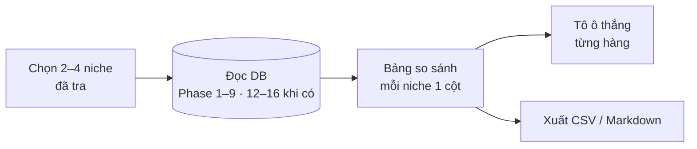

# Phase 44 · So sánh niche

> Đặt **2–4 niche đã tra** cạnh nhau trên một màn: niche nào nhiều keyword trống hơn, đối thủ yếu hơn, nhu cầu đang lên,
> người dùng than nhiều hơn, có người trả tiền thật. **Không AI.**

Xong sớm 2026-10-27 · trang /compare, 4 niche thật · màn hỏi trong app từ landing shotmatic.app

!!! note "Bật lại (anh chốt 2026-10-28)"
    Sáng 28/10 từng ẩn khỏi app, chiều cùng ngày bật lại: mục "So sánh niche" trong menu More features, ô tick + nút
    "So sánh (N)" ở bảng Lịch sử, dòng trong danh sách tính năng About. Công tắc `COMPARE_ON` ở `web/src/lib/features.ts`.
    Từ 2026-10-31 nằm dưới tab **Compare** trên menu chính ([Phase 44.1](phase-44-1-compare-tab.md)), không còn ở More features.

**Vì sao dời lên Version 1.** Phase này chỉ đọc DB, không cần nguồn mới hay AI — chạy được ngay với dữ liệu Phase 1–9.
Chọn giữa vài niche là câu hỏi chính của tool, không nên chờ YouTube / Amazon / Maps (Phase 51–55): nhóm **Nguồn mới**
ghi "chưa tra" tới khi các phase đó xong. Số cũ: 18 → 10 → 26 (2026-10-25, khi chèn Phase 18–26 làm kỹ tính năng chính).

## Chạy thế nào

## Làm gì

| | |
|---|---|
| :material-playlist-check: **Chọn niche** | tick 2–4 niche trong danh sách đã tra. Niche cũ hơn 7 ngày → nút "tra lại trước khi so" |
| :material-table-column: **Bảng so sánh** | mỗi niche một cột. Hàng chia nhóm: **Cơ hội** (số keyword Top cơ hội, điểm cao nhất) · **Đối thủ** (số app, sao trung bình top 10, app bỏ bê) · **Xu hướng** (Trends 12 tháng lên/xuống, mùa vụ) · **Đau** (số chủ đề than, review 1–2★) · **Tiền** (tỷ lệ app thu phí, khoảng giá, TrustMRR verified) · **Nguồn mới** (YouTube, Amazon, Maps nếu đã tra) |
| :material-trophy: **Ô thắng** | mỗi hàng tô ô tốt nhất theo luật cố định (ít đối thủ hơn = thắng, nhu cầu lên = thắng…). Đếm số hàng thắng mỗi niche |
| :material-help-circle-outline: **Ô thiếu** | niche chưa tra nguồn nào → ô ghi "chưa tra", không tính thắng thua |
| :material-link: **Bấm vào ô** | mở đúng màn chi tiết của niche đó (cây keyword, bảng đối thủ…) |
| :material-file-export: **Xuất** | CSV + Markdown (bảng + link) để dán vào `/app-research` |

**Luật**

- Mọi số lấy từ DB đã có. Phase này **không cào thêm**
- Luật tô ô thắng ghi rõ trên UI (di chuột vào tên hàng), không có "điểm tổng hợp" bí ẩn

**Xong khi**

- So 3 niche thật đã tra ra bảng đủ nhóm, ô thiếu ghi đúng "chưa tra"
- Kiểm tay 10 ô ngẫu nhiên khớp với màn chi tiết của niche
- Bảng 4 niche đọc được ở 1340px, không cột hẹp vỡ chữ
- Xuất Markdown dán vào được `research/*.md`

**Không làm ở phase này**

- So hơn 4 niche một lần
- AI viết kết luận ([Phase 57](phase-57-ai-cite-report.md))
- So cùng niche giữa hai thời điểm (ứng viên Phase 9)

## Đã làm (2026-10-27)

Làm sớm vì landing [shotmatic.app](https://shotmatic.app/#compare) đã có khối "bấm thẻ niche → bấm tab xem bảng" mà app chưa có.
Giao diện app theo khối đó nhưng theo màu app (nền kem, không tối).

- **Trang `/compare?runs=13,14,15`** (menu **So sánh**; ở màn ≤ 600px menu ẩn mục này, vào từ nút **So sánh (N)** ở bảng Lịch sử).
  Ô chọn 2–4 niche đã tra ngay đầu trang.
- **Thẻ niche** (bấm để chọn niche đang xem): điểm sức khoẻ /10 + thanh màu, chip BUILD / TEST THÊM / BỎ, đường Google Trends,
  số hàng thắng, cảnh báo "tra N ngày trước" khi cũ hơn 7 ngày.
- **5 tab**: **Tổng quan** = bảng cạnh nhau 6 nhóm hàng (Tổng · Cơ hội · Đối thủ · Xu hướng · Đau · Tiền · Nguồn mới), ô thắng tô xanh,
  di chuột vào ⓘ đọc luật · **Đối thủ** top 10 · **Lời chê** 8 chủ đề kèm câu nguyên văn · **Feature gap** 10 hàng · **Sức khoẻ** 7 yếu tố
  + độ tin + nguồn. 4 tab sau là số của niche đang chọn, có link **Mở chi tiết** tới đúng khối trong trang kết quả.
- **Xuất**: Copy Markdown (bảng, ô thắng in đậm, link `/r/:id`) + Tải CSV (BOM, số thô).
- Luật + hàng ở 1 chỗ: `web/src/lib/compare-niche.ts`. Test: `web/tests/compare-niche.test.ts`.

**Khác plan ban đầu:** không thêm API `/api/compare` — trang gọi đúng các API của trang kết quả (`/research/:id`, `/health`, `/complaints`,
`/gap`) nên chạy được cả ở bản demo; xuất CSV / Markdown làm ở trình duyệt. Lời chê + Feature gap chỉ tải khi mở tab (lần đầu có thể
đọc store như trang kết quả — cache 7 ngày). Hàng **Cơ hội** dùng số keyword gợi ý của lần Research (cây Explore để Phase sau).
"Tra lại" là cảnh báo + link sang trang kết quả, không tự chạy. Ở 375px bảng cuộn ngang trong khung, cột tên hàng dính trái
(không xoay thành từng khối).

**Kiểm tay (DB thật, 4 niche 13 · 14 · 15 · 28):** habit tracker 30 Play · 28 App Store · 4.7★ · sức khoẻ 5.7 · top 10 1,635,832 rating ·
Offline 0/10 · lời chê "subscription" 95 review — khớp `/r/13`. budget tracker 4.7 · pomodoro 5.3 · external display manager 4 /10,
thắng 4 hàng (ít app App Store nhất, sao thấp nhất, top 10 nhỏ nhất, 20% app bỏ bê). 1340px 4 niche đọc rõ; 375px không tràn ngang.

Plan code chi tiết: [Phase 44](../superpowers/plans/2026-10-25-niche-radar-phase28-compare-niche.md)
