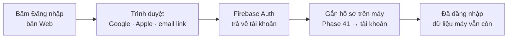

# Phase 44 · Firebase Auth

> Cho người dùng **đăng nhập thật** bằng Google, Apple hoặc link gửi qua email, để Phase 45 mang project của họ sang máy
> khác. Không đăng nhập thì app vẫn dùng đủ như cũ.

Chưa làm · sau Phase 43

## Chạy thế nào

**Firebase Auth** (dịch vụ đăng nhập của Google, có gói miễn phí) lo phần mật khẩu, xác minh email. Mình không tự
giữ mật khẩu.

## Làm gì

| | |
|---|---|
| :material-google: **Google** | đăng nhập Google trên bản Web |
| :material-apple: **Apple** | đăng nhập Apple trên bản Web |
| :material-email-fast: **Email link** | gõ email → bấm link trong thư là vào, không mật khẩu |
| :material-account-switch: **Gắn hồ sơ** | lần đầu đăng nhập: gắn hồ sơ trên máy ([Phase 41](version-8.md)) với tài khoản, không mất dữ liệu cũ |
| :material-logout: **Đăng xuất** | đăng xuất vẫn dùng được trên máy, project trên máy còn nguyên |
| :material-file-code: **File** | mới: lớp đăng nhập phía client trong `web/src/lib/` và route kiểm token trong `web/src/server/` (tên chốt ở plan) |

**Xong khi**

- Đăng nhập / đăng xuất được cả 3 cách (Google, Apple, email link) trên bản Web
- Tắt mạng vẫn mở được project trên máy
- Lần đầu đăng nhập: đếm project trước / sau khi gắn hồ sơ, không mất dòng
- Không đăng nhập: mọi tính năng trên máy chạy như bản 8.0
- `npm test && npm run typecheck && npm run lint` xanh

**Không làm ở phase này**

- Đưa project lên cloud (Phase 45)
- Analytics, báo lỗi (Phase 46)
- Xoá tài khoản trên cloud (Phase 47)
- Tự làm đăng nhập bằng mật khẩu, server riêng ngoài Firebase
- Tạo project Firebase, nhập thanh toán Google Cloud: anh tạo, Claude nối code

[Tổng quan Version 9](version-9.md)
