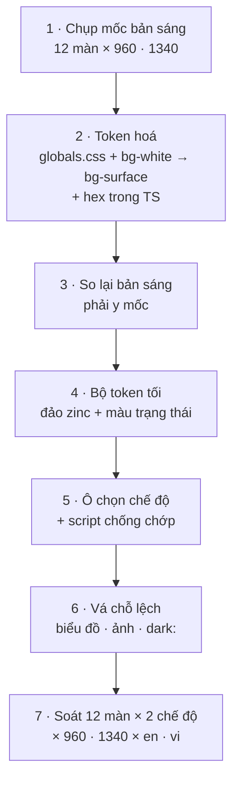

# Phase 45.1 · Chế độ tối — Sáng · Tối · Theo máy

> Hôm nay app chỉ có giao diện sáng (nền kem `#fbf7f2`). Tool cho dev / indie hacker gần như đều có chế độ tối, người
> dùng ngồi buổi tối hay bật. Phase này thêm **chế độ tối đúng chuẩn**: chọn Sáng · Tối · Theo máy, mở app không chớp
> trắng, đủ tương phản AA như bản sáng, bảng · biểu đồ · chip đọc rõ. Làm ở `web/` → app Mac + Windows tự có.

<span class="chip chip--done">Xong bản Web 2026-11-02 · app Mac / Windows chưa kiểm trên máy thật</span>

Từ [Appendix](../appendix.md) mục "Chế độ tối" (để lại từ soát [Phase 25](phase-25-ui-ux.md), mục 6).

## Mục tiêu · cần làm · KHÔNG làm

- **Mục tiêu:** mọi trang của bản Web (cả app Mac + Windows, demo site) có chế độ tối đọc rõ ngang bản sáng.
- **Cần làm:**
    - Gom màu thành **token** (nền, mặt thẻ, chữ, viền, màu nhấn, màu trạng thái, màu biểu đồ) — một chỗ định nghĩa.
    - Bộ token thứ hai cho chế độ tối.
    - Ô chọn **Sáng · Tối · Theo máy** ở Cài đặt, nhớ trên máy.
    - Mở app / tải lại trang không chớp trắng trước khi vào tối.
    - Biểu đồ (Recharts), hình minh hoạ, logo đọc được trên nền tối.
    - Test chặn màu viết thẳng mới + đo tương phản cả 2 bộ token.
- **KHÔNG làm:**
    - Không đổi bố cục, cỡ chữ, khoảng cách — chỉ đổi màu.
    - Không làm lại bản sáng (giữ đúng màu hiện tại, screenshot trước / sau phải y nhau).
    - Không đụng extension ShotMatic Lite và landing shotmatic.app (repo khác) — ghi Appendix nếu cần sau.
    - Không thêm nhiều theme màu (chỉ Sáng + Tối).

## Hiện trạng (đo 2026-11-01)

Đếm bằng `grep` trong `web/src`.

| Đo gì | Số |
|---|---|
| Class màu Tailwind (`bg-*` · `text-*` · `border-*`…) | 2.231 |
| … trong đó họ `zinc` (xám ấm đã chỉnh ở `@theme`) | 1.325 |
| … `orange` · `white` · `rose` · `emerald` · `amber` | 269 · 191 · 189 · 116 · 86 |
| Mã hex trong `globals.css` | 126 |
| File `.ts` / `.tsx` có mã hex viết thẳng (biểu đồ, NicheMap, icon nguồn…) | 14 |
| Class `dark:` | 0 |
| Token CSS đã có trên `:root` | 6 (`--canvas` · `--surface` · `--accent` · `--accent-hover` · `--accent-soft` · `--line`) |

Màu nhiều nhất: `text-zinc-500` (470), `border-zinc-200` (218), `text-zinc-600` (178), `text-rose-600` (78),
`bg-orange-50` (72). File nhiều class màu nhất: `HealthBlock.tsx`, `DecisionBoard.tsx`, `ComparePage.tsx`.

## Cách làm — đảo bảng màu, không sửa 2.231 class

Tailwind v4 dịch `text-zinc-500` thành `color: var(--color-zinc-500)`. Repo đã ghi đè `--color-zinc-50…900` trong `@theme`
để có xám ấm. Vậy chế độ tối chỉ cần **định nghĩa lại các biến đó** khi `<html data-theme="dark">`:

```css
:root[data-theme="dark"] {
  --color-zinc-50:  /* nền tối nhất */;
  --color-zinc-900: /* chữ sáng nhất */;
  --color-orange-50: /* nền cam tối */;
  --color-rose-600:  /* đỏ sáng hơn cho đọc trên nền tối */;
  --canvas: …; --surface: …; --line: …;
}
```

Thang xám đảo chiều (50 ↔ 900), các màu trạng thái: nền nhạt `-50/-100` thành nền tối pha màu, chữ `-600/-700/-800` sáng lên
cho đủ 4,5:1. Đa số trang **tự đúng** mà không sửa JSX.

Chỗ không tự đúng — sửa có chủ đích:

| Chỗ | Vì sao | Sửa |
|---|---|---|
| `bg-white` (mặt thẻ, popover) | trắng đảo chung sẽ làm `text-white` trên nút cam tối luôn | đổi `bg-white` → `bg-surface` (token mới); `text-white` giữ trắng cố định |
| `bg-zinc-900` + chữ trắng (tooltip, chip đậm) | đảo xong thành nền sáng chữ trắng | token riêng `--inverse` / `--on-inverse` |
| Hex trong `globals.css` (126) | không qua biến | đổi sang token; header `#fbf7f2f5` → `color-mix` từ `--canvas` |
| Hex trong 14 file TS (Recharts, NicheMap, SourceIcon…) | SVG / style inline | đọc từ token (`var(--chart-*)`); kiểm WKWebView nhận `var()` trong thuộc tính SVG, không thì đọc `getComputedStyle` |
| Logo, `HuntFlowArt`, ảnh hướng dẫn | ảnh nền sáng | logo có bản cho nền tối (Claude viết prompt, Codex sinh); ảnh chụp màn hình giữ nguyên, thêm viền |
| Bóng đổ `shadow-*` | gần như mất trên nền tối | thay bằng viền `--line` ở chế độ tối |

Chỗ đảo chung mà vẫn sai thì vá bằng `dark:` (variant `@custom-variant dark (&:where([data-theme=dark], [data-theme=dark] *))`)
— mục tiêu dưới 50 chỗ, ghi lại từng chỗ.

## Chọn chế độ

```text
Cài đặt → Giao diện
  Chế độ màu   ( Theo máy )  ( Sáng )  ( Tối )
```

- **Mặc định: Theo máy** (`prefers-color-scheme`) — anh chốt lại ở bước duyệt nếu muốn mặc định Sáng.
- Lưu ở `localStorage` (`theme`), hỏng / bị chặn thì về Theo máy — giống `page-size.ts`. Có hàm nhận `store` để test.
- Theo máy thì đổi theo khi hệ điều hành đổi (lắng nghe `matchMedia(...).change`), không cần tải lại.
- **Không chớp trắng:** script nhỏ chạy trong `<head>` của `index.html` đặt `data-theme` trước khi React vẽ.
- App Tauri: cửa sổ theo theme hệ thống (không ép `theme` trong `tauri.conf.json`), đặt màu nền cửa sổ khớp `--canvas`
  để lúc mở không loé trắng. Mac: WKWebView theo macOS; Windows: WebView2 theo Windows — kiểm cả hai.
- Chữ en / vi / es: `settings.appearance`, `theme.system`, `theme.light`, `theme.dark`.
- Không có nút đổi nhanh trên header ở phase này (header đang chật ở 960px) — chỉ Cài đặt.

## Các bước



1. **Mốc:** screenshot 12 màn ở Phase 25 (`/`, Explore, Research, Projects, 1 Project, Compare, Cài đặt, Gap, Hướng dẫn,
   About, Setup, AI Agent) ở 960 + 1340, dữ liệu dài nhất.
2. **Token hoá** (chưa có chế độ tối): mã hex trong `globals.css` → biến; `bg-white` → `bg-surface`; hex trong TS → token.
3. **So lại bản sáng:** so ảnh với mốc — khác là lỗi bước 2.
4. **Bộ token tối:** chọn màu, đo tương phản từng cặp chữ / nền dùng thật (AA 4,5:1 chữ thường, 3:1 viền ô nhập / icon).
5. **Ô chọn + chống chớp.**
6. **Vá chỗ lệch:** biểu đồ, NicheMap, ảnh, các `dark:` lẻ.
7. **Soát:** 12 màn × Sáng / Tối × 960 / 1340 × English / Tiếng Việt, không cuộn ngang cả trang. Chạy app Mac (`npm run mini`)
   chuyển macOS sang tối xem đổi theo.

## Code đụng tới

| File | Sửa gì |
|---|---|
| `web/src/client/globals.css` | token sáng + tối, `@custom-variant dark`, hex → biến |
| `web/index.html` | script đặt `data-theme` trước khi vẽ |
| `web/src/lib/theme.ts` (mới) | đọc / ghi lựa chọn, theo máy, nghe đổi hệ điều hành |
| `web/src/client/SettingsPage.tsx` | mục Giao diện → Chế độ màu |
| `web/src/components/charts/theme.tsx` + các file biểu đồ | màu từ token |
| `web/src/components/*.tsx`, `web/src/client/*.tsx` | `bg-white` → `bg-surface`, nền / chữ đảo ngược (`bg-zinc-900 text-white`) → token `inverse` |
| `web/src/locales/en.ts` · `vi.ts` · `es.ts` | chữ ô chọn |
| `app/src-tauri/tauri.conf.json` | màu nền cửa sổ (nếu cần) — không viết UI trong `app/` |
| `web/tests/` | xem dưới |

## Test

- `ui-contrast.test.ts` mở rộng: đo tương phản các cặp token ở **cả 2 bộ** (sáng giữ như cũ, tối đạt AA).
- `theme.test.ts` (mới): lưu / đọc, storage hỏng → Theo máy, Theo máy đổi theo `matchMedia`.
- Test chặn: không còn `bg-white` cho mặt thẻ, không thêm mã hex mới trong `.tsx` ngoài file token.

## Xong khi

<div class="box box--star" markdown>
- Cài đặt có **Chế độ màu: Theo máy · Sáng · Tối**, nhớ sau khi tải lại và mở lại app
- Bản sáng **y như trước** (so ảnh mốc 12 màn)
- Chế độ tối: 12 màn × 960 + 1340 × en + vi, screenshot đã Read — chữ, bảng, chip, biểu đồ, ô nhập đọc rõ
- Mọi cặp chữ / nền dùng thật ở chế độ tối đạt AA (test đo, không đo bằng mắt)
- Tải lại trang và mở app Mac ở chế độ tối không chớp trắng
- App Mac đổi theo khi chuyển macOS sáng ↔ tối; app Windows kiểm khi có bản build Phase 36 (chưa có thì ghi `chưa kiểm`)
- `npm run check` xanh, `npm run docs:build` xanh
</div>

## Rủi ro

<div class="box box--rules" markdown>
- **Màu trạng thái mất nghĩa:** đỏ / xanh / cam trên nền tối dễ chói hoặc chìm (BUILD / TEST THÊM / BỎ, cờ chặn). Chọn bộ
  màu tối riêng cho 4 họ `rose · emerald · amber · orange`, đo từng cặp.
- **Bản sáng lỡ đổi** khi token hoá → bước 3 so ảnh mốc trước khi làm tối.
- **SVG không nhận `var()`** ở WebView cũ → dự phòng đọc `getComputedStyle` khi đổi chế độ.
- **Khối lượng:** đổi `bg-white` là thay chữ máy móc nhưng chạm nhiều file — làm một lần, một commit riêng, dễ xem lại.
- Thời gian: `chưa đo`.
</div>

## Kết quả (2026-11-02)

**Đã làm**

- **Cài đặt → Appearance** (tab mới): System · Light · Dark. Lưu `localStorage` khoá `theme`, hỏng / bị chặn → System.
  System đổi theo hệ điều hành ngay, không cần tải lại (đã thử bằng giả lập `prefers-color-scheme` sáng ↔ tối).
- **Không chớp trắng:** script trong `<head>` của `index.html` đặt `data-theme` trước khi React vẽ; `theme-color` có bản tối.
- **Bộ màu tối sinh bằng lệnh** `npm run theme:dark` (`web/src/lib/theme-dark-gen.ts` → `web/src/client/theme-dark.css`):
    - Bảng màu Tailwind đảo qua biến CSS — xám ấm chọn tay; họ màu (rose, emerald, amber…) nền 50–300 thành nền tối pha màu,
      chữ 500–950 tự bước sáng tới khi đạt 4,5:1 trên mặt thẻ, nền, dải xám và nền nhạt cùng họ.
    - Nền đặc trong code (`bg-orange-600`, `bg-rose-600`, `bg-zinc-900`…, 24 class) giữ đậm để chữ trắng vẫn đọc được.
    - Rule có hex trong `globals.css` → rule tối tự sinh (đổi theo độ sáng OKLCH, bóng đổ thành đen). **Khác plan:** không thay hex
      trong `globals.css` bằng biến — giữ nguyên để bản sáng chắc chắn không đổi; bộ sinh đọc thẳng file này.
- **Token hoá:** `bg-white` → `bg-surface` (160 chỗ); xám biểu đồ / NicheMap / header dính → `--chart-*`, `--map-*`, `--header-glass`;
  `--accent-solid` cho nền cam sau chữ trắng (nút chính, số bước, ô điểm Bàn quyết định, Hướng dẫn).
- Logo: dùng sẵn `shotmatic-wordmark-light.png` ở chế độ tối (không cần sinh ảnh mới). Nút 📷 chụp khối: ảnh theo chế độ đang xem.
- **Không có `dark:` lẻ nào** — đảo bảng màu + nền đặc + token đủ cho 16 trang đã soát.

**Đo**

| Kiểm gì | Kết quả |
|---|---|
| Bản sáng không đổi — so màu tính toán (color, nền, viền, bóng, fill, stroke) mọi phần tử, 16 trang ở 1340px, trước / sau | không lệch màu nào (chỉ lệch số phần tử do biểu đồ tải chậm) |
| Quét tương phản chữ thật trên 16 trang, chế độ tối | còn 4 loại < 4,5:1, đều có sẵn ở bản sáng (chữ trắng trên `bg-emerald-600` / `bg-amber-500` / `bg-orange-600`) hoặc chữ nút khoá (WCAG miễn) |
| Cùng phép quét ở bản sáng | 23 loại (zinc-500 trên zinc-100 4,26:1, amber-600 3,2:1…) — có từ trước, ngoài phạm vi phase này |
| Cuộn ngang cả trang ở 960px, chế độ tối | không (945 / 960, phần còn lại là thanh cuộn) |
| Test `theme-dark.test.ts` | 9 test: file sinh khớp, AA cho xám + 10 họ màu, nền đặc, đổi hex, chặn `bg-white` / xám viết thẳng, lựa chọn chế độ |

**Chưa kiểm**

- App Mac (WKWebView) đổi theo macOS — `chưa kiểm` trên app build (`var()` trong thuộc tính SVG đã chạy ở Chromium; Safari hỗ trợ theo đặc tả).
- App Windows — chờ bản build Phase 36.
- Tiếng Việt: app hiện chỉ có tiếng Anh (ô chọn ngôn ngữ đã gỡ), nên chỉ soát English.

## Sau phase này

Màu đã gom về token → đổi màu thương hiệu sau này chỉ sửa một chỗ. Extension ShotMatic Lite và landing có thể dùng lại
bộ token nếu cần chế độ tối.
