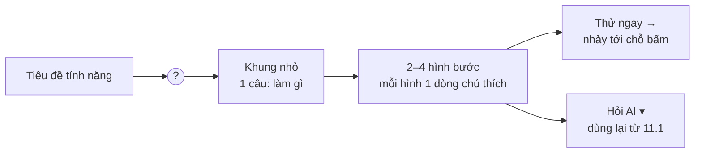

# Phase 45 · Tutorial trong Web

> Mỗi tính năng có nút nhỏ **ⓘ / ?** cạnh tiêu đề. Bấm vào hiện **vài hình đơn giản theo bước** và **một câu ghi chú**
> tính năng đó làm gì — ngắn, ít chữ, xem 10 giây là hiểu.

Chưa làm · sau Phase 24

## Chạy thế nào

## Làm gì

| | |
|---|---|
| :material-help-circle-outline: **Nút ?** | icon nhỏ cạnh tiêu đề mỗi khối tính năng (Research, Explore, Đối thủ bị chê gì, Feature Gap, Tóm tắt AI, Collect, Sức khoẻ niche, Backup…) |
| :material-card-text-outline: **Khung giải thích** | bấm → khung nổi nhỏ: 1 câu "làm gì" + 2–4 hình bước + nút **Thử ngay**; Esc / bấm ngoài để đóng |
| :material-image-multiple-outline: **Hình bước** | hình đơn giản, nét ít, màu của app; mỗi hình 1 dòng chú thích ≤ 10 chữ |
| :material-database-outline: **Một nguồn nội dung** | nối vào `web/src/lib/features.ts` (đã có `title`, `what`) — thêm `steps: [{ img, caption }]`; trang Guide dùng lại |
| :material-eye-off-outline: **Không làm phiền** | không tự bật tour lần đầu; chỉ hiện khi bấm ? — người cũ không bị chặn |
| :material-check-circle-outline: **Đã xem** | nút ? của tính năng đã mở đổi sang màu nhạt (lưu trên máy) |

## Luật chữ

- Câu "làm gì": **1 câu, ≤ 15 chữ** — lấy từ `what` đang có, cắt gọn nếu dài.
- Chú thích mỗi hình: **≤ 10 chữ**, động từ đầu câu ("Gõ niche", "Tick 5 keyword", "Bấm Chốt").
- Tối đa **4 hình** mỗi tính năng. Cần nhiều hơn = tính năng đang rối → ghi vào Phase 25 (UI / UX).

## Hình

- Claude viết prompt + Style lock theo màu app; **Codex sinh hình** (`codex_image.sh`), Claude nhặt về `web/public/help/<tính-năng>/01.png…` và mở xem từng hình.
- Không tự vẽ bằng SVG / Pillow, không dùng screenshot thô làm hình bước.
- Chưa có hình thì khung chỉ hiện chữ (như trang Guide đang làm).

**Xong khi**

- Mọi tính năng `status: 'done'` trong `features.ts` có nút ? + ≥ 2 hình bước
- Mỗi khung đạt luật chữ (script kiểm số chữ)
- 1 người ngoài hiểu Explore chỉ bằng nút ?, không hỏi anh
- Screenshot khung ? của 3 tính năng đã Read (sáng + tối)

**Không làm**

- Video hướng dẫn trong app — để Version 11 (Marketing)
- Tour bắt buộc nhiều bước khi mở app lần đầu
- Dịch sang tiếng Anh — khi có người dùng ngoài nói tiếng Anh

Plan code chi tiết: [Phase 45](../superpowers/plans/2026-10-25-niche-radar-phase30-2-tutorial.md)
