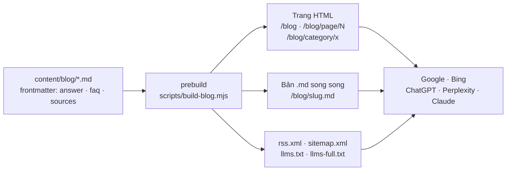

# Phase 46.1 · Landing shotmatic.app — Blog (phân trang, SEO · AEO · GEO)

> Landing Niche Radar (shotmatic.app) có **blog riêng**: bài nói vì sao chọn niche trước khi build, bài giới thiệu
> tính năng, và 3 chuyên mục **SEO · AEO · GEO** cho người làm app nhỏ. Blog dựng chuẩn để **Google và AI search**
> (ChatGPT, Perplexity, Gemini, Claude) đọc được, trích được. Khuôn học từ blog oneclicktool.app và playbook
> *AI Search Visibility* của Product Growth Hack.

Xong · live 2026-10-27 · 7 bài · 5 chuyên mục · 2 trang

**Kết quả (2026-10-27):** [shotmatic.app/blog](https://shotmatic.app/blog) · trang 2 [/blog/page/2](https://shotmatic.app/blog/page/2) ·
chuyên mục [SEO](https://shotmatic.app/blog/category/seo) · [AEO](https://shotmatic.app/blog/category/aeo) · [GEO](https://shotmatic.app/blog/category/geo) ·
bản .md mỗi bài (`text/markdown`) · [llms.txt](https://shotmatic.app/llms.txt) · [llms-full.txt](https://shotmatic.app/llms-full.txt) · [rss.xml](https://shotmatic.app/blog/rss.xml).
Thêm bài = thêm 1 file `content/blog/<slug>.md` ở repo shotmatic, push main (prebuild tự sinh .md, RSS, llms, sitemap).

## Chạy thế nào

## Mục tiêu

- Người đọc hiểu **vì sao tìm niche trước** giúp tiết kiệm thời gian, token AI, server, công build, đỡ rối plan.
- Mỗi bài là **phễu** về Niche Radar: CTA để email nhận trial + demo. Không nút Download (luật 2026-10-25).
- Blog **được AI trích**: mỗi bài mở bằng câu trả lời ngắn, H2 dạng câu hỏi, bảng, FAQ, nguồn, số tự đo có ngày.

## Làm gì

| | |
|---|---|
| :material-file-document-outline: **Bài = Markdown** | `content/blog/<slug>.md` (giống oneclicktool): `title`, `description`, `date`, `updated`, `category`, `keyword`, `answer` (40–60 từ), `faq`, `sources`, `evidence`. Thêm bài = thêm 1 file, không sửa code |
| :material-folder-multiple-outline: **Chuyên mục** | `niche` (chọn niche) · `product` (tính năng Niche Radar) · `seo` · `aeo` · `geo` — mỗi mục có trang `/blog/category/<mục>` + đoạn giới thiệu |
| :material-page-next-outline: **Phân trang** | 6 bài / trang: `/blog`, `/blog/page/2`… và `/blog/category/<mục>/page/2`. Có `rel=prev/next`, canonical riêng từng trang |
| :material-robot-outline: **Chuẩn LLM** | bản `.md` song song mỗi bài (`/blog/<slug>.md`, có `<link rel="alternate" type="text/markdown">`) · `llms.txt` liệt kê mọi bài theo chuyên mục · `llms-full.txt` gộp toàn văn · `robots.txt` cho phép bot AI tìm kiếm |
| :material-code-json: **Schema** | `BlogPosting` (ngày đăng + sửa, tác giả, `abstract` = câu trả lời ngắn) · `FAQPage` · `BreadcrumbList` · `CollectionPage` cho trang danh sách |
| :material-rss: **RSS + sitemap** | `rss.xml` thật (trước đây redirect sang oneclicktool) · sitemap có `lastmod` thật từng bài, cả trang chuyên mục |
| :material-pencil-outline: **Bài mới** | 1 bài mỗi chuyên mục SEO, AEO, GEO — lấy kiến thức từ playbook *AI Search Visibility* (có nguồn), nối về Niche Radar đúng sự thật: cây keyword = câu người ta gõ thật = H2 nên viết. **Không** nói Niche Radar đo được GEO (Phase 59–62 chưa làm) |
| :material-link-variant: **Link cũ** | 28 slug + 7 chuyên mục blog ShotMatic cũ vẫn 308 sang oneclicktool.app/blog — không dùng lại tên đó |

## Chuẩn mỗi bài (soát trước khi đăng)

- `answer` 40–60 từ, đọc một mình vẫn hiểu → hộp **The short answer** đầu bài
- H2 là câu hỏi người ta gõ thật (autocomplete / People Also Ask / cây keyword của Niche Radar)
- Mỗi số có nguồn + ngày; số của mình lấy từ lần tra thật (demo data 2026-10-24). Không có thì ghi "not measured"
- `sources` ≥ 2 link khi bài nói về Google / AI search; FAQ 3 câu ngắn
- Tiếng Anh (site 100 % tiếng Anh), ảnh là màn hình thật của app ở `app-demo`, không ảnh giả

**Xong khi**

- `/blog` có ≥ 7 bài, phân trang chạy (`/blog/page/2` có bài), 5 trang chuyên mục mở được
- Mỗi bài có bản `.md` trả `200 text/markdown`; `llms.txt`, `llms-full.txt`, `rss.xml`, `sitemap.xml` sinh từ cùng nguồn
- Schema hợp lệ (BlogPosting + FAQPage + BreadcrumbList); link cũ vẫn 308 sang oneclicktool
- Build xanh, xem tận mắt ở 1340 + 375, live trên shotmatic.app

**Không làm ở phase này**

- Ô tìm kiếm, bình luận, newsletter riêng cho blog (form email landing đủ rồi)
- Ảnh cover sinh bằng AI cho từng bài (dùng màn hình thật; cover để sau nếu cần)
- Gửi sitemap lên Search Console / Bing, đo GEO 20 câu hỏi — để [Phase 48](phase-48-dogfood-content.md)
- Viết hàng loạt bài AI mỏng; nói Niche Radar có tính năng chưa làm

[Tổng quan Version 11](version-11.md) · Code ở repo `nvminhtu/shotmatic` (`content/blog/`, `pages/blog/`, `scripts/build-blog.mjs`)
