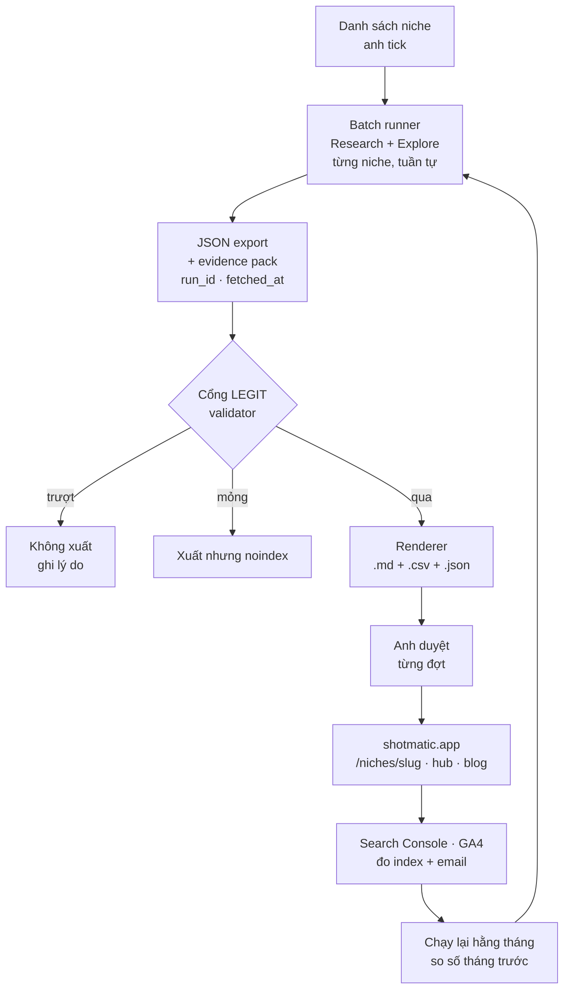

# Phase 46.2 · Niche Reports — dữ liệu research thật lên shotmatic.app

> Chạy ShotMatic thật cho **hàng loạt niche** (water tracker, habit tracker, daily bible, prayer, dog training, cat
> health…), biến mỗi lượt research thành **một trang báo cáo công khai** trên shotmatic.app: bảng đối thủ, keyword đuôi
> dài, lời chê, khoảng trống tính năng, xu hướng. Trang nhìn giống hệt kết quả người dùng thấy trong tool. Mục tiêu:
> **được index các cụm từ khoá đuôi dài** (vd "habit tracker app niche research app store") và **chứng minh tool chạy
> thật** bằng dữ liệu kiểm được. Mọi số đều có nguồn, có ngày, tải được file gốc. Không có số thì ghi `not measured`.

Plan 2026-11-02 · chờ anh duyệt · chưa làm

## Vì sao làm

| | |
|---|---|
| :material-magnify: **SEO đuôi dài** | mỗi niche = 1 trang nhắm 1 cụm chính + 5–8 câu hỏi phụ lấy từ cây keyword. Người tìm "is habit tracker app saturated" là đúng khách của ShotMatic |
| :material-check-decagram: **Bằng chứng cho tool** | điểm yếu lớn nhất hiện giờ là "chưa có case". Mỗi báo cáo là một lần tool chạy thật, ai cũng soi lại được bằng link store |
| :material-database-outline: **Tài sản dữ liệu** | bảng tổng nhiều niche (Niche Index) + file CSV / JSON tải về. Thứ này người ta trích, AI search dẫn lại, blog khác link về |
| :material-email-outline: **Phễu email** | cuối mỗi trang: "Run this niche yourself in ShotMatic" → form email (nút tải khi có bản bán) |

Phase này **làm thay phần "báo cáo niche công khai"** của [Phase 48](phase-48-dogfood-content.md). Phần đo GEO cho
chính từ khoá của ShotMatic vẫn nằm ở Phase 48 (Backlog).

## Chạy thế nào

## Một trang báo cáo gồm gì

Ví dụ `shotmatic.app/niches/habit-tracker-app`. Thứ tự khối cố định, chữ tiếng Anh như cả site.
Cột "Lấy từ" trỏ về bảng xuất của tool ([Định dạng file xuất](../export-schema.md)).

| Khối | Nội dung | Lấy từ |
|---|---|---|
| **H1 + ngày** | "Habit Tracker App Niche Research: App Store & Google Play Data (Nov 2026)" · nước · ngày lấy số | `run.seed`, `country`, `fetched_at` |
| **The short answer** | 40–60 từ: niche đông hay vắng, khách than gì nhiều nhất, tiền chảy theo kiểu nào, điểm sức khoẻ | `scores` (total) + `complaints` + `competitors.money_model` |
| **Snapshot** | bảng số gọn: số app mỗi store (top 30), tổng rating top 10, rating trung vị, % app thu sub / IAP / ads, xu hướng 12 tháng lên / ngang / xuống | `keywords`, `competitors`, `trends` |
| **Top competitors** | 10 dòng: app, store, sao, số rating, lượt cài (Play), kiểu tiền, lần cập nhật cuối, link store | `competitors` |
| **Long-tail keywords** | 10–20 keyword trong cây: nguồn gợi ý, số app mỗi store, app đứng đầu, ô "ít đông" | `keywords` + Explore ([Phase 40](phase-40-explore-tree.md)) |
| **Demand trend** | đường 12 tháng (SVG + bảng số bên dưới), truy vấn liên quan + đang lên. Ghi rõ: chỉ số tương đối 0–100, không phải lượt tìm | `trends` |
| **What users complain about** | chủ đề than, số review 1–2★, mức nặng, 1 câu nguyên văn ngắn mỗi chủ đề | `complaints` |
| **Feature gaps** | tính năng × top 5 app: bao nhiêu app có, bao nhiêu chỉ ở bản trả phí, ô "gap" | `gaps` |
| **How apps make money** | kiểu tiền đọc từ store · doanh thu chỉ hiện khi có dòng TrustMRR **verified** ([Phase 38](phase-38-revenue.md)) | `competitors.money_label`, TrustMRR |
| **Health score** | 7 yếu tố, mỗi yếu tố có điểm 0–10, độ tin (verified · proxy · tự chấm · chưa đo), bằng chứng | `scores` |
| **What this means** | 3–5 nhận định do AI viết, **câu nào cũng gắn mã nguồn** (C3, P1, G2, K5…). Không có mã thì xoá câu | brief + mã nguồn |
| **Methodology + download** | cách lấy số, ngày, giới hạn, tải `.csv` / `.json` của chính lượt này, link trang Methodology chung | export JSON |
| **FAQ + CTA** | 3 câu ngắn · "Run this niche yourself in ShotMatic" → email | — |

**Không bao giờ có trên trang**

- Lượt tải / doanh thu ước đoán (kiểu "app này kiếm $50k/tháng") khi không có nguồn verified
- "X searches / month" khi không có nguồn đo được kèm tên tool và ngày
- Tên người viết review, ảnh chụp review, icon / ảnh màn hình của app khác
- Niche anh đang làm cho app riêng

## Keyword đuôi dài cho từng niche

Không đoán keyword. Lấy từ **cây keyword mà tool đã có** ([Phase 40](phase-40-explore-tree.md)): Google autocomplete,
gợi ý Google Play, gợi ý tìm kiếm App Store, cộng các đuôi mẫu sẵn trong tool ("for adhd", "for kids", "widget",
"offline", "ai", "with reminders"…).

**Mỗi niche chọn:**

- **1 cụm chính** cho title + URL: thường dạng `<niche> app niche research` hoặc `<niche> app market` — chọn cụm có
  trong gợi ý thật
- **5–8 câu hỏi làm H2**, theo các khuôn dưới đây, chỉ giữ câu có dữ liệu trả lời được:

| Khuôn câu hỏi (H2) | Trả lời bằng khối |
|---|---|
| How many `<niche>` apps are on the App Store / Google Play? | Snapshot |
| What are the top `<niche>` apps by ratings? | Top competitors |
| What do users hate about `<niche>` apps? | Complaints |
| How do `<niche>` apps make money? | Money |
| Is demand for `<niche>` apps growing? | Trend |
| Which `<niche>` keywords are less crowded? | Long-tail keywords |
| What features are `<niche>` apps missing? | Feature gaps |
| Is the `<niche>` app niche worth building in 2026? | Health score + What this means |

**Tool keyword ngoài (tuỳ chọn, anh chốt):**

| Tool | Dùng để | Điều kiện |
|---|---|---|
| Google Search Console | sau khi trang lên: xem query thật đưa người vào → thêm H2 / FAQ đúng câu đó | anh nối tài khoản, Claude không nhập mật khẩu |
| Google Keyword Planner | khoảng lượt tìm (range) cho cụm chính | cần tài khoản Google Ads của anh · ghi "Keyword Planner, range, ngày xem" |
| Ahrefs / Semrush (trả phí) | volume + độ khó | chỉ khi anh chốt mua · ghi tên tool + ngày, không chép số qua trang khác |

Chưa có nguồn thì cột volume ghi `not measured`. Thứ tự ưu tiên vẫn là: gợi ý thật > số app cạnh tranh > Trends.

## Danh sách niche

Anh tick trước mỗi đợt. Đợt pilot đi trước, đo xong mới mở đợt sau.

| Nhóm | Niche gợi ý (seed chốt lại theo cây keyword) |
|---|---|
| **Sức khoẻ · thói quen** | water tracker · habit tracker · sleep tracker · fasting tracker · step counter · mood journal |
| **Đức tin** | daily bible · prayer app · daily devotional · bible study · rosary · quran reading |
| **Thú cưng** | dog training · cat health tracker · pet care reminder · dog walking log · pet medication · puppy potty training |
| **Năng suất · tiền** | budget tracker · pomodoro timer · to-do for adhd · subscription tracker · gratitude journal · reading tracker |

- **Pilot (5):** habit tracker · water tracker · daily bible · prayer app · dog training
- **Đợt 2 (~25):** phần còn lại của bảng trên, anh bỏ niche nào không muốn công khai
- **Đợt 3 (tới ~100):** chỉ mở khi pilot + đợt 2 đạt luật đo ở dưới
- Nước: **US** trước. Thêm GB / CA / AU là trang riêng chỉ khi số khác hẳn US, không nhân bản trang cho đủ số

## LEGIT — luật dữ liệu

Đây là phần quan trọng nhất. Trang sai một số là mất uy tín cho cả tool.

| Luật | Kiểm thế nào |
|---|---|
| **Mọi số có nguồn + ngày** | mỗi bảng có dòng "Source · fetched YYYY-MM-DD", mỗi app có link store. Validator so từng số trên trang với JSON của lượt đó, lệch 1 số là trượt |
| **Dữ liệu tải được** | `.csv` + `.json` của đúng lượt, có `run_id`, `fetched_at`, `schema_version`, mã băm nội dung. Ai muốn soi thì soi |
| **Câu trích là thật** | chỉ lấy câu đã được tool kiểm khớp review gốc (cơ chế sẵn ở `complaints`), ≤ 25 từ, không tên người viết, ghi app + store |
| **Doanh thu chỉ verified** | chỉ hiện MRR từ TrustMRR có nhãn verified. Không có → ghi "Revenue: not measured (no verified source)" |
| **Trends nói đúng bản chất** | luôn ghi "relative index 0–100, not search volume". Chuỗi thưa (< 50% tuần có số) → ghi "too few searches", không vẽ đường |
| **Điểm có công thức** | điểm sức khoẻ hiện từng yếu tố + độ tin. Yếu tố chưa đo hiện `not measured`, không tự lấp |
| **AI chỉ diễn giải** | đoạn "What this means" mỗi câu phải có ≥ 1 mã nguồn tồn tại trong JSON. Câu không mã → validator xoá |
| **Đủ dữ liệu mới đăng** | ngưỡng tối thiểu (anh chốt ở B0, gợi ý: ≥ 10 app mỗi store, ≥ 50 review 1–2★ đã đọc, Trends có số). Dưới ngưỡng → `noindex` hoặc không xuất |
| **Số cũ phải nói là cũ** | ngày lấy số ở đầu trang. Quá 90 ngày chưa chạy lại → băng "Data from <ngày>, refresh pending" |
| **Sửa sai công khai** | trang Methodology có email báo sai. Sửa xong ghi dòng "Corrected YYYY-MM-DD: …" ở cuối trang |

**Cổng chặn tự động (validator) chạy trước khi xuất, trượt một ý là không có file:**

- Không còn `TODO`, `null` hiện thành chữ, `NaN`, `undefined`
- Mọi số trong `.md` có trong JSON cùng `run_id`
- Mọi link store trả 200 lúc kiểm (link chết → bỏ dòng, ghi lý do)
- Mọi mã nguồn (C/P/G/K/S/T) trong câu AI có thật
- Câu trích có trong cache review gốc, ≤ 25 từ
- Không có chữ cấm: "estimated revenue", "downloads per month", "guaranteed"…, trừ khi đi kèm nguồn verified
- Nội dung khác các trang đã có ≥ ngưỡng (so bảng đối thủ + keyword, không phải so văn mẫu), tránh trang na ná nhau

## Không thành "scaled content abuse"

Google có luật spam riêng cho việc sinh nhiều trang chủ yếu để kéo hạng, dù trang làm bằng máy hay bằng người
([Google, 03/2024](https://developers.google.com/search/blog/2024/03/core-update-spam-policies)). Cách làm của mình
phải đứng được trước luật đó:

- **Mỗi trang có dữ liệu riêng của nó.** Khuôn giống nhau, nhưng số, app, lời chê, khoảng trống là của niche đó. Niche
  nào số na ná niche khác thì gộp lại, không tách trang
- **Tăng chậm, có đo.** 5 → 25 → 100. Không đăng 100 trang một ngày
- **Người duyệt.** Anh đọc từng trang pilot, đọc mẫu ngẫu nhiên ở đợt sau. Có checklist duyệt ngắn ở B6
- **Trang mỏng không vào index.** Dưới ngưỡng → `noindex`, không vào sitemap
- **Không trang cửa (doorway).** Không tạo trang "habit tracker app for X" cho từng X nếu không có lượt research riêng

## Schema · AEO · GEO

Theo chuẩn blog đã dựng ở [Phase 46.1](phase-46-1-landing-blog.md):

- **Schema:** `Article` (ngày đăng + ngày sửa) · `Dataset` (tên, mô tả, ngày, giấy phép, link tải CSV / JSON —
  [tài liệu Google](https://developers.google.com/search/docs/appearance/structured-data/dataset)) · `BreadcrumbList`.
  `FAQPage` vẫn giữ cho AI đọc, nhưng không trông vào rich result: Google đã thu hẹp FAQ rich result từ 08/2023
  ([Google](https://developers.google.com/search/blog/2023/08/howto-faq-changes))
- **Bảng bằng HTML thật**, không ảnh chụp bảng. Biểu đồ là SVG kèm bảng số bên dưới để AI đọc được
- **Bản `.md` song song** mỗi trang + thêm mục "Niche reports" vào `llms.txt` / `llms-full.txt`
- **Câu trả lời ngắn đầu trang** (40–60 từ) đứng một mình vẫn đúng → dễ được AI trích
- **Licence dữ liệu** ghi rõ (gợi ý CC BY 4.0, anh chốt) để người khác dẫn lại có ghi nguồn

## Hub · blog · link trong

| Trang | Làm gì |
|---|---|
| `/niches` | **Niche Index**: bảng mọi niche đã đăng (điểm, số app, xu hướng, lời chê số 1, ngày), lọc theo nhóm. Đây là trang dễ được link nhất |
| `/niches/<nhóm>` | trang nhóm (health, faith, pets, productivity) + đoạn mở ngắn |
| `/niches/methodology` | cách lấy số, nguồn, giới hạn, lịch chạy lại, báo sai |
| **Blog** | mỗi tháng 1 bài data story từ Niche Index (vd "30 app niches ranked by user complaints, Nov 2026"), link về từng báo cáo. Blog là một phần, không thay trang báo cáo |
| **Link trong** | mỗi báo cáo link 3 niche cùng nhóm + 1 bài blog; bài blog cũ về chọn niche link tới báo cáo phù hợp |

URL: `/niches/<slug>` tách khỏi `/blog` để trang báo cáo có khuôn riêng và cập nhật số mà không đổi ngày đăng bài
blog. Anh muốn để hết trong `/blog` thì chỉ đổi đường dẫn, phần còn lại giữ nguyên.

## Làm theo bước

| Bước | Làm gì | Xong khi |
|---|---|---|
| **B0 · Chốt** | anh trả lời 6 câu ở cuối trang · chốt ngưỡng dữ liệu tối thiểu + luật đo | có câu trả lời ghi vào trang này |
| **B1 · Làm tay 1 trang** | chạy habit tracker trong tool, Claude dựng tay 1 trang `.md` đủ khối, anh xem → chốt khuôn | anh duyệt khuôn |
| **B2 · Batch runner** | script đọc danh sách niche, gọi đúng luồng Research + Explore sẵn có (cùng code với tool, không viết collector mới), chạy tuần tự qua bộ giới hạn tốc độ sẵn có, lưu JSON export | chạy 5 niche pilot không lỗi, mỗi niche có JSON đủ 6 bảng. Thời gian mỗi niche: đo ở bước này (`chưa đo`) |
| **B3 · Renderer** | JSON → `.md` có frontmatter (title, keyword, answer, faq, sources, dataset) + `.csv` + `.json` | xuất 5 trang từ 5 JSON, không sửa tay |
| **B4 · Validator** | cổng LEGIT ở trên, chạy tự động trước khi xuất | test đỏ khi cố tình cài số lệch / câu trích giả / mã nguồn ma |
| **B5 · Khuôn trang trên landing** | repo landing: trang `/niches/<slug>`, hub, Methodology, schema Dataset, sitemap, llms.txt, RSS | build xanh, xem ở 1340 + 375, schema hợp lệ |
| **B6 · Pilot 5 trang** | anh duyệt theo checklist (số khớp store khi mở 3 link ngẫu nhiên · câu trích đúng · không lộ niche riêng · đọc dễ hiểu) → lên live | 5 trang live, gửi sitemap trong Search Console |
| **B7 · Đo** | GA4: `report_view`, `dataset_download`, `generate_lead` có `utm_source=niche-report` · Search Console: trang đã index, impression, query | bảng số tuần đầu có dòng |
| **B8 · Mở rộng + chạy lại** | đạt luật đo → đợt 2, rồi đợt 3 · mỗi tháng chạy lại mọi niche đã đăng, trang có khối "Changes since last month" | đợt 2 live · lần chạy lại đầu tiên xong |

**Code nằm đâu:** runner + renderer + validator ở `web/` (dùng chung code research của tool, có test ở `web/tests/`).
Khuôn trang, hub, schema ở repo landing shotmatic. Plan code chi tiết viết ở bước B2, sau khi anh duyệt trang này.

## Luật đo + luật dừng

Ngưỡng dưới đây là **đề xuất**, anh chốt ở B0:

- **4 tuần sau pilot:** ≥ 4/5 trang được index → mở đợt 2
- **6 tuần sau pilot:** cả 5 trang 0 impression → dừng mở rộng, sửa khuôn / chọn lại keyword trước
- **Đợt 2:** tỉ lệ index < 50% → dừng, coi lại chất lượng (dấu hiệu Google xem là trang mỏng)
- **Email:** đếm `generate_lead` từ `utm_source=niche-report`. Số thật ghi ngày, chưa có thì `chưa đo`

## Rủi ro

| Rủi ro | Cách giảm |
|---|---|
| Google xem là trang sinh hàng loạt | dữ liệu riêng mỗi trang, tăng chậm, người duyệt, noindex trang mỏng |
| Điều khoản store khi lấy dữ liệu | chỉ số công khai, tốc độ thấp qua bộ giới hạn sẵn có, cache, chỉ đăng số tổng hợp + vài câu trích ngắn, không chép nguyên bộ review |
| Số cũ, sai | ngày ở đầu trang, chạy lại hằng tháng, băng "refresh pending", sửa sai công khai |
| Lộ niche anh đang làm | anh tick danh sách mỗi đợt, có danh sách cấm trong runner |
| Trang tranh hạng lẫn nhau | 1 cụm chính / trang, không 2 trang cho cùng cụm, gộp niche quá giống |
| Tên app / thương hiệu của người khác | chỉ dùng tên để mô tả, không logo, không icon, không ảnh màn hình |

**Xong khi**

- Khuôn trang anh duyệt (B1), runner + renderer + validator có test, `npm run check` xanh
- 5 trang pilot live trên shotmatic.app, mỗi trang tải được `.csv` + `.json` khớp số trên trang
- Hub `/niches` + Methodology live, schema hợp lệ, có trong sitemap + llms.txt
- Bảng đo 4 tuần đầu có số, quyết định mở / dừng đợt 2 ghi lại ở trang này

**Không làm ở phase này**

- Ước lượt tải / doanh thu không nguồn, mua dữ liệu bên thứ ba khi anh chưa chốt
- Đăng 100 trang một lần, tạo trang theo nước / theo đuôi khi không có lượt research riêng
- Đăng lên Reddit / X / Product Hunt (thuộc [Phase 49](phase-49-six-week-launch.md))
- Viết thêm collector mới. Chỉ dùng nguồn tool đang có

## Anh cần chốt (B0)

1. **Danh sách pilot:** giữ 5 niche gợi ý (habit tracker · water tracker · daily bible · prayer app · dog training) hay đổi?
2. **Có hiện kết luận BUILD / TEST THÊM / BỎ công khai không?** Gợi ý: hiện điểm + tín hiệu, câu kết luận ghi
   "ShotMatic's read, not advice"
3. **Tool keyword trả phí:** chỉ dùng nguồn miễn phí (gợi ý thật + Search Console), hay mua Ahrefs / Semrush?
4. **URL:** `/niches/<slug>` riêng (gợi ý) hay để trong `/blog`?
5. **Licence dữ liệu:** CC BY 4.0 (gợi ý) hay giữ bản quyền?
6. **Nhịp:** pilot 1 tuần, sau đó mỗi tuần bao nhiêu trang (gợi ý ≤ 10)?

[Tổng quan Version 11](version-11.md) · [Phase 46.1 · Blog](phase-46-1-landing-blog.md) · [Phase 48 · Dogfood](phase-48-dogfood-content.md)
