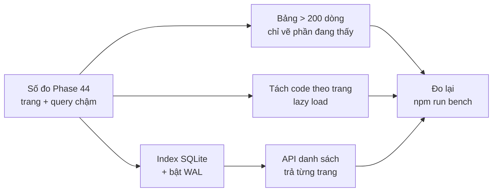

# Phase 46 · UI + DB nhanh

> Khi một niche có hàng nghìn keyword, bảng bắt đầu giật và trang mở chậm. Phase này sửa đúng **những chỗ Phase 44 đo
> ra chậm**: bảng, trang, câu truy vấn cơ sở dữ liệu.

Chưa làm · sau Phase 44

## Chạy thế nào

## Làm gì

| | |
|---|---|
| :material-table-large: **Bảng lớn** | bảng > 200 dòng chỉ vẽ phần đang thấy (virtualize). Bắt đầu từ `web/src/components/KeywordTable.tsx` |
| :material-file-code-outline: **Tách code theo trang** | mỗi trang trong `web/src/client/` tải code riêng khi mở (lazy load), trang chủ không phải tải hết |
| :material-database-search: **Index SQLite** | thêm index (chỉ mục giúp tìm nhanh) cho các query chậm nhất đã đo ở Phase 44, qua migration Drizzle |
| :material-database-cog: **Bật WAL** | chế độ ghi của SQLite cho đọc và ghi cùng lúc không chặn nhau |
| :material-page-next-outline: **API trả từng trang** | API danh sách trả theo trang thay vì cả bảng một lần |

**Xong khi**

- Bảng 1.000 keyword cuộn mượt
- Mở trang niche ≤ 1 giây với DB có 50 niche
- Bundle trang chủ nhỏ hơn mốc
- Script so của Phase 44: cùng niche, cùng ngày → cùng bảng keyword, cùng điểm
- Test xanh, không chỉ số nào trong bảng mốc tệ đi quá 10%

**Không làm ở phase này**

- Đổi framework UI hay đổi cơ sở dữ liệu
- Sửa trang / query chưa có số đo là chậm
- Đổi giao diện, thêm tính năng

[Tổng quan Version 5](version-5.md)
