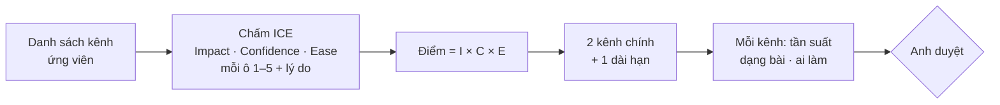

# Phase 46 · Chọn 2 kênh

> Có nhiều chỗ để nói về niche-radar, nhưng sức có hạn. Chấm điểm từng kênh rồi **chọn đúng 2 kênh chính** để làm
> đều tay 6 tuần — thay vì mỗi kênh một bài rồi bỏ.

Chưa làm · sau Phase 45

## Chạy thế nào

## Bảng ICE

Mỗi ô chấm 1–5, kèm lý do một dòng. **Confidence** phải có link indie cùng ngách thắng ở kênh đó. Điểm để trống tới
khi chấm ở phase này.

| Kênh | Impact | Confidence | Ease | Điểm | Chọn |
|---|---|---|---|---|---|
| X build in public | chấm ở phase này | | | | |
| Reddit | chấm ở phase này | | | | |
| Indie Hackers | chấm ở phase này | | | | |
| Product Hunt | chấm ở phase này | | | | |
| YouTube | chấm ở phase này | | | | |
| SEO blog | chấm ở phase này | | | | |

Cột **Chọn**: `chính` (đúng 2) · `dài hạn` (1, thứ tích luỹ như SEO blog) · `phụ` (tối đa 2) · `bỏ` (kèm lý do).

## Làm gì

| | |
|---|---|
| :material-format-list-bulleted: **Liệt kê kênh** | 6 kênh ở bảng trên, thêm kênh khác nếu có bằng chứng. Đọc `references/channels.md` của `/app-gtm` |
| :material-scale-balance: **Chấm ICE** | điền bảng `## Chọn kênh` trong `marketing/gtm.md`, mỗi điểm có lý do |
| :material-numeric-2-box: **Chọn 2** | 2 kênh `chính` + 1 `dài hạn`. Còn lại `phụ` hoặc `bỏ` |
| :material-calendar-sync: **Nhịp mỗi kênh** | tần suất (bao nhiêu bài / tuần), dạng bài (thread, post, comment, video, bài blog), ai làm (Claude soạn, anh đăng) |
| :material-reddit: **Nếu chọn Reddit** | danh sách sub ở `marketing/reddit/subs.md`, giọng theo `/app-reddit`, đọc luật từng sub trước |

**Xong khi**

- Bảng ICE đủ mọi kênh ứng viên, mỗi điểm có lý do, Confidence có link
- Đúng 2 kênh `chính` được chọn, mỗi kênh có tần suất · dạng bài · ai làm
- Anh duyệt

**Không làm ở phase này**

- Chạy hơn 2 kênh chính cùng lúc
- Đăng bài (lịch ở Phase 48)
- Chấm điểm theo cảm giác, không có lý do / link
- Quảng cáo trả tiền, mua follow / upvote

[Tổng quan Version 11](version-11.md)

Plan code chi tiết: [Phase 46](../superpowers/plans/2026-10-25-niche-radar-phase71-two-channels.md)
