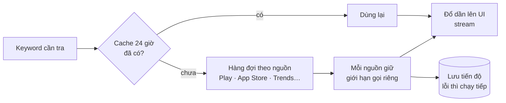

# Phase 47 · Collector nhanh hơn

> Hiện tool tra **lần lượt từng nguồn**, nên phải chờ cộng dồn. Phase này cho các nguồn **chạy cùng lúc**, kết quả
> hiện dần lên màn hình, và không tra lại thứ vừa tra xong.

Chưa làm · sau Phase 46

## Chạy thế nào

## Làm gì

| | |
|---|---|
| :material-call-split: **Song song theo nguồn** | mỗi nguồn một hàng đợi riêng, chạy cùng lúc. Giới hạn gọi giữ như cũ (vd App Store 1 request / 3 giây ở `web/src/lib/rate-limit.ts` + `web/src/collectors/appstore.ts`) |
| :material-play-speed: **Đổ kết quả dần** | có dòng nào đẩy lên UI ngay (stream — gửi từng phần, không chờ xong hết) |
| :material-cached: **Cache dùng chung** | cache theo keyword, dùng chung giữa các niche: niche B dùng lại keyword niche A đã tra trong 24 giờ |
| :material-restart: **Chạy tiếp khi lỗi** | lỗi / mất mạng giữa chừng → chạy tiếp từ chỗ dừng, không tra lại từ đầu |
| :material-scale-balance: **Giữ kết quả** | chạy script so của Phase 46: cùng niche, cùng ngày → cùng bảng keyword, cùng điểm |

**Xong khi**

- Kết quả đầu tiên ≤ 30 giây
- Tổng thời gian ≈ nguồn chậm nhất + ≤ 10%
- Không nguồn nào bị chặn nhiều hơn mốc
- Ngắt mạng giữa chừng rồi bật lại → chạy tiếp được
- `npm run bench` đo lại: không chỉ số nào tệ đi quá 10% so với `bench/baseline.json`

**Không làm ở phase này**

- Gọi nguồn nhanh hơn giới hạn, proxy xoay, nhiều IP
- Hàng đợi trên server cloud
- Thêm nguồn mới

[Tổng quan Version 5](version-5.md)
