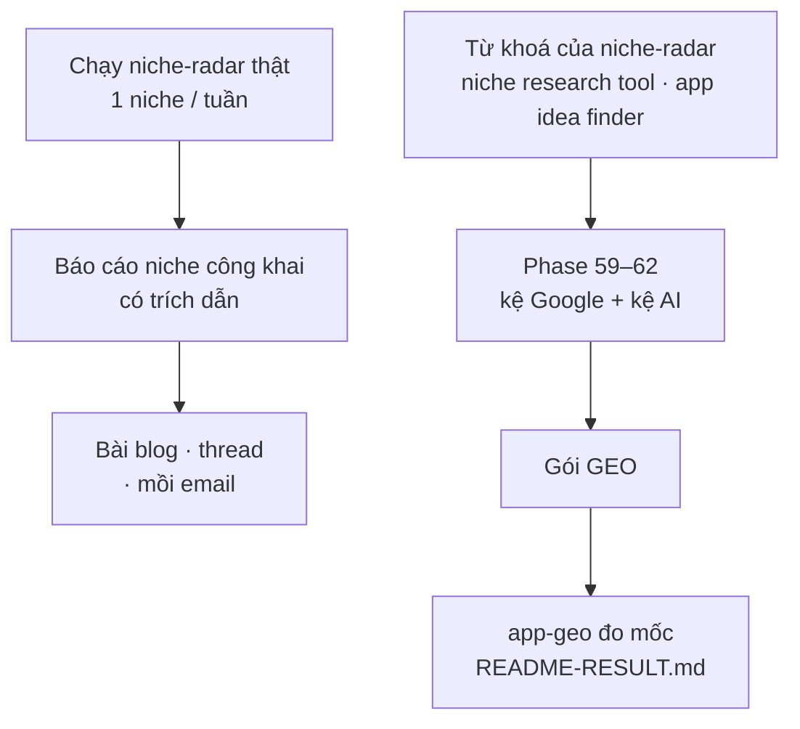

# Phase 48 · Dogfood làm nội dung

> Dùng **chính niche-radar** làm marketing: mỗi tuần chạy tool thật ra một **báo cáo niche công khai** làm bài và mồi
> email. Và chạy Version 4 cho chính từ khoá của niche-radar để biết Google + AI đang nói gì về nó trước ra mắt.

Chưa làm · sau Phase 46

## Chạy thế nào

## Làm gì

| | |
|---|---|
| :material-file-chart: **Báo cáo niche** | mỗi tuần 1 niche: chạy tool thật, giữ trích dẫn nguồn, viết thành báo cáo đọc được |
| :material-post-outline: **Thành bài** | báo cáo → bài blog qua `/oneclicktool-blog` (tiếng Anh) · thread cho kênh chính · mồi email trên landing |
| :material-eye-off-outline: **Giữ riêng** | báo cáo công khai **không** lộ niche đang làm cho app riêng của mình |
| :material-magnify: **Version 4 cho chính nó** | chạy Phase 59–62 với từ khoá của niche-radar ("niche research tool", "app idea finder"…) → xuất gói GEO |
| :material-robot-outline: **Đo mốc GEO** | `/app-geo`: câu hỏi người mua hay hỏi → `geo.py run` → `geo.py analyze` → ghi `marketing/geo-test/YYYY-MM-DD/README-RESULT.md` |
| :material-format-list-checks: **Việc từ khoảng trống** | câu nào AI không nhắc niche-radar → ghi thành việc (trang "alternative", bài how-to) cho lịch Phase 49 |

**Xong khi**

- 3 báo cáo niche đăng được, mỗi báo cáo có trích dẫn từ lần chạy tool thật
- Đo mốc GEO của niche-radar có `README-RESULT.md` (số dạng `x / N` + ngày + engine)
- Không báo cáo nào lộ niche của app riêng

**Không làm ở phase này**

- Trang báo cáo công khai tự động (để [Version 12](version-12.md), nếu báo cáo tay kéo được người)
- Bịa số trong báo cáo: số nào chưa đo ghi `chưa đo`
- Tính năng mới cho tool chỉ để làm báo cáo đẹp hơn
- Claude đăng bài thay anh

[Tổng quan Version 11](version-11.md)

Plan code chi tiết: [Phase 48](../superpowers/plans/2026-10-25-niche-radar-phase72-dogfood-content.md)
