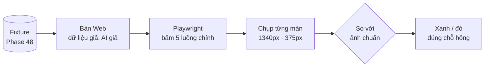

# Phase 49 · Test giao diện (E2E)

> Cho máy **tự bấm qua các luồng chính** trên bản Web như người dùng thật, và chụp ảnh từng màn để so với ảnh chuẩn.
> Nút hỏng hay màn vỡ thì test báo đỏ trước khi tới tay mình.

Chưa làm · sau Phase 48

## Chạy thế nào

## 5 luồng chính

| Luồng | Kiểm gì |
|---|---|
| Tra niche | gõ keyword → có kết quả |
| Explore | mở rộng keyword → bảng đầy |
| Xem đối thủ | mở chi tiết đối thủ |
| So sánh niche | đặt các niche cạnh nhau |
| Hỏi dữ liệu → xuất | hỏi bằng AI giả, xuất file |

## Làm gì

| | |
|---|---|
| :material-robot-outline: **Playwright** | Playwright (công cụ điều khiển trình duyệt bằng code) chạy 5 luồng trên bản Web, dữ liệu từ fixture |
| :material-brain: **AI giả** | phần hỏi dữ liệu dùng câu trả lời ghi sẵn, không gọi AI thật |
| :material-camera: **Chụp + so ảnh** | chụp từng màn ở 1340px và 375px, so với ảnh chuẩn |
| :material-console: **Lệnh chạy** | lệnh mới trong `package.json`, chạy được cùng `npm test` trên máy |

**Xong khi**

- 5 luồng chính chạy xanh, không cần mạng
- Cố tình làm hỏng 1 nút → test đỏ đúng chỗ
- Có bộ ảnh chuẩn ở 1340px và 375px cho từng màn

**Không làm ở phase này**

- Search thật trên nguồn thật (đó là Phase 51b tùy chọn)
- Chạy trên CI (để Version 7)
- Test tải nặng, nhiều người cùng lúc

[Tổng quan Version 6](version-6.md)
