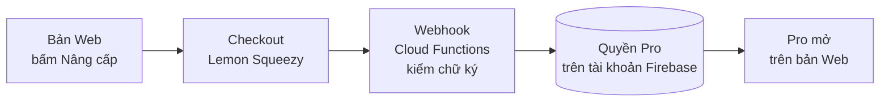

# Phase 49 · Thanh toán

> Bấm nâng cấp → trả tiền → **quyền Pro gắn vào tài khoản** trong vài giây. Dùng **Lemon Squeezy** (nền tảng bán phần
> mềm, lo luôn thuế VAT các nước thay mình). Anh tạo cửa hàng, Claude nối code.

Chưa làm · sau Phase 48

## Chạy thế nào

**Webhook** = Lemon Squeezy tự gọi về server của mình mỗi khi có đơn, gia hạn, huỷ, hoàn tiền. **Cloud Functions** =
đoạn code chạy trên Firebase, không cần server riêng.

## Làm gì

| | |
|---|---|
| :material-store: **Sản phẩm** | gói theo `money.md` Phase 48. Anh tạo cửa hàng, nhập ngân hàng, thuế trên Lemon Squeezy |
| :material-cart-arrow-right: **Checkout** | mở từ bản Web, gắn tài khoản người mua |
| :material-webhook: **Webhook** | nhận đơn / gia hạn / huỷ / hoàn tiền → cập nhật quyền Pro. Kiểm chữ ký, webhook giả bị từ chối |
| :material-file-code: **File** | mới: Cloud Function webhook, lớp kiểm quyền Pro trong `web/src/lib/` (tên chốt ở plan) |

**Xong khi**

- Mua bằng chế độ test → quyền Pro ≤ 30 giây
- Huỷ / hoàn tiền → quyền tắt
- Webhook giả mạo bị từ chối (kiểm chữ ký)
- Mua test → Pro mở trên bản Web ở 2 trình duyệt

**Không làm ở phase này**

- Mac App Store / thanh toán trong app của Apple
- Tự xử lý thẻ, Stripe tự làm phần thuế
- Crypto, chuyển khoản tay
- Claude tạo tài khoản Lemon Squeezy, nhập ngân hàng / thuế, bấm bán thật
- Paywall, dùng thử (Phase 50)

[Tổng quan Version 10](version-10.md)
