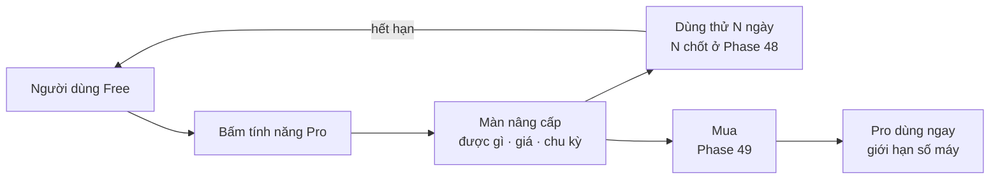

# Phase 50 · Paywall + dùng thử

> Bấm tính năng Pro thì hiện **màn nâng cấp nói rõ được gì**, cho **dùng thử**, có **Khôi phục mua**. Mua xong dùng
> ngay, không khởi động lại.

Chưa làm · sau Phase 49

## Chạy thế nào

**Paywall** = màn chặn tính năng trả phí, mời nâng cấp.

## Làm gì

| | |
|---|---|
| :material-lock: **Khoá Pro đúng chỗ** | bấm tính năng Pro → màn nâng cấp, nói rõ được gì |
| :material-cash: **Giá hiển thị** | ghi rõ chu kỳ, tự gia hạn, cách huỷ. Không gọi gói trả phí là "quyên góp" |
| :material-timer-sand: **Dùng thử** | N ngày, N chốt ở Phase 48 |
| :material-restore: **Khôi phục mua** | nút "Khôi phục mua" trên bản Web (app Mac ở [Phase 61](../app/phase-61-app-only.md)) |
| :material-laptop: **Giới hạn số máy** | một license dùng tối đa số máy chốt ở `money.md` |
| :material-web: **Khớp landing** | trang giá trên landing ([Version 11](version-11.md)) khớp giá trong app |

**Xong khi**

- Free → bấm Pro → mua → dùng ngay, không khởi động lại
- Hết hạn dùng thử → quay về Free, dữ liệu còn đủ (đếm project trước / sau)
- "Khôi phục mua" trên máy mới mở lại Pro
- Vượt số máy → báo rõ, không khoá máy đang dùng
- Tính năng đã Free ở bản trước vẫn Free với người đang dùng

**Không làm ở phase này**

- Mã giảm giá phức tạp, affiliate: xét sau đơn thứ 10
- Gói team / nhiều chỗ ngồi
- Chi phí AI theo gói (Phase 51)
- Ép mua bằng đếm ngược giả, giấu nút đóng

[Tổng quan Version 10](version-10.md)
