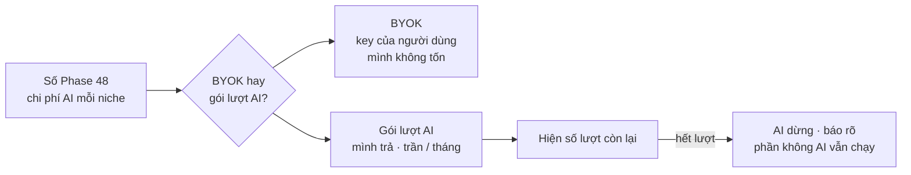

# Phase 51 · Chi phí AI theo gói

> Người dùng Pro **không làm chi phí AI vượt tiền họ trả**. Chọn giữa **BYOK** (người dùng tự dán key AI) và **gói
> lượt AI kèm Pro** (mình trả, có trần mỗi tháng) bằng số đo ở Phase 48.

Chưa làm · sau Phase 48

## Chạy thế nào

**BYOK** (bring your own key — tự mang key) = người dùng dán API key AI của họ, tiền AI tính vào tài khoản của họ.
Có thể chọn cả hai cách cùng lúc.

## Làm gì

| | |
|---|---|
| :material-scale-balance: **Chọn cách** | BYOK, gói lượt AI, hoặc cả hai, theo số Phase 48 |
| :material-key-variant: **BYOK** | ô dán key AI, key giữ trên máy (`.env.local` / Cài đặt bản Web; Keychain ở app Mac → [Phase 61](../app/phase-61-app-only.md)) |
| :material-counter: **Gói lượt AI** | đếm lượt mỗi người, trần mỗi tháng theo `money.md` |
| :material-gauge: **Lượt còn lại** | hiện số lượt còn trên bản Web |
| :material-hand-back-left: **Hết lượt** | báo, không tự trừ tiền thêm, phần không AI vẫn chạy |
| :material-file-code: **File** | sửa lớp AI chung hiện có (Phase 6), thêm bộ đếm lượt trong `web/src/lib/` (tên chốt ở plan) |

**Xong khi**

- 1 người Pro dùng hết trần → AI dừng, phần không AI vẫn chạy
- Chi phí AI tháng ≤ % doanh thu đã đặt ở `money.md` (số từ dashboard, ghi ngày)
- Hết lượt → không có lần gọi AI nào tính tiền mình (kiểm log)
- BYOK: key sai → báo rõ, không lùi sang key của mình

**Không làm ở phase này**

- Tự trừ tiền thêm khi hết lượt, bán thêm lượt lẻ
- Đổi giá Pro (giữ theo `money.md` đã duyệt)
- Thêm model AI mới
- Gói team dùng chung lượt

[Tổng quan Version 10](version-10.md)
