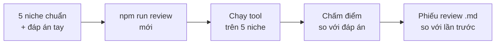

# Phase 51 · Review kết quả

> Test xanh chỉ nói code chạy. Phase này hỏi câu khác: **tool có trả lời đúng không**. Có một bộ niche với đáp án anh
> kiểm tay, mỗi bản mới chấm lại và ra **phiếu review**: đúng bao nhiêu, sai ở đâu.

Chưa làm · sau Version 5

## Chạy thế nào

## Đáp án và cách chấm

| Phần | Đáp án tay mỗi niche | Chấm |
|---|---|---|
| Keyword | 10 keyword đáng làm | trùng bao nhiêu keyword |
| Đối thủ | 5 đối thủ chính | trùng bao nhiêu đối thủ |
| Chủ đề than | 3 chủ đề than | trùng bao nhiêu chủ đề |
| Trích dẫn | — | % trích dẫn qua kiểm |
| So sánh niche | — | % ô so sánh khớp màn chi tiết |

## Làm gì

| | |
|---|---|
| :material-clipboard-check-outline: **Bộ niche chuẩn** | 5 niche, đáp án do anh kiểm tay. AI không tự viết đáp án rồi tự chấm |
| :material-play-circle-outline: **Lệnh chấm** | `npm run review` (mới) chạy tool trên 5 niche và chấm theo bảng trên |
| :material-file-document-outline: **Phiếu review** | file `.md` có điểm từng niche + điểm chung, so với lần trước |
| :material-history: **Lưu lịch sử** | giữ phiếu các lần trước để so điểm khi ra bản mới |

**Xong khi**

- Phiếu review ra tự động, có điểm từng niche + điểm chung
- Chạy 2 lần cùng dữ liệu ra cùng điểm
- Phiếu có cột so với lần trước

**Không làm ở phase này**

- AI tự viết đáp án hay tự sửa đáp án
- Sửa đáp án cho điểm đẹp (trừ khi đáp án sai, ghi lý do)
- Chạy trên CI (để Version 7)

[Tổng quan Version 6](version-6.md)
